# CMsoft Import for PAC Machine Edition — Visual Studio Code extension

## User Manual

**Extension:** CMsoft Import for PAC Machine Edition (`MariuszCzyrnek.emerson-import`) · **Version described:** 1.2.1 · **Date:** October 2026  
**Vendor:** CMsoft · [shop.cmsoft.com.pl](https://shop.cmsoft.com.pl) · [office@cmsoft.com.pl](mailto:office@cmsoft.com.pl) · [questions and problem reports](https://github.com/cmariusz/EmersonImport.VSExt/issues)

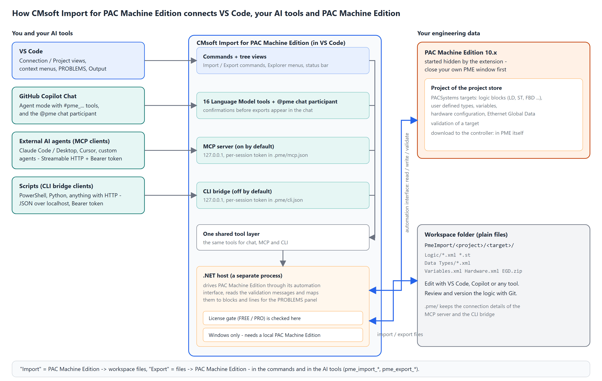

This manual shows how to install the extension, what PAC Machine Edition needs for it, and how to use every part of the extension: connecting to PAC Machine Edition, importing the logic blocks, data types, variables and hardware configuration of a target into plain files, editing them in Visual Studio Code, exporting them back, validating the target, reading the validation results in the **PROBLEMS** panel, and driving all of this from GitHub Copilot, from external AI agents (MCP) and from scripts (CLI). A complete worked example (Chapter 10) takes one change from the import to a commit.

All screenshots were taken with VS Code 1.143 (dark theme) and PAC Machine Edition 10.7 on Windows 11, against a small demo project called **ZZ_CMsoft_ManualDemo** (one PACSystems RX3i target named `Target1`). Numbered red callouts in the pictures are explained in the text below each picture. Private values (license e-mail, license ID, hardware ID, session tokens, the names of other projects in the PAC Machine Edition project store) are hidden by hatched boxes. The chat answers in chapter 11 were written by a scripted stand-in model, because the screenshots were made in a VS Code without a Copilot subscription; the tool calls, the confirmations and the results in those pictures are real (section 11.1).

> **Which version is this?** The manual describes CMsoft Import for PAC Machine Edition **1.2.1**. If the version you installed is older (Extensions view → CMsoft Import for PAC Machine Edition → version number), some commands, messages or settings described here may not exist in it. Update the extension first.

## Contents

- [1. About this manual](#1-about-this-manual)
  - [1.1 Who it is for](#11-who-it-is-for)
  - [1.2 Conventions](#12-conventions)
  - [1.3 Import and export — the direction of the words](#13-import-and-export--the-direction-of-the-words)
  - [1.4 The demo project used in the examples](#14-the-demo-project-used-in-the-examples)
  - [1.5 Where to find this manual](#15-where-to-find-this-manual)
- [2. What the extension does](#2-what-the-extension-does)
  - [2.1 In one paragraph](#21-in-one-paragraph)
  - [2.2 How the pieces fit together](#22-how-the-pieces-fit-together)
  - [2.3 The programming loop](#23-the-programming-loop)
  - [2.4 Feature overview](#24-feature-overview)
  - [2.5 FREE and PRO](#25-free-and-pro)
  - [2.6 Requirements](#26-requirements)
  - [2.7 Limitations to know up front](#27-limitations-to-know-up-front)
- [3. Installing the extension](#3-installing-the-extension)
  - [3.1 Before you start](#31-before-you-start)
  - [3.2 Install from the Visual Studio Marketplace](#32-install-from-the-visual-studio-marketplace)
  - [3.3 Install from a VSIX file](#33-install-from-a-vsix-file)
  - [3.4 Install from the command line](#34-install-from-the-command-line)
  - [3.5 What you see after the installation](#35-what-you-see-after-the-installation)
  - [3.6 Updating and uninstalling](#36-updating-and-uninstalling)
- [4. Setting up PAC Machine Edition](#4-setting-up-pac-machine-edition)
  - [4.1 PAC Machine Edition must be installed and licensed](#41-pac-machine-edition-must-be-installed-and-licensed)
  - [4.2 Close PAC Machine Edition while the extension is connected](#42-close-pac-machine-edition-while-the-extension-is-connected)
  - [4.3 The project store and project backups](#43-the-project-store-and-project-backups)
  - [4.4 Without PAC Machine Edition — the demo mode](#44-without-pac-machine-edition--the-demo-mode)
  - [4.5 First connection test](#45-first-connection-test)
- [5. The user interface at a glance](#5-the-user-interface-at-a-glance)
  - [5.1 Where everything lives](#51-where-everything-lives)
  - [5.2 The toolbar of the Connection view](#52-the-toolbar-of-the-connection-view)
  - [5.3 The rows of the Connection view](#53-the-rows-of-the-connection-view)
  - [5.4 The Project view](#54-the-project-view)
  - [5.5 Right-click menus in the Explorer (exporting)](#55-right-click-menus-in-the-explorer-exporting)
  - [5.6 The status bar](#56-the-status-bar)
  - [5.7 The Command Palette](#57-the-command-palette)
  - [5.8 Prepare Workspace — templates for AI tools PRO](#58-prepare-workspace--templates-for-ai-tools-pro)
- [6. Connecting to PAC Machine Edition](#6-connecting-to-pac-machine-edition)
  - [6.1 Connect](#61-connect)
  - [6.2 PAC Machine Edition is open](#62-pac-machine-edition-is-open)
  - [6.3 After connecting](#63-after-connecting)
  - [6.4 Selecting another project](#64-selecting-another-project)
  - [6.5 Opening a project file or a backup](#65-opening-a-project-file-or-a-backup)
  - [6.6 Disconnect and refresh](#66-disconnect-and-refresh)
  - [6.7 Open the project in PAC Machine Edition](#67-open-the-project-in-pac-machine-edition)
  - [6.8 Back up the project](#68-back-up-the-project)
- [7. Importing from PAC Machine Edition into files](#7-importing-from-pac-machine-edition-into-files)
  - [7.1 What an import does](#71-what-an-import-does)
  - [7.2 Import a target — step by step](#72-import-a-target--step-by-step)
  - [7.3 Import a single item](#73-import-a-single-item)
  - [7.4 Import the entire project](#74-import-the-entire-project)
  - [7.5 Where the files go](#75-where-the-files-go)
  - [7.6 Structured Text as .st files](#76-structured-text-as-st-files)
  - [7.7 Importing again — what happens to your files](#77-importing-again--what-happens-to-your-files)
  - [7.8 Readable XML — one element per line](#78-readable-xml--one-element-per-line)
- [8. Exporting to PAC Machine Edition from files](#8-exporting-to-pac-machine-edition-from-files)
  - [8.1 How an export works](#81-how-an-export-works)
  - [8.2 Export a file — step by step](#82-export-a-file--step-by-step)
  - [8.3 Export a target folder — step by step](#83-export-a-target-folder--step-by-step)
  - [8.4 Which files go where](#84-which-files-go-where)
  - [8.5 Deleting blocks without a file](#85-deleting-blocks-without-a-file)
  - [8.6 Hardware configuration and Ethernet Global Data](#86-hardware-configuration-and-ethernet-global-data)
  - [8.7 New blocks](#87-new-blocks)
  - [8.8 The FREE limits](#88-the-free-limits)
  - [8.9 Good habits](#89-good-habits)
- [9. Compiling (Validate) and the PROBLEMS panel](#9-compiling-validate-and-the-problems-panel)
  - [9.1 When a compilation runs](#91-when-a-compilation-runs)
  - [9.2 What you see while and after compiling](#92-what-you-see-while-and-after-compiling)
  - [9.3 The PROBLEMS panel](#93-the-problems-panel)
  - [9.4 The same messages in PAC Machine Edition](#94-the-same-messages-in-pac-machine-edition)
  - [9.5 Rules and limits to know](#95-rules-and-limits-to-know)
- [10. Complete example: from an import to a tested change](#10-complete-example-from-an-import-to-a-tested-change)
  - [10.1 The task](#101-the-task)
  - [10.2 Before you start](#102-before-you-start)
  - [10.3 Step 1 — Connect](#103-step-1--connect)
  - [10.4 Step 2 — Prepare the workspace and start a Git repository](#104-step-2--prepare-the-workspace-and-start-a-git-repository)
  - [10.5 Step 3 — Import](#105-step-3--import)
  - [10.6 Step 4 — Change the code](#106-step-4--change-the-code)
  - [10.7 Step 5 — Export the changes](#107-step-5--export-the-changes)
  - [10.8 Step 6 — Read the compile result in PROBLEMS](#108-step-6--read-the-compile-result-in-problems)
  - [10.9 Step 7 — Fix the problems](#109-step-7--fix-the-problems)
  - [10.10 Step 8 — Export and compile again](#1010-step-8--export-and-compile-again)
  - [10.11 Step 9 — Review the change and commit](#1011-step-9--review-the-change-and-commit)
  - [10.12 Step 10 — Write a test block](#1012-step-10--write-a-test-block)
  - [10.13 Step 11 — Export and compile the test](#1013-step-11--export-and-compile-the-test)
  - [10.14 Step 12 — Run the test](#1014-step-12--run-the-test)
  - [10.15 Step 13 — Import again, back up and the final commit](#1015-step-13--import-again-back-up-and-the-final-commit)
  - [10.16 The loop on one page](#1016-the-loop-on-one-page)
- [11. AI assistants: Copilot tools and the @pme chat participant PRO](#11-ai-assistants-copilot-tools-and-the-pme-chat-participant-pro)
  - [11.1 What you get](#111-what-you-get)
  - [11.2 First request with @pme](#112-first-request-with-pme)
  - [11.3 What to ask — examples](#113-what-to-ask--examples)
  - [11.4 Confirmations — you stay in control](#114-confirmations--you-stay-in-control)
  - [11.5 Using the tools by name — Agent mode and #pme_…](#115-using-the-tools-by-name--agent-mode-and-pme_)
  - [11.6 The compile-and-fix loop](#116-the-compile-and-fix-loop)
  - [11.7 Exports that replace or delete](#117-exports-that-replace-or-delete)
  - [11.8 What the assistant knows about your project](#118-what-the-assistant-knows-about-your-project)
  - [11.9 Responsibility](#119-responsibility)
- [12. The MCP server — drive PAC Machine Edition from any AI agent](#12-the-mcp-server--drive-pac-machine-edition-from-any-ai-agent)
  - [12.1 What it is](#121-what-it-is)
  - [12.2 Where the connection details are](#122-where-the-connection-details-are)
  - [12.3 VS Code (Copilot agent mode) — nothing to configure](#123-vs-code-copilot-agent-mode--nothing-to-configure)
  - [12.4 Claude Code](#124-claude-code)
  - [12.5 Cursor, Claude Desktop and other clients](#125-cursor-claude-desktop-and-other-clients)
  - [12.6 Your own client — a complete example](#126-your-own-client--a-complete-example)
  - [12.7 Typical agent sessions](#127-typical-agent-sessions)
  - [12.8 Things that go wrong](#128-things-that-go-wrong)
- [13. The CLI bridge — drive PAC Machine Edition from scripts PRO](#13-the-cli-bridge--drive-pac-machine-edition-from-scripts-pro)
  - [13.1 What it is](#131-what-it-is)
  - [13.2 Switch it on](#132-switch-it-on)
  - [13.3 The state file .pmecli.json](#133-the-state-file-pmeclijson)
  - [13.4 The helper emerson-import](#134-the-helper-emerson-import)
  - [13.5 The raw HTTP API](#135-the-raw-http-api)
  - [13.6 The commands](#136-the-commands)
  - [13.7 A script that fails the build when the target does not compile](#137-a-script-that-fails-the-build-when-the-target-does-not-compile)
  - [13.8 More examples](#138-more-examples)
  - [13.9 Things that go wrong](#139-things-that-go-wrong)
- [14. Settings](#14-settings)
  - [14.1 Where to change them](#141-where-to-change-them)
  - [14.2 Reference](#142-reference)
- [15. License: FREE, PRO and the free trial](#15-license-free-pro-and-the-free-trial)
  - [15.1 What is what](#151-what-is-what)
  - [15.2 Where you see the state](#152-where-you-see-the-state)
  - [15.3 The license panel](#153-the-license-panel)
  - [15.4 Buying online](#154-buying-online)
  - [15.5 Activating a key, by e-mail](#155-activating-a-key-by-e-mail)
  - [15.6 Managing the license](#156-managing-the-license)
  - [15.7 Offline use, renewals, expiry](#157-offline-use-renewals-expiry)
  - [15.8 What data leaves the computer](#158-what-data-leaves-the-computer)
  - [15.9 Documents in the extension package](#159-documents-in-the-extension-package)
  - [15.10 Disclaimer of liability](#1510-disclaimer-of-liability)
- [16. Troubleshooting and FAQ](#16-troubleshooting-and-faq)
  - [16.1 First aid](#161-first-aid)
  - [16.2 Connecting](#162-connecting)
  - [16.3 Importing and exporting](#163-importing-and-exporting)
  - [16.4 Compiling and PROBLEMS](#164-compiling-and-problems)
  - [16.5 AI tools, MCP and CLI](#165-ai-tools-mcp-and-cli)
  - [16.6 License](#166-license)
  - [16.7 Frequently asked questions](#167-frequently-asked-questions)
- [Appendix A — Command reference](#appendix-a--command-reference)
- [Appendix B — The 16 tools](#appendix-b--the-16-tools)
- [Appendix C — Folders and files](#appendix-c--folders-and-files)
  - [C.1 The workspace](#c1-the-workspace)
  - [C.2 Where the extension keeps its own files](#c2-where-the-extension-keeps-its-own-files)
  - [C.3 File formats](#c3-file-formats)
- [Appendix D — The demo project ZZ_CMsoft_ManualDemo](#appendix-d--the-demo-project-zz_cmsoft_manualdemo)
  - [D.1 The PAC Machine Edition project](#d1-the-pac-machine-edition-project)
  - [D.2 Data type PumpData](#d2-data-type-pumpdata)
  - [D.3 The variables](#d3-the-variables)
  - [D.4 Function block PumpFB](#d4-function-block-pumpfb)
  - [D.5 Block LevelControl](#d5-block-levelcontrol)
  - [D.6 Block PumpControl — the state before chapter 10](#d6-block-pumpcontrol--the-state-before-chapter-10)
  - [D.7 Block Alarms](#d7-block-alarms)
  - [D.8 Block _MAIN](#d8-block-_main)
  - [D.9 Bringing the project into PAC Machine Edition](#d9-bringing-the-project-into-pac-machine-edition)
  - [D.10 The finished blocks after chapter 10](#d10-the-finished-blocks-after-chapter-10)
- [Appendix E — Glossary](#appendix-e--glossary)
- [Appendix F — Documents, files and contacts](#appendix-f--documents-files-and-contacts)

---

## 1. About this manual

### 1.1 Who it is for

For PLC programmers, commissioning engineers and automation teams who work with **Emerson PAC Machine Edition 10.x** on
**PACSystems** controllers and want to edit their logic as text in **Visual Studio Code** — alone, with GitHub Copilot, or with other AI
tools — and send the result back into PAC Machine Edition. No programming knowledge of the extension is needed. You should know
PAC Machine Edition (targets, blocks, variables, validation) and basic Windows administration.

### 1.2 Conventions

| Convention | Meaning |
| --- | --- |
| **Bold** | A button, menu item, view or setting name as it appears on the screen (for example **Import Target to Workspace**). |
| `Monospace` | A file name, folder, command, setting key, tool name or text you type. |
| Red numbered callout | A number drawn on a screenshot. The text below the picture says what it points at. |
| **PRO** | The feature needs a CMsoft Import for PAC Machine Edition PRO license (or the free trial). Everything else works in FREE (section 2.5). |
| *Import* / *Export* | *Import* always means **PAC Machine Edition → files in the workspace**, *Export* means **files → PAC Machine Edition** — in the commands, in the AI tools (`pme_import_…`, `pme_export_…`) and in this manual (section 1.3). |
| PME | Short for PAC Machine Edition, as in the names of some commands (**Export File to PME**). |

### 1.3 Import and export — the direction of the words

All CMsoft extensions name the two directions from your point of view, the workspace: you **import** a project *into* your workspace
and **export** your edited files *back to* the engineering tool. PAC Machine Edition's own automation interface uses the opposite words
(it *exports* a block to a file when you import it into the workspace). You meet PME's words only in its own messages, which the
extension passes on unchanged — for example *Export of '_MAIN' succeeded* in the log while the extension imports `_MAIN`.

### 1.4 The demo project used in the examples

The examples use a small project, **ZZ_CMsoft_ManualDemo** (the `ZZ_` prefix keeps it at the end of the project list), with one
PACSystems RX3i target `Target1`, created in PAC Machine Edition from the template *PACSystems RX3i*. Its program is a simple two-pump
sump station: a level switch starts the lead pump, the lag pump helps at a high level, a pump with a motor overload hands its work to
the other pump.

| Object | Kind | Purpose |
| --- | --- | --- |
| `_MAIN` | block, Structured Text | Runs every scan; calls the three blocks below. |
| `LevelControl` | block, Structured Text | When the station pumps: the requests for the lead and the lag pump. |
| `PumpControl` | block, Structured Text | Which pump runs: lead / lag selection, fault hand-over, two `PumpFB` instances. |
| `PumpFB` | function block (UDFB), Structured Text | One pump: contactor, fault latch, start counter. |
| `Alarms` | block, Structured Text | The common alarm lamp. |
| `PumpData` | user defined type | Command, running, fault and start counter of one pump. |
| Variables | variable list | Fifteen variables: level switches, motor feedbacks and overloads, contactors, the tank level, settings. |
| Hardware configuration | RX3i rack | The template's rack; only the IP addresses of the CPU's Ethernet ports were set. |

The complete sources are listed in Appendix D, so you can recreate the project and follow Chapter 10 step by step.

### 1.5 Where to find this manual

The manual is part of the extension, so it is at hand on every computer — also one without internet access. Press `F1` and run
**CMsoft Import for PAC Machine Edition: Open User Manual**; **CMsoft Import for PAC Machine Edition: Search the User Manual** lists every
chapter and section.

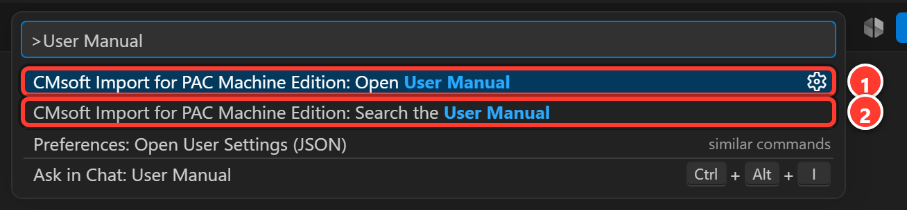

*(1) **CMsoft Import for PAC Machine Edition: Open User Manual** opens the manual. (2) **CMsoft Import for PAC Machine Edition: Search the
User Manual** opens a list of its chapters and sections.*

The manual opens in VS Code's Markdown preview, themed like the editor, with all screenshots. The contents list at the top is clickable.

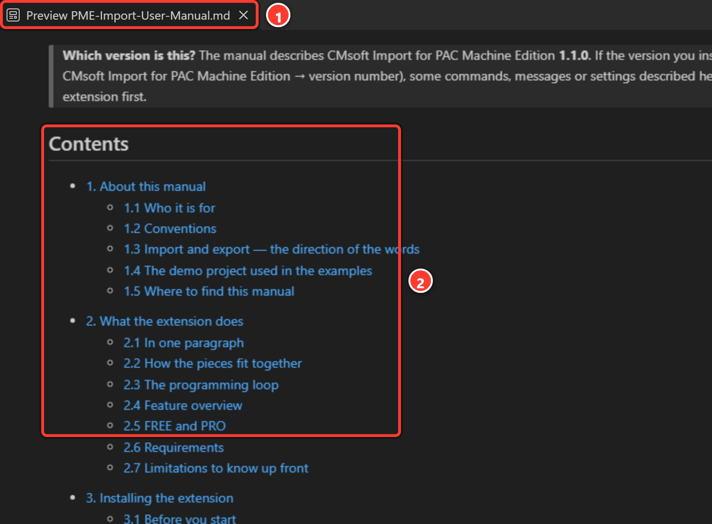

*(1) The manual in a **Preview** tab. (2) The contents list: a click jumps to the chapter.*

The search list narrows while you type — part of a title is enough — and `Enter` opens the manual at that heading:

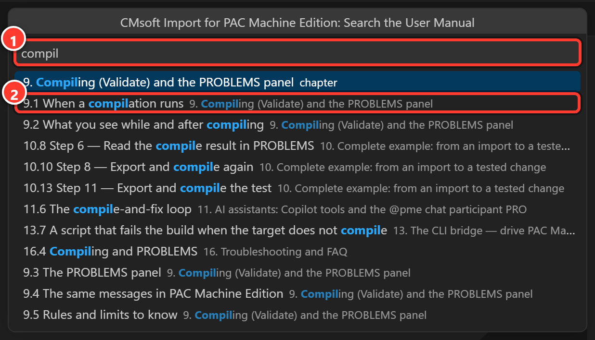

*(1) The text you typed. (2) A section: the grey text names the chapter it belongs to.*

The **Get Started with CMsoft Import for PAC Machine Edition** walkthrough (**Welcome: Open Walkthrough…** in the Command Palette) leads
through the first steps and links to the sections of this manual:

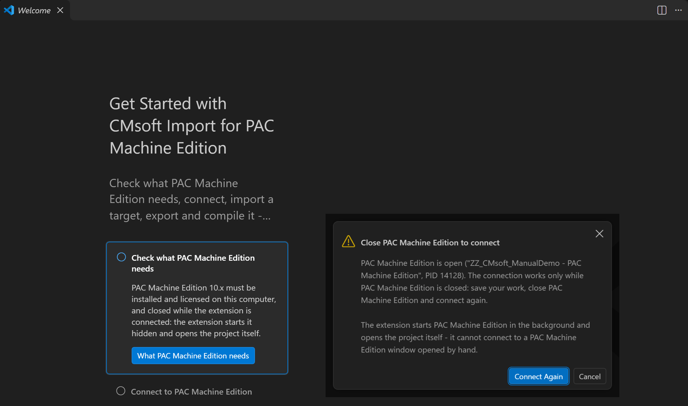

*The walkthrough: its seven steps — what PAC Machine Edition needs, connecting, importing a target, exporting and compiling, working safely,
PRO, this manual —, each with a button and a picture of this manual. The first step is open: **What PAC Machine Edition needs** opens chapter
4.*

The extension also opens the manual at the right place by itself. The empty **Project** view ends with a *First time here?* line: **User
Manual** opens this manual, **PAC Machine Edition needs** its chapter 4. The **Open Help** button of the message that appears when a
connection fails opens the troubleshooting of section 16.2. With several CMsoft extensions installed, **Help: CMsoft Manuals…** (Command
Palette, and the list of the **CMsoft** item in the status bar) lists the manuals of all of them.

---

## 2. What the extension does

### 2.1 In one paragraph

CMsoft Import for PAC Machine Edition connects Visual Studio Code to **PAC Machine Edition** through its **automation interface**. It
starts PAC Machine Edition in the background, opens a project of your PME project store and copies the engineering data of a target —
logic blocks, user defined types, the variable list, the hardware configuration and Ethernet Global Data — into **plain files** in your
VS Code workspace. Structured Text blocks also come as plain `.st` text. You edit the files with any text tools, compare and version
them with Git, and send the changed objects back into PAC Machine Edition. PAC Machine Edition itself compiles (its **Validate**); the
extension turns the messages into entries of the VS Code **PROBLEMS** panel that point at the block and, for Structured Text, at the line.

### 2.2 How the pieces fit together


*Left: everything that can drive the extension. Centre: the extension; every entry point ends in the same tool layer and the
same .NET host, which drives PAC Machine Edition. Right: PAC Machine Edition with its project store, and the plain files in the
workspace.*

Four consequences are worth remembering:

* **PAC Machine Edition runs once, and the extension starts it.** PME allows one running copy, and its automation interface cannot
  attach to a PME window you opened yourself. Close PAC Machine Edition before you connect; the extension starts its own, hidden PAC
  Machine Edition and quits it when you disconnect (section 4.2). **Open Project in PAC Machine Edition** hands the project over to a
  normal PME window when you want to work in PME (section 6.7).
* **Everything is local.** The MCP server and the CLI bridge listen on `127.0.0.1` only and need a per-session token. No project
  data leaves your computer; the only network traffic of the extension is license activation and renewal (chapter 15).
* **One engine, four doors.** The menus, the Copilot tools / `@pme`, the MCP server and the CLI bridge all call the same functions, so
  they behave the same way and obey the same safety rules.
* **PAC Machine Edition stays the source of truth for compiling and downloading.** The extension never checks Structured Text itself
  and never downloads to a controller.

### 2.3 The programming loop

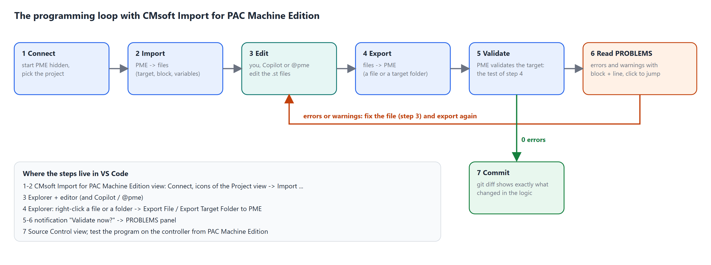

*The loop of this manual: 1 Connect → 2 Import → 3 Edit → 4 Export → 5 Compile (Validate) → 6 read PROBLEMS → back to 3 until there are no
errors → 7 Commit.*

### 2.4 Feature overview

| Area | What you can do | Where | FREE / PRO |
| --- | --- | --- | --- |
| Connection | Pick the project in the Windows file dialog — the `.SwxCF` of a project of the PME project store, or a project backup (`.zip`) restored into the store —, then PAC Machine Edition starts hidden and opens it; switch projects the same way; one connection at a time, with its progress shown | **Connection** view, status bar | FREE |
| Import (PME → files) | Whole project, one target, one item: logic blocks (PLCopen XML, Structured Text also as `.st`), user defined types, the variable list, the hardware configuration, Ethernet Global Data — the XML indented, one element per line | **Project** view (inline icons, toolbar) | FREE: 10 objects per operation; PRO: unlimited |
| Export (files → PME) | One file (an edited `.st` is merged into its block), or a whole target folder: data types → variables → blocks, each block after the function blocks it uses; hardware configuration and EGD on request; optional deletion of blocks without a file | Explorer right-click, **Project** view | FREE: 10 objects per operation; PRO: unlimited |
| Safety | A ZIP backup of the project before the first export of a session, the project saved after every export, confirmation before every export — a deletion names its blocks —, `_MAIN` never deleted, an empty `Logic` folder deletes nothing | dialogs, PME's backup folder | FREE / **PRO** |
| Compile | **Compile Target (Validate)**, **Rebuild Target (Compile All Blocks)**; compile after export (ask / always / never); results in **PROBLEMS** with block and Structured Text line | **Project** view, Explorer and editor of an imported file, notification, **PROBLEMS** | FREE; compile after an export (ask / always): **PRO** |
| Project | **Back Up Project (ZIP)**, **Open Project in PAC Machine Edition** (hand-over to a PME window) | **Project** view toolbar | FREE |
| Workspace templates | `.github/instructions/emerson-import*.instructions.md`, sections in `AGENTS.md`, `CLAUDE.md`, `.github/copilot-instructions.md`, `Tools/` example | **Prepare Workspace** | **PRO** |
| Copilot / AI | 16 Language Model tools (`#pme_…`) and the `@pme` chat participant, with confirmations before exports | Chat view | **PRO** |
| MCP server | The same 16 tools for any MCP client (Claude, Cursor, custom agents, VS Code). Every call passes the license check, so in FREE the tools answer `LICENSE_REQUIRED` | `.pme/mcp.json`, **MCP: List Servers** | on by default; tools **PRO** |
| CLI bridge | The same tools for scripts (PowerShell, Python, anything that speaks HTTP) | **CLI bridge** row | **PRO** |

### 2.5 FREE and PRO

The license panel (section 15.3) shows the table below. FREE connects, browses and compiles without limits and moves up to 10 objects per
import or export; PRO moves whole projects, compiles after every export and unlocks the automation features.

| Feature | FREE | PRO |
| --- | :---: | :---: |
| Connect to PAC Machine Edition, open projects, browse the project structure | ✔ | ✔ |
| Import PME → workspace (logic blocks, data types, variables, hardware configuration, EGD) | up to 10 objects per operation | ✔ unlimited |
| Compile a target (Validate, rebuild), errors and warnings in the PROBLEMS panel | ✔ | ✔ |
| Back up the project, open it in PAC Machine Edition | ✔ | ✔ |
| Export workspace → PME (a file, a target folder) | up to 10 objects per operation | ✔ unlimited |
| Next import or export | 15 minutes after the previous | ✔ at once |
| Compile after an export (setting `emersonImport.compileAfterExport`: ask / always) | — (**Compile Target (Validate)**) | ✔ |
| Copilot tools (`pme_*`), chat `@pme` | — | ✔ |
| MCP server for AI agents | runs, tools answer `LICENSE_REQUIRED` | ✔ |
| CLI bridge for scripts | — | ✔ |
| Prepare Workspace (instructions for AI agents, templates, Tools) | — | ✔ |

**The FREE plan limits** — the same as in CMsoft Import for TiaPortal: one operation (one command such as **Import to Workspace**, **Import
Target to Workspace**, **Import Entire Project to Workspace**, **Export File to PME** or **Export Target Folder to PME**) moves at most 10
objects in either direction. A block counts one (a block file with several POUs counts each of them), a data type one; the variable list,
the hardware configuration and Ethernet Global Data count one each. The next import or export is available 15 minutes after the previous
one has ended — in every VS Code window and after a restart. An operation over the limit is refused before anything is read or changed,
and the dialog says what the limit is and when the next operation is possible (section 16.3). Compiling, backing up and browsing have no
limits; demo mode has none either. PRO and the free trial (14 days) have no limits at all (section 15.1).

**Compile after an export** is PRO, as in CMsoft Import for TiaPortal: in the FREE plan the setting `emersonImport.compileAfterExport`
acts as `never`, and the target is compiled with **Compile Target (Validate)** or **Rebuild Target (Compile All Blocks)** — both FREE
(section 9.1).

### 2.6 Requirements

| Requirement | Details |
| --- | --- |
| Operating system | Windows 10 / 11 (PAC Machine Edition is Windows-only) |
| PAC Machine Edition | 10.x with its automation interface, installed and licensed on the same computer (chapter 4). Verified with 10.7. |
| Controllers | PACSystems targets (Controller targets) of PAC Machine Edition. Verified with an RX3i; View / QuickPanel targets are listed but not imported. |
| Visual Studio Code | 1.95 or newer. MCP integration needs 1.99+, Copilot features need a Copilot subscription. |
| .NET | The .NET Framework 4.8 that is part of Windows 10 / 11 |
| Workspace | A **trusted**, local folder (the extension does not run in untrusted or virtual workspaces) |

Nothing else needs to be installed — no Node.js, npm or build tools: the extension comes ready to run, and VS Code provides its runtime (also for the
command-line helper of section 13.4).

### 2.7 Limitations to know up front

* **PAC Machine Edition must be closed while the extension is connected** — it cannot work next to an open PME window (section 4.2).
* **Windows only.** Remote / virtual workspaces are not supported.
* **Structured Text is edited as text; Ladder as PLCopen XML.** Ladder (LD) blocks come as PLCopen XML as PME exports them, indented
  (section 7.8): you can version and compare them, and send them back, but they are not meant for editing by hand.
* **Ladder (LD) and Structured Text (ST) only.** Function Block Diagram (FBD) blocks and Sequential Function Charts (SFC) are not
  supported — PAC Machine Edition has SFC only for Windows PC and QuickPanel Control targets, and the extension works with Controller
  targets (PACSystems). C blocks cannot be imported: PAC Machine Edition exports no XML for them. The **Project** view lists every block
  with its language all the same.
* **New blocks need their XML.** A new Structured Text block is a `.st` file next to an `.xml` file that names the block (section 8.7).
* **A block cannot change its language on export** — PME refuses to replace a Ladder block by a Structured Text block of the same name.
* **One PAC Machine Edition operation at a time.** Calls from the UI, Copilot, MCP and CLI wait for each other.

> **Warning — your responsibility.** You use the extension at your own risk. Exports change engineering data, and the program you
> download from PAC Machine Edition later controls a real machine. You are responsible for everything the extension moves, converts or
> generates — also for what an AI assistant produced: **AI-generated code is not reviewed or verified by CMsoft**. Keep verified project
> backups, review and test every change, and never download untested code to a running machine. Programs for safety controllers need an
> independent review before an assistant may touch them (section 11.9). CMsoft's liability is excluded or limited as far as the law
> allows: section 15.10 sums up the disclaimer of liability of the license terms (`LICENSE.md`).

---

## 3. Installing the extension

### 3.1 Before you start

* Install **Visual Studio Code** 1.95 or newer (<https://code.visualstudio.com>). The *User Installer* is fine.
* The extension itself installs without PAC Machine Edition, but you need PAC Machine Edition to *use* it (chapter 4) — or the demo
  mode (section 4.4) to try it without.
* Open (or create) an empty folder as your workspace later — the extension stores its files there.

### 3.2 Install from the Visual Studio Marketplace

1. In VS Code open the **Extensions** view (click the Extensions icon in the Activity Bar or press `Ctrl+Shift+X`).
2. Type `CMsoft Import for PAC Machine Edition` into the search box.
3. Click **Install** on the **CMsoft Import for PAC Machine Edition** entry.

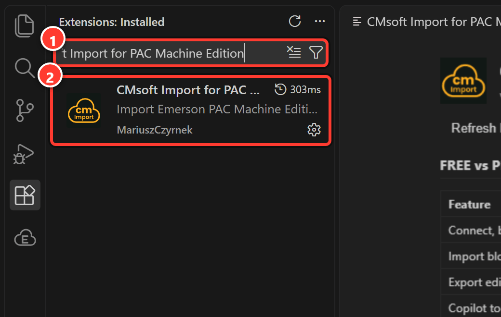

*The Extensions view after the installation: (1) the search box — `@installed` in front of the text limits the list to the installed
extensions; (2) the entry **CMsoft Import for PAC Machine Edition** with its icon, its description and its publisher. In the Marketplace
results the same entry has an **Install** button where the installed one shows the gear.*

Clicking the entry opens its details page with the README, **FEATURES** (everything the extension adds: commands, settings, tools)
and **CHANGELOG** tabs. Before the installation **Install** is also available there:

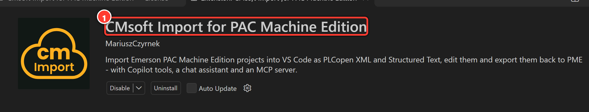

*The details page of the installed extension: (1) the name; under it the publisher and the description. Installed, the buttons offer
**Disable** and **Uninstall**; before the installation the page shows **Install** at that place. The identifier of the extension is
`MariuszCzyrnek.emerson-import`.*

> **Version note.** The Marketplace may show a version that is older than the one this manual describes (1.2.1). The
> **CHANGELOG** tab lists what each version added. If you need a build that is not on the Marketplace yet, install the VSIX file you
> received from the vendor (next section).

### 3.3 Install from a VSIX file

Use this for computers without internet access, for builds sent to you by the vendor, and for pinned versions.

1. In the **Extensions** view click the **…** button (*Views and More Actions…*) at the top of the side bar — callout 1.
2. Choose **Install from VSIX…** — callout 2.
3. Select the `.vsix` file. VS Code shows the standard Windows file dialog; in the screenshot the dialog is VS Code's own
   path box (setting `files.simpleDialog.enable`), where you type the full path and press **Install**.

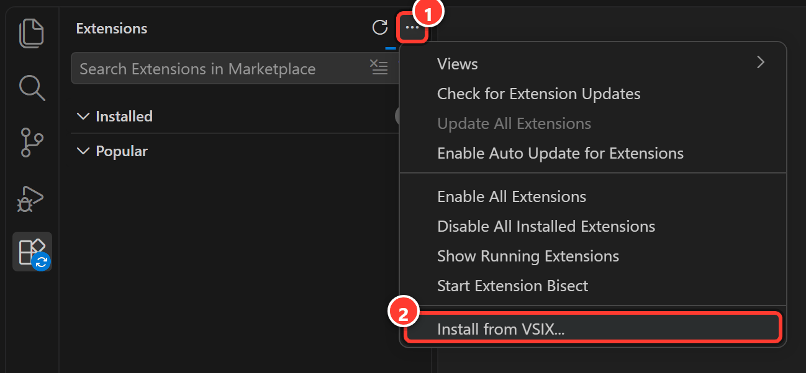

*(1) **Views and More Actions…**, (2) **Install from VSIX…**.*

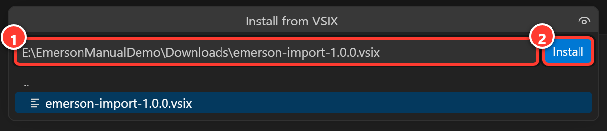

*(1) the full path of the file, (2) **Install**.*

### 3.4 Install from the command line

```powershell
# from the Marketplace (extension id: publisher.name, case-insensitive)
code --install-extension MariuszCzyrnek.emerson-import

# from a file
code --install-extension C:\Downloads\emerson-import-1.2.1.vsix

# check what is installed
code --list-extensions --show-versions
```

The last command lists `mariuszczyrnek.emerson-import@1.2.1` among the installed extensions (VS Code prints the identifier in
lower case).

### 3.5 What you see after the installation

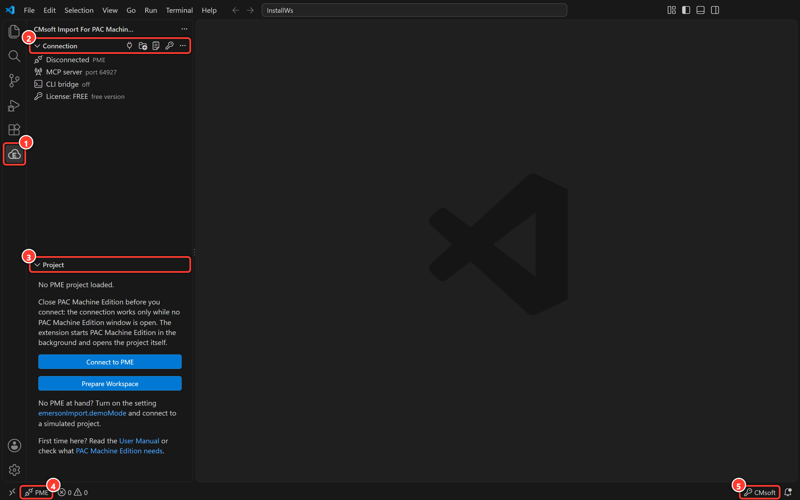

*(1) The new icon in the Activity Bar — a cloud with an **E** — opens the views of the extension: (2) **Connection** and (3) **Project**.
(4) The status bar item **PME** shows the connection; (5) the **CMsoft** item lists the licenses and the manuals of all installed
CMsoft extensions.*

VS Code reports *Completed installing extension.*, and at its first start the extension opens its license panel once as a welcome page:
FREE, the FREE-vs-PRO table and the ways to PRO (section 15.3). Close it — it opens by itself again only on the first start of a new major
version, or when a license is about to expire (section 15.7).

The extension starts by itself when VS Code has started (`onStartupFinished`); it does not start PAC Machine Edition until you
connect. Chapter 5 explains every part of the window.

### 3.6 Updating and uninstalling

VS Code updates Marketplace extensions by itself (Extensions view → the gear of the entry → **Auto Update**). A VSIX installation is
updated by installing the newer VSIX the same way. To remove the extension: Extensions view → gear → **Uninstall**.

What stays when you update or uninstall:

* your settings (`emersonImport.*` in the user or workspace settings);
* everything in your workspaces — the imported files, `.pme/`, the instruction files of **Prepare Workspace**;
* the license: it is stored for the computer, not for the installation, so a reinstalled extension is PRO again at once (chapter 15).

---

## 4. Setting up PAC Machine Edition

Nothing has to be configured in PAC Machine Edition, but four things must be true before the first connection. Each of them comes with
a check you can run yourself.

### 4.1 PAC Machine Edition must be installed and licensed

The extension drives **PAC Machine Edition** through the automation interface that PAC Machine Edition installs and registers itself
(`CimplicityME.Application`). It brings no part of PAC Machine Edition along: the installation and the license of PAC Machine Edition on
the same computer are yours. The extension was verified with **PAC Machine Edition 10.7**; other 10.x versions use the same interface.

Check in PowerShell that the automation interface is registered:

```powershell
PS> [type]::GetTypeFromProgID('CimplicityME.Application') -ne $null
True
```

`False` means PAC Machine Edition is not installed (or its installation is damaged): **Connect** then says *PAC Machine Edition was not
found on this computer.* (section 16.2). The installed version is shown in **Settings → Apps → Installed apps**, or here:

```powershell
PS> Get-ItemProperty 'HKLM:\SOFTWARE\WOW6432Node\Microsoft\Windows\CurrentVersion\Uninstall\*' |
>>     Where-Object DisplayName -like '*PAC Machine Edition*' | Select-Object DisplayName, DisplayVersion

DisplayName         DisplayVersion
-----------         --------------
PAC Machine Edition 10.7.222.0T_10_7_Patch
```

### 4.2 Close PAC Machine Edition while the extension is connected

PAC Machine Edition runs **once** at a time, and its automation interface **cannot attach to a PAC Machine Edition window that you opened
yourself**. So the extension works the other way round:

1. **Connect** starts its own PAC Machine Edition — hidden, without a window — and opens the project you choose.
2. Every import, export and validation goes through that hidden PAC Machine Edition.
3. **Disconnect** closes the project and quits it; so does closing VS Code.

While the extension is connected you cannot open PAC Machine Edition yourself — and when PAC Machine Edition is open, the extension
cannot connect. **Connect** then explains it and offers to try again once you have closed PAC Machine Edition:

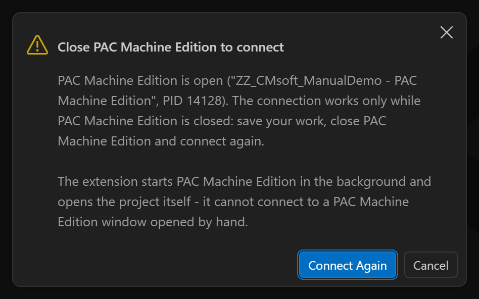

*The message of **Connect** while a PAC Machine Edition window is open: it names the window and its process ID. Save your work in
PAC Machine Edition, close it, then click **Connect Again**.*

The empty **Project** view says the same before you connect (section 5.1). To look at the project in PAC Machine Edition, use
**Open Project in PAC Machine Edition**: it turns the hidden PAC Machine Edition into a normal window with the project open and ends the
connection (section 6.7). Close that window before you connect again.

> **Note.** The hidden PAC Machine Edition is started by the extension and ends with the connection. If VS Code was killed while it was
> connected, the hidden instance may still run: the next **Connect** recognises it as left over by the extension and ends it first.
> A PAC Machine Edition that you opened yourself is never ended by the extension.

### 4.3 The project store and project backups

The extension opens projects of the **local project store** of PAC Machine Edition — the projects that PAC Machine Edition lists under
**File → Open Project**. On a standard installation they are folders in

```text
C:\Users\<you>\Documents\Emerson\PME\SecurWORX\Local\FrameworX\<project>\<project>.SwxCF
```

(PAC Machine Edition remembers another place in the registry if it was changed.) **Connect** opens the file dialog in this folder; you
pick the `.SwxCF` file of a project (section 6.1). A project **backup** (`.zip`, made by PAC Machine Edition or by **Back Up Project (ZIP)**) is restored into the store
first — the extension never restores a backup over an existing project (section 6.5).

Backups that the extension writes before the first export of a session, and **Back Up Project (ZIP)**, go to the backup folder of PAC
Machine Edition (`C:\Users\Public\Documents\Emerson\PME\Backup` on a standard installation).

### 4.4 Without PAC Machine Edition — the demo mode

To look at the extension before PAC Machine Edition is installed, turn on the setting `emersonImport.demoMode` (the empty **Project**
view has a link to it): **Connect** then opens a small simulated project instead of PAC Machine Edition — the **Connection** view shows a
**Demo mode** row. Imports write the files of that project, exports change it, and its validation reports an error for every line that
contains the word `ERROR` — enough to see the **PROBLEMS** panel at work. Nothing of it reaches PAC Machine Edition. Turn the setting off
again for real work.

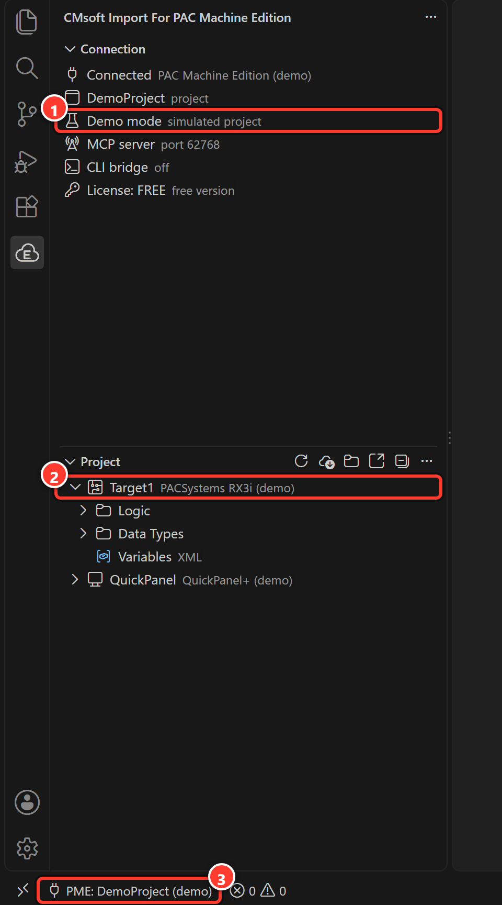

*Connected in demo mode: (1) the **Demo mode** row, (2) a simulated RX3i target (the project also has a simulated QuickPanel target),
(3) the status bar item marked `(demo)`.*

### 4.5 First connection test

1. Close PAC Machine Edition.
2. Open a folder in VS Code (**File → Open Folder…**).
3. Click the cloud icon of the extension in the Activity Bar, then **Connect to PME** (chapter 6).

The extension asks which project to open — the file dialog opens in the project store — and after 10 to 30 seconds (PAC Machine
Edition starts in the background) the project is open. If it is not, section 16.2 lists the messages you may see and what to do.

---

## 5. The user interface at a glance

### 5.1 Where everything lives

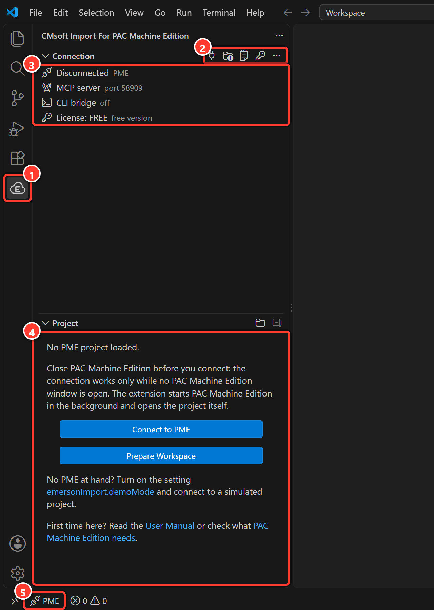

*(1) The icon of the extension in the Activity Bar — a click shows its views. (2) The toolbar of the **Connection** view (section 5.2).
(3) The rows of the **Connection** view (section 5.3). (4) The **Project** view: before you connect it says what to do and offers
**Connect to PME** and **Prepare Workspace**; once connected it shows the project tree (section 5.4). (5) The status bar item **PME**
(section 5.6).*

Everything else you use is VS Code's own: the **Explorer** with the imported files and their right-click menus (section 5.5), the editor,
the **PROBLEMS** panel with the validation results (chapter 9) and the **Output** panel with the log of the extension (section 16.1).

### 5.2 The toolbar of the Connection view

The icons appear when the mouse is over the view.

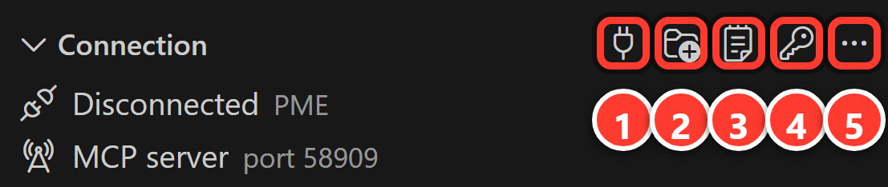

| # | Icon | Command | What it does |
| --- | --- | --- | --- |
| 1 | plug | **Connect to PAC Machine Edition** | Asks for the project file, then starts PAC Machine Edition hidden and opens the project (chapter 6). While connected, two icons stand here instead: **Disconnect (close PAC Machine Edition)** and **Select Project**; while a connect, an open or a disconnect runs, none. |
| 2 | folder with a plus | **Prepare Workspace** **PRO** | Writes the instructions for AI assistants into the workspace (section 5.8). |
| 3 | page | **Show Logs** | Opens the log of the extension in the **Output** panel (section 16.1). |
| 4 | key | **Manage License / Subscription** | Opens the license panel (chapter 15). Shown only while the license is not PRO. |
| 5 | … | **Views and More Actions…** | **Open Project File or Backup (.SwxCF, .zip)…** (section 6.5). |

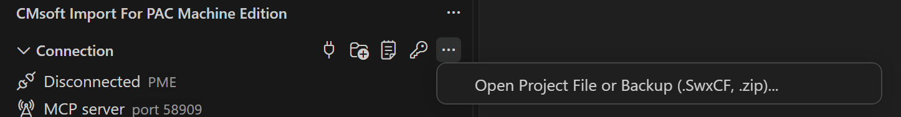

*The **…** menu of the **Connection** view.*

### 5.3 The rows of the Connection view

| Row | Shows | A click … |
| --- | --- | --- |
| **Disconnected** / **Connected** | `PME` / the PAC Machine Edition version, e.g. `PAC Machine Edition 10.7.222.0` | connects / disconnects. Its tooltip, before you connect, repeats that PAC Machine Edition must be closed. |
| **Connecting...** / **Opening the project...** / **Disconnecting...**, with a spinning icon | the current step, e.g. `starting PAC Machine Edition in the background - 10 to 30 seconds` | opens the log. The row stands in for **Disconnected** / **Connected** while the operation runs (sections 6.1, 6.6). |
| the project (connected only) | the name of the open project | opens the file dialog (**Select Project**, section 6.4) |
| **Demo mode** (only with the setting `emersonImport.demoMode`) | `simulated project` | opens the setting (section 4.4) |
| **MCP server** | `port 58909` (changes every session), `starting` or `off` | **Start MCP Server**: offers to switch the server on when it is off (chapter 12) |
| **CLI bridge** | `on` / `off` | **Toggle CLI Bridge** **PRO** (chapter 13) |
| **License** | `FREE`, `PRO`, the trial and its days | opens the license panel (chapter 15) |

### 5.4 The Project view

While connected, the **Project** view shows the targets of the open project and what each of them holds:

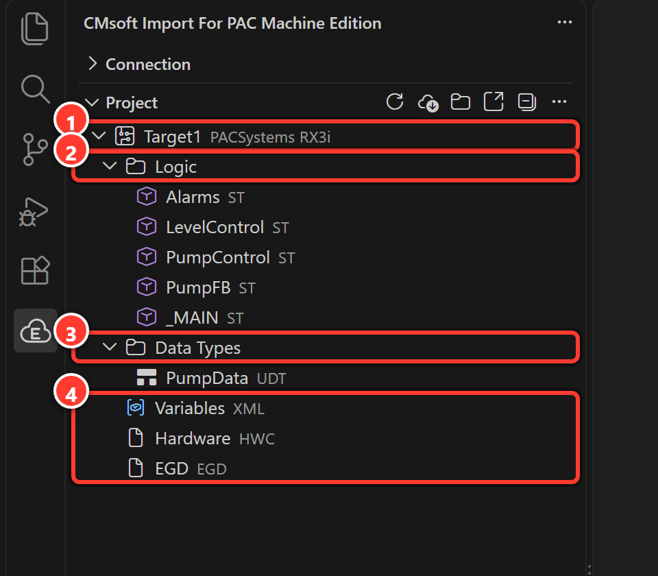

*(1) A target with its model — the extension imports Controller targets (PACSystems). (2) **Logic**: the logic blocks with their
language (`LD`, `ST`; other languages are listed too, but only LD and ST are supported — section 2.7). (3) **Data Types**: the user
defined types. (4) **Variables**, **Hardware** and **EGD**: the
variable list, the hardware configuration and Ethernet Global Data of the target.*

The tooltip of a block names its kind — *block*, *function block* (a UDFB) — and its language. The icons on the right of a row appear
when the mouse is over it:

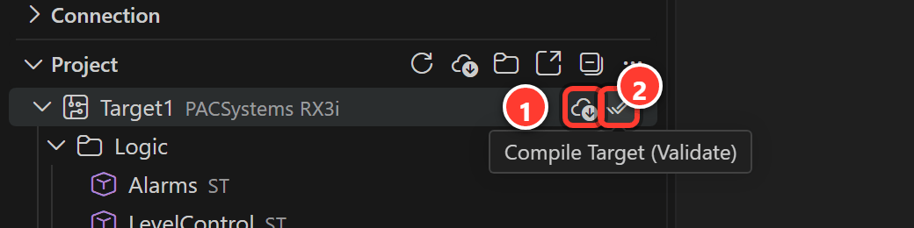

*The icons of a target: (1) **Import Target to Workspace** (chapter 7), (2) **Compile Target (Validate)** (chapter 9).*

An item (a block, a data type, **Variables**, **Hardware**, **EGD**) has one icon: **Import to Workspace** (section 7.3). The right-click
menu of a target holds **Export Target Folder to PME** (section 8.3), **Compile Target (Validate)** and **Rebuild Target (Compile All
Blocks)** (section 9.1); groups and items offer **Compile Target (Validate)** for their target:

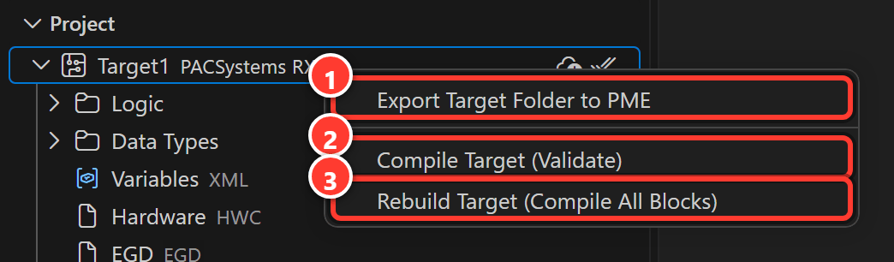

*The right-click menu of a target: (1) **Export Target Folder to PME** (section 8.3), (2) **Compile Target (Validate)** and (3) **Rebuild
Target (Compile All Blocks)** (section 9.1).*

The toolbar of the **Project** view:

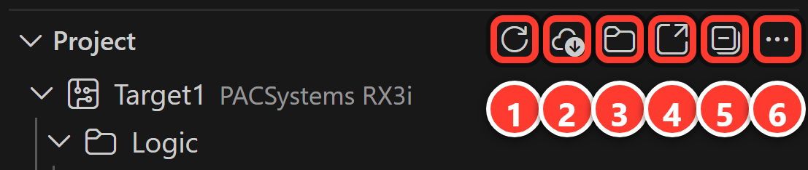

| # | Command | What it does |
| --- | --- | --- |
| 1 | **Refresh Project Structure** | Reads the targets and items from PAC Machine Edition again (section 6.6). |
| 2 | **Import Entire Project to Workspace** | Imports every Controller target of the project (section 7.4). |
| 3 | **Open Import Folder** | Shows the import folder of the workspace (`PmeImport`) in the Windows File Explorer. |
| 4 | **Open Project in PAC Machine Edition** | Hands the project over to a normal PAC Machine Edition window and ends the connection (section 6.7). |
| 5 | **Collapse All** | VS Code's own: collapses the tree. |
| 6 | **…** | **Back Up Project (ZIP)** (section 6.8). |

### 5.5 Right-click menus in the Explorer (exporting)

While the extension is connected, the right-click menu of the **Explorer** has one entry of the extension: on a file **Export File to PME**,
on a folder **Export Target Folder to PME** (chapter 8; the FREE plan exports up to 10 objects per operation, section 2.5).

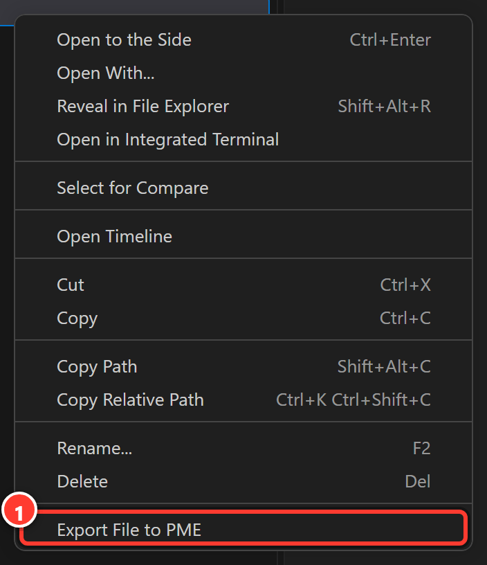

*(1) **Export File to PME** — the last entry of the right-click menu of a file.*

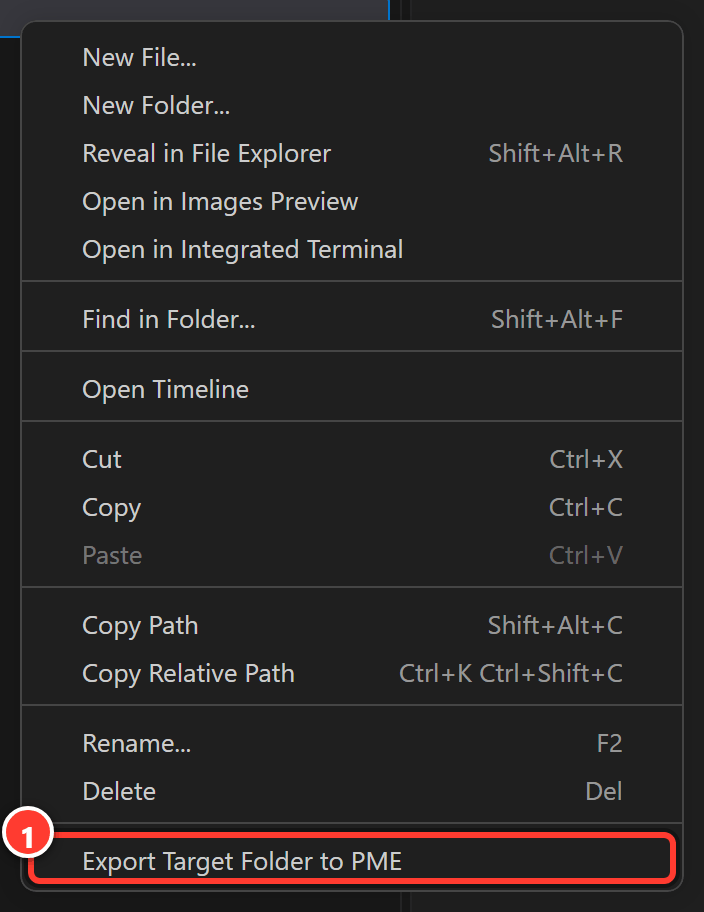

*(1) **Export Target Folder to PME** — the last entry of the right-click menu of a folder.*

### 5.6 The status bar


*(1) The item **PME** of the extension: disconnected; a click connects. (2) VS Code's counters of errors and warnings in the **PROBLEMS**
panel — after a compilation they count its messages (chapter 9).*

Connected, the item shows the project; its tooltip names the PAC Machine Edition version, and a click opens the project list:

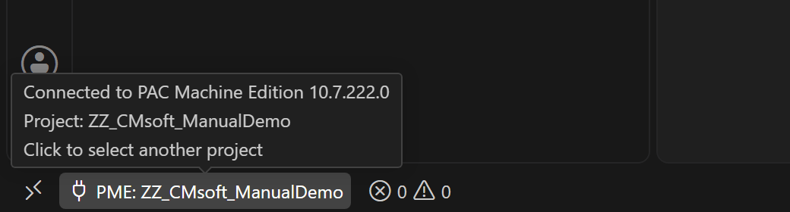

*The item **PME: ZZ_CMsoft_ManualDemo** and its tooltip.*

On the right of the status bar, the **CMsoft** item lists the licenses and the manuals of every installed CMsoft extension (section 15.2).

### 5.7 The Command Palette

Every command of the extension starts with **CMsoft Import for PAC Machine Edition:**. Press `F1` (or `Ctrl+Shift+P`) and type a part
of it — `PAC Machine` lists them all, `export` the export commands:

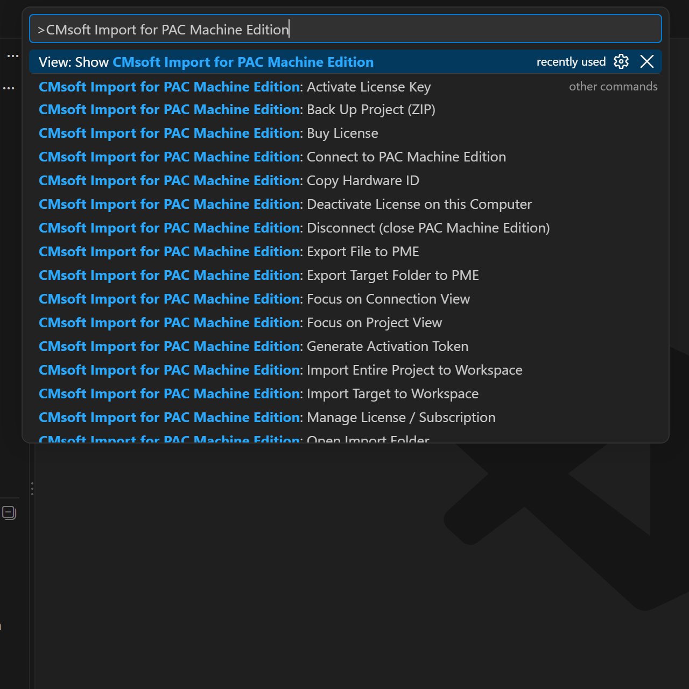

*The commands of the extension in the Command Palette (the list goes on below). Appendix A lists every command.*

### 5.8 Prepare Workspace — templates for AI tools **PRO**

**Prepare Workspace** (toolbar of the **Connection** view, or the button of the empty **Project** view) writes into the workspace what an AI
assistant needs to know about the files of the extension — the file formats of PAC Machine Edition, the rules for Structured Text and the
commands of the extension:

| Path in the workspace | What it is |
| --- | --- |
| `.github/instructions/emerson-import.instructions.md` | Instructions that GitHub Copilot applies to every file (`applyTo: "**"`): the folders, the file formats, the rules for editing Structured Text and for exporting. |
| `.github/instructions/emerson-import-cli.instructions.md` | How scripts and agents use the CLI bridge (chapter 13). |
| `Tools/pme_cli_example.py`, `Tools/pme_cli_example.md` | A complete CLI client in Python and its description. |
| `AGENTS.md`, `CLAUDE.md`, `.github/copilot-instructions.md`, `.gitignore`, `Tools/README.md` | One section of this extension in each, between `cmsoft:begin` / `cmsoft:end` marks — next to your own text and to the sections of other CMsoft extensions. |
| `.github/ProjectDescription.md`, `UserFiles/` | Created once if missing — a place to describe your project for the assistant, and the output folder of scripts. Never changed again. |

Run it again after an update of the extension: it refreshes its own files and sections and keeps your text. A file of yours with the same
name as one of its own files is kept and reported in the log.

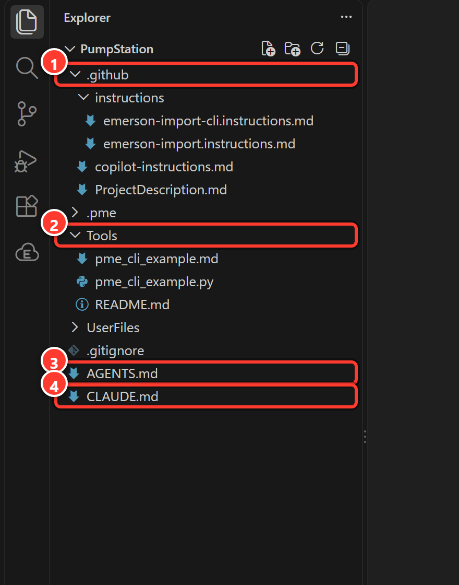

*The workspace after **Prepare Workspace**: (1) `.github` with the instructions, (2) `Tools`, (3) `AGENTS.md` and `CLAUDE.md`.*

---

## 6. Connecting to PAC Machine Edition

### 6.1 Connect

Close PAC Machine Edition first (section 4.2). Then use one of the three places:

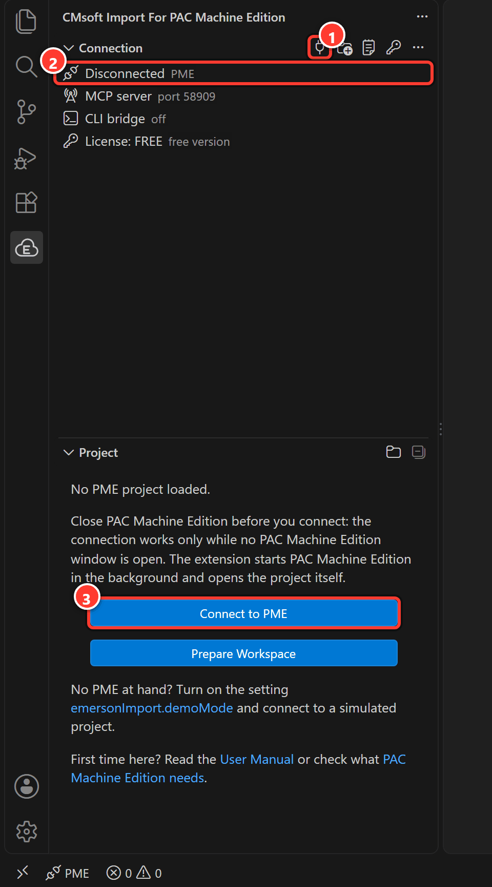

*(1) **Connect to PAC Machine Edition** in the toolbar of the **Connection** view, (2) the row **Disconnected**, (3) the button **Connect
to PME** of the empty **Project** view. The status bar item **PME** and the Command Palette (**CMsoft Import for PAC Machine Edition: Connect
to PAC Machine Edition**) work as well.*

1. Click one of them. First the extension asks which project to open: the Windows file dialog
   **Connect to PAC Machine Edition - choose the project to open** opens in the project store (section 4.3), one folder per project.
   Open the folder of the project, pick its `.SwxCF` file — or a project backup `.zip` (section 6.5) — and click **Open in PME**. You can
   also type or paste the path of the file into **File name**.

   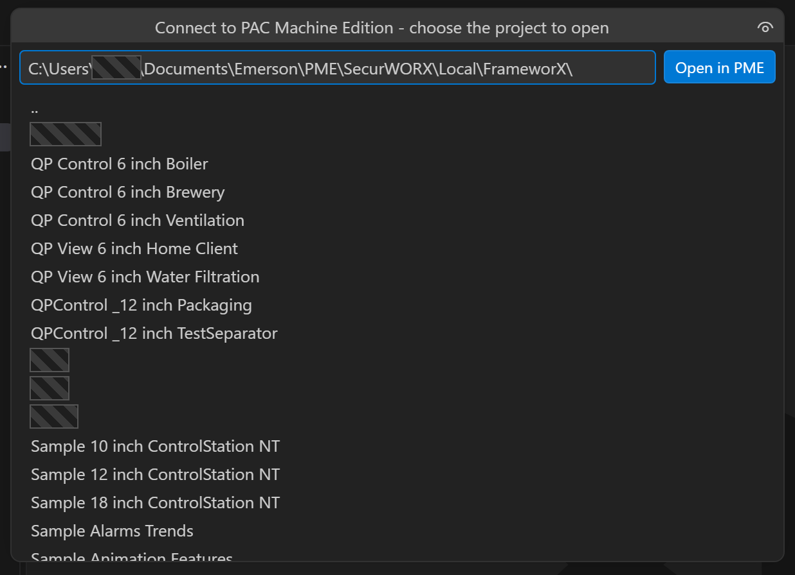

   *The file dialog of **Connect**: the project store with one folder per project; the `.SwxCF` file in a project's folder opens that
   project. Most folders here are the sample projects PAC Machine Edition installs; the author's own projects and the user name in the
   path are hidden in this picture.*

2. A notification says **Connecting to PME...** with the current step — *starting PAC Machine Edition in the background*, *opening
   ZZ_CMsoft_ManualDemo.SwxCF*, *reading the project structure* — while PAC Machine Edition starts in the background: 10 to 30 seconds,
   longer on the first start after Windows started. Meanwhile the **Connection** view shows **Connecting...** with a spinning icon, and the
   status bar item spins as well.

   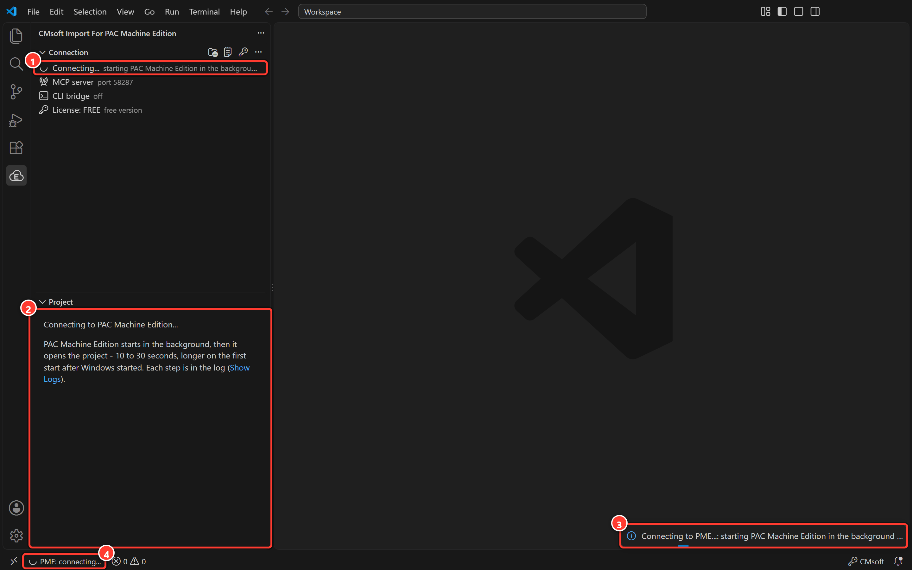

   *(1) The row **Connecting...** with the current step, (2) the **Project** view while PAC Machine Edition starts, (3) the notification
   **Connecting to PME...** — VS Code shortens its text to one line —, (4) the status bar item **PME: connecting...**.*

3. The extension opens the project — 3 to 10 seconds — and shows it:

   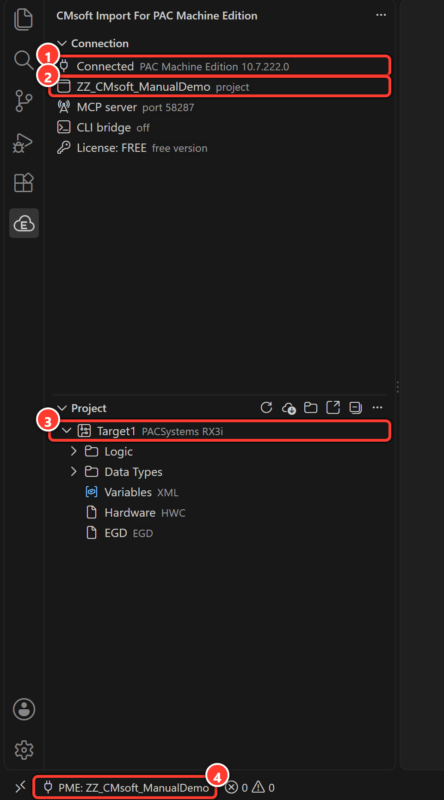

   *(1) **Connected** and the version of PAC Machine Edition, (2) the open project, (3) its target in the **Project** view, (4) the status
   bar item.*

Cancel the file dialog, and nothing starts. A file PAC Machine Edition cannot open — a `.SwxCF` outside the project store, another kind
of file — is refused before PAC Machine Edition starts; **Choose Another File** opens the dialog again.

There is one connection at a time. While **Connect** runs, the toolbar and the rows offer no second **Connect**, and the Command Palette
answers that connecting is in progress. Connected already, **Connect** says so and offers **Select Project** (section 6.4).

### 6.2 PAC Machine Edition is open

When a PAC Machine Edition window is open — opened by you, or the window of **Open Project in PAC Machine Edition** — **Connect** stops
and explains it:


*The message of **Connect** while a PAC Machine Edition window is open: it names the window and its process ID. Save your work in
PAC Machine Edition, close it, then click **Connect Again**.*

The connection cannot share PAC Machine Edition with a window (section 4.2).

Neither can two VS Code windows share it: while one window is connected, **Connect** in another one answers *PAC Machine Edition is
already connected in another VS Code window*. **Disconnect** in the first window (or close it), then click **Connect Again**.

### 6.3 After connecting

* The **Connection** view shows **Connected** and the project, the **Project** view the targets.
* The status bar item shows **PME: ZZ_CMsoft_ManualDemo**.
* The Explorer offers **Export File to PME** and **Export Target Folder to PME** (section 5.5).
* The log (**Show Logs**) records the start:

```text
[info] Connecting to PME...
[info] ✓ Connected to PAC Machine Edition 10.7.222.0 in 10.6 s
[info] Opening C:\Users\<you>\Documents\Emerson\PME\SecurWORX\Local\FrameworX\ZZ_CMsoft_ManualDemo\ZZ_CMsoft_ManualDemo.SwxCF...
[info] Project ZZ_CMsoft_ManualDemo: 1 target(s), opened in 7.2 s
```

PAC Machine Edition runs hidden as long as the extension is connected. The commands, Copilot, the MCP server and the CLI bridge all use
this one connection.

### 6.4 Selecting another project

**Select Project** — the toolbar of the **Connection** view while connected, the project row, the status bar item or the Command Palette —
opens the file dialog of section 6.1 again, in the project store. The extension closes the open project (an export has saved it already)
and opens the chosen one; the notification **Opening the project...** and the row **Opening the project...** of the **Connection** view
show it. Not connected, **Select Project** is **Connect**.

### 6.5 Opening a project file or a backup

**Open Project File or Backup (.SwxCF, .zip)…** (the **…** menu of the **Connection** view) opens a file:

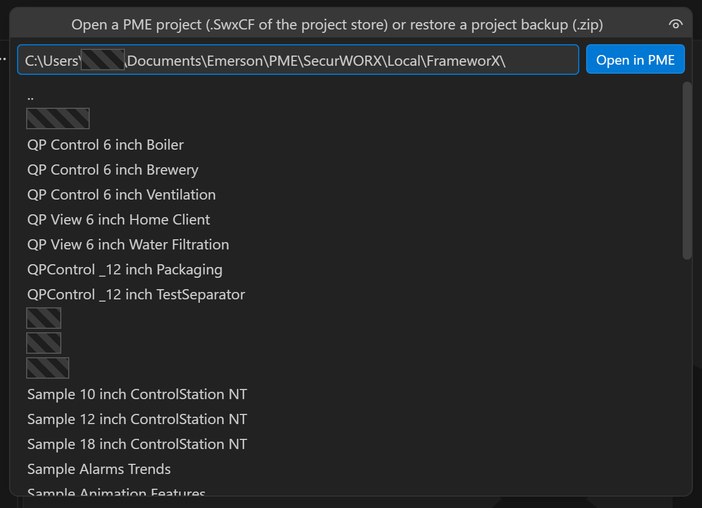

*The dialog starts in the project store, like the one of **Connect**; pick the file or type its path, then **Open in PME**.*

* A **`.SwxCF`** file must be the project file of a project in the project store (section 4.3) — the extension opens that project.
* A **`.zip`** backup is restored into the project store first, under the project name stored in the backup, and then opened. The extension
  never restores over a project of the same name: PAC Machine Edition refuses it, and the log says
  *Restoring ZZ_CMsoft_ManualDemo-20261026-105419.zip failed: a project with this name already exists (0x80040340).*
  Rename or delete the project in PAC Machine Edition first if you want the backup back.

Without a connection, the command is **Connect** (section 6.1) — the same dialog, then PAC Machine Edition starts.

### 6.6 Disconnect and refresh

* **Disconnect (close PAC Machine Edition)** — the toolbar of the **Connection** view or the **Connected** row — closes the project and quits
  the hidden PAC Machine Edition. Nothing is lost: every export has saved the project already. Closing VS Code (or **Reload Window**)
  disconnects as well: the extension's background process closes PAC Machine Edition within about half a minute after the window is
  gone, and a window that connects meanwhile waits for it.
  PAC Machine Edition needs up to half a minute to exit: until it has, the notification **Disconnecting from PAC Machine Edition...** and the
  spinning row **Disconnecting...** show it, and the log records the start and the time it took:

  ```text
  [info] Disconnecting - closing PAC Machine Edition...
  [info] Disconnected in 17.4 s
  ```
* **Refresh Project Structure** (toolbar of the **Project** view) reads the targets and items again — after an export that created blocks the
  extension refreshes by itself.

### 6.7 Open the project in PAC Machine Edition

To see or change the project in PAC Machine Edition itself — the LD editor, the hardware configuration, online work with the controller —
use **Open Project in PAC Machine Edition** (toolbar of the **Project** view):

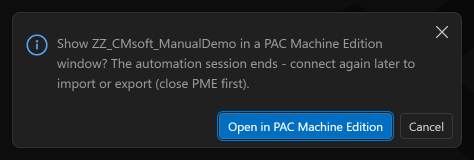

*The confirmation: the connection ends with the hand-over.*

The hidden PAC Machine Edition becomes a normal window with the project open, and the extension disconnects:

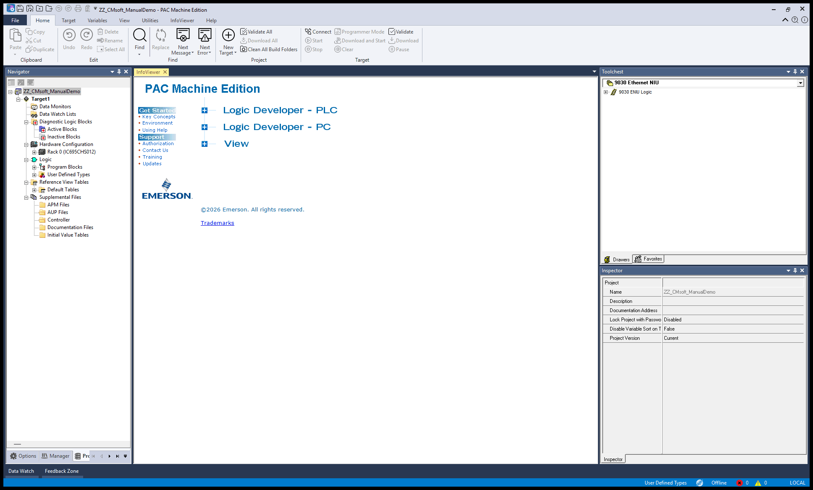

*PAC Machine Edition after the hand-over, with the demo project in its **Navigator**.*

The window is yours now: work in it, save, close it. Connect again only after you have closed it (section 6.2).

### 6.8 Back up the project

**Back Up Project (ZIP)** (the **…** menu of the **Project** view) writes a backup of the open project in the backup format of PAC
Machine Edition into its backup folder:

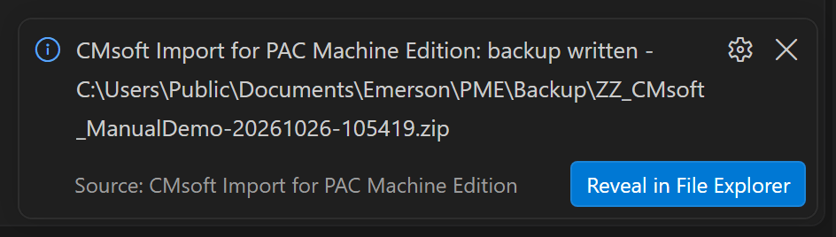

*The notification names the file; **Reveal in File Explorer** shows it.*

The extension also writes such a backup by itself before the first export of a session (section 8.1). A backup is restored with **Open
Project File or Backup** (section 6.5) or in PAC Machine Edition.

---

## 7. Importing from PAC Machine Edition into files

### 7.1 What an import does

An import copies engineering data **from PAC Machine Edition into files of your workspace**. PAC Machine Edition is not changed. The FREE
plan imports up to 10 objects per operation, with 15 minutes between two imports or exports (section 2.5); PRO has no limits.

| What | File in the workspace | Format |
| --- | --- | --- |
| A logic block | `Logic/<block>.xml` | PLCopen XML as PAC Machine Edition exports it, indented (section 7.8) — Ladder and Structured Text blocks (section 2.7) |
| A Structured Text block, additionally | `Logic/<block>.st` | The Structured Text as plain text (section 7.6) |
| A user defined type | `Data Types/<type>.xml` | PLCopen XML, indented |
| The variable list | `Variables.xml` | The variable list of PAC Machine Edition (XML, indented) |
| The hardware configuration | `Hardware.xml` | The hardware configuration export of PAC Machine Edition (XML, indented) |
| Ethernet Global Data | `EGD.zip` and `EGD.xml` | The EGD export of PAC Machine Edition (a ZIP archive) and the `EGD.xml` it contains, for reading and comparing |

The files of a target are in `<workspace>/PmeImport/<project>/<target>/` (section 7.5).

### 7.2 Import a target — step by step

1. In the **Project** view, move the mouse over the target and click **Import Target to Workspace** — the first icon on the right of the row:

   

   *(1) **Import Target to Workspace**, (2) **Compile Target (Validate)**.*

2. A notification shows the progress. A target like the demo one takes a second or two; the hardware configuration and many blocks take longer.

   

3. The result names the number of items:

   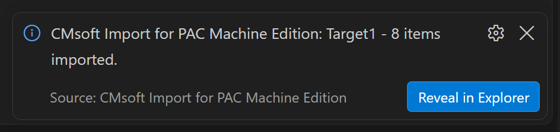

   *Eight items: five blocks, the data type, the variable list and the hardware configuration. **Reveal in Explorer** shows the files.*

4. The files are in the Explorer:

   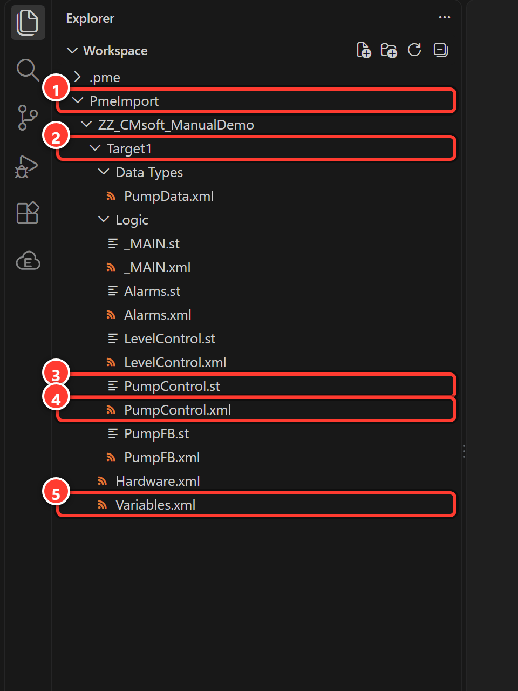

   *(1) The import folder `PmeImport`, (2) the folder of the target in the folder of the project, (3) the Structured Text of `PumpControl`
   and (4) its PLCopen XML, (5) the variable list.*

The log (**Show Logs**) lists every item:

```text
[info] Importing Target1 into e:\EmersonManualDemo\Workspace\PmeImport\ZZ_CMsoft_ManualDemo\Target1
[info] Alarms: Imported
[info] LevelControl: Imported
[info] PumpControl: Imported
[info] PumpFB: Imported
[info] _MAIN: Imported
[info] PumpData: Imported
[info] Variables: Imported (46 variables and elements)
[info] Hardware: Imported
[warning] EGD: Not imported: Importing Ethernet Global Data failed: PAC Machine Edition refused the request (0x80004005).
[info] ✓ Target1: 8 item(s) imported
```

The demo target has no Ethernet Global Data: PAC Machine Edition then refuses the EGD export, and the log says so as a warning — the
other items are imported all the same. The variable list counts *variables and elements*: the members of the data-type variables and of
the function block instances are listed one by one.

### 7.3 Import a single item

The icon on the right of an item in the **Project** view — a block, a data type, **Variables**, **Hardware**, **EGD** — imports that one
item into the folder of its target and opens it in the editor:

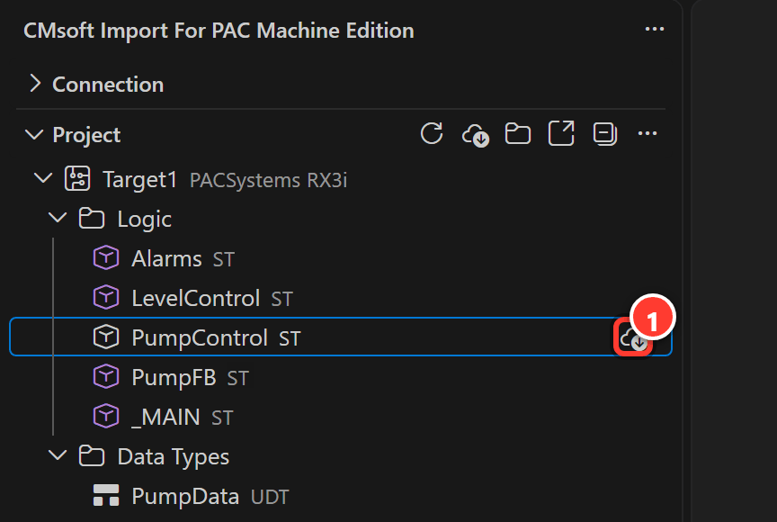

*(1) **Import to Workspace** on the row of a block.*

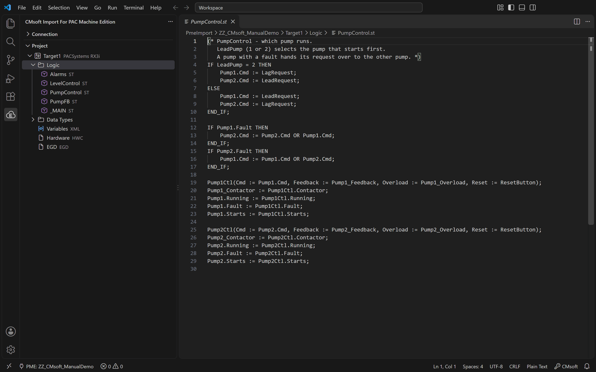

*A Structured Text block opens as its `.st` file — here `PumpControl.st` — every other item as its `.xml` file (**EGD** as the extracted
`EGD.xml`).*

### 7.4 Import the entire project

**Import Entire Project to Workspace** (the second icon of the toolbar of the **Project** view) imports every Controller target of the
project, one after the other. The notification names the target in progress and has a **Cancel** button: the target in progress finishes,
the next ones are skipped. The result counts the items of all targets:


View and QuickPanel targets are skipped: the extension works with the logic of PACSystems controllers. **Import Target to Workspace**
on such a target answers *Target '…' is a … target.* (not verified on this computer: the demo project has no View target).

### 7.5 Where the files go

Every import writes below the import folder of the workspace, one folder per project and one per target. The demo project after **Import
Target to Workspace** (the listing shows every file):

```text
Workspace/
├─ .pme/
│  └─ mcp.json                          connection details of the MCP server (section 12.2)
└─ PmeImport/                           the import folder (setting emersonImport.importFolderName)
   └─ ZZ_CMsoft_ManualDemo/             the project
      └─ Target1/                       the target
         ├─ Data Types/
         │  └─ PumpData.xml
         ├─ Logic/
         │  ├─ _MAIN.st         _MAIN.xml
         │  ├─ Alarms.st        Alarms.xml
         │  ├─ LevelControl.st  LevelControl.xml
         │  ├─ PumpControl.st   PumpControl.xml
         │  └─ PumpFB.st        PumpFB.xml
         ├─ Hardware.xml
         └─ Variables.xml
```

The name of the import folder is the setting `emersonImport.importFolderName` (default `PmeImport`). **Open Import Folder** (toolbar of the
**Project** view) shows it in the Windows File Explorer. Appendix C describes every file.

### 7.6 Structured Text as `.st` files

PAC Machine Edition stores Structured Text inside the PLCopen XML of the block, in an HTML-like form (`<br/>` for a line break, escaped
characters). The extension writes that text a second time as a plain `.st` file — UTF-8, Windows line ends — so you can edit, search,
compare and review it like any source file:

```text
(* PumpControl - which pump runs.
   LeadPump (1 or 2) selects the pump that starts first.
   A pump with a fault hands its request over to the other pump. *)
IF LeadPump = 2 THEN
    Pump1.Cmd := LagRequest;
    Pump2.Cmd := LeadRequest;
...
```

* Edit the **`.st`** file. Leave the `.xml` next to it as it is: it carries everything else of the block — its interface, its variables,
  its sizes — and the export merges the edited `.st` into it (section 8.2).
* Ladder (LD) blocks have no `.st`: their `.xml` describes the rungs and boxes with coordinates. Version and compare them; edit them
  in PAC Machine Edition.
* An unchanged block comes back byte for byte the same on every import — `.st` and indented `.xml` alike —, so `git diff` shows only real
  changes.

### 7.7 Importing again — what happens to your files

An import writes the target as it is in PAC Machine Edition **now**:

* **`Logic/` and `Data Types/` are written anew.** Every `.xml` and `.st` file in them that is not a block or a data type of the target is
  **deleted** — the files of blocks that were deleted in PAC Machine Edition, and also the files of a **new block you have not exported
  yet**. Other files in these folders (a `README.md`, notes) stay.
* An edited `.st` or `.xml` that you have not exported is **overwritten** with the state of PAC Machine Edition.
* `Variables.xml`, `Hardware.xml`, `EGD.zip` and `EGD.xml` are overwritten.
* Everything outside the folder of the target stays.

> **Warning.** Export your changes before you import the same target again — or keep the workspace in Git (section 10.4), so that an
> import that overwrote work is one `git checkout` away from undone.

### 7.8 Readable XML — one element per line

PAC Machine Edition writes the XML of a block, a data type, the variable list and the hardware configuration on **one line** — a block of
a few hundred elements is a single line of 50 000 characters. The extension writes these files **indented**: every element on a line of
its own, two spaces per level.

```xml
<?xml version="1.0" encoding="UTF-8"?>
<project>
  <fileHeader companyName="Emerson" productName="PAC Machine Edition" productVersion="10.7" creationDateTime="2010-03-26T00:00:00"/>
  <contentHeader name="LDPROG1">
    <addDataInfo name="www.ge-ip.com" vendor="Emerson"/>
  </contentHeader>
  <types>
    <pous>
      <pou name="PumpFB" pouType="functionBlock">
        ...
```

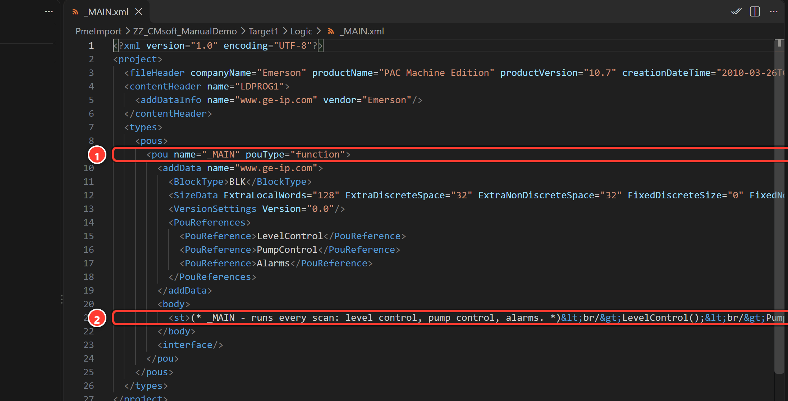

*`_MAIN.xml` of the demo project in the editor: (1) every element on a line of its own, indented by its level; (2) an element with a
text — here the Structured Text in `<st>`, with PAC Machine Edition's `&lt;br/&gt;` for its line breaks — stays on one line.*

* **Only the line breaks between the elements are added.** Tags, attributes and texts stay exactly as PAC Machine Edition wrote them; an
  element with a text — `<Name>Pump1_Overload</Name>`, the Structured Text in `<st>` — stays on its line.
* **PAC Machine Edition gets its own file back.** Every export to PAC Machine Edition (chapter 8) removes the indentation first, so PAC
  Machine Edition reads the file byte for byte as it wrote it.
* **Readable differences.** A changed rung or a new variable is a change of a few lines in `git diff`, not of one long line.
* `EGD.xml` comes indented from PAC Machine Edition already and is written as it is.
* The setting `emersonImport.formatXml` (on by default, chapter 14) turned off writes the files exactly as PAC Machine Edition exports
  them, on one line.

When you edit an XML file yourself, the whitespace between the elements does not matter. The whitespace **inside** an element that holds a
text is part of the text: do not wrap such a text onto lines of its own.

---

## 8. Exporting to PAC Machine Edition from files

*Export = files in your workspace → PAC Machine Edition.*

### 8.1 How an export works

Two commands write files of the workspace into the project that is open in PAC Machine Edition:

| Command | Where | What it exports |
| --- | --- | --- |
| **Export File to PME** | right-click a file in the **Explorer** (section 5.5); the Command Palette exports the file of the active editor | one file: a block (`.st` or `.xml`), a data type, the variable list, the hardware configuration or Ethernet Global Data (section 8.4) |
| **Export Target Folder to PME** | right-click the folder of a target in the **Explorer**, or the target in the **Project** view (section 5.4); the Command Palette | the folder of a target, the parts you tick (section 8.3) |

Both commands are in the menus while the extension is connected; started without a connection, they connect first (section 6.1). The
target is the one whose folder holds the file; with several targets a choice of the targets opens, that one first. Every export follows
the same rules:

* **You confirm every export.** A dialog names the file or the parts and the target; nothing happens until you click **Export**.
* **A backup comes first.** Before the first export after connecting to a project, the extension writes a ZIP backup of the project
  into the backup folder of PAC Machine Edition — `C:\Users\Public\Documents\Emerson\PME\Backup` on a standard installation — and the log
  names the file. One backup per project and connection; **Back Up Project (ZIP)** writes one whenever you want (section 6.8).
* **The project is saved after the export.** Every export that changed something ends with *Project saved* in the log — PAC Machine
  Edition has the change on disk, nothing has to be saved by hand.
* **An existing object is replaced.** A block, data type or variable of the same name is overwritten with the content of the file. The
  extension does not compare: every file you export is written, also an unchanged one (the log says *Updated*).
* **An edited `.st` travels in its block.** The `.xml` of a block holds everything else of the block; the export merges the Structured Text
  of the `.st` next to it into it (section 7.6).
* **Nothing is deleted** — unless you tick **Delete blocks without a file** in a folder export (section 8.5).
* **A file that fails does not stop the others.** Its error goes to the log, and the result counts the errors.

An export only transfers the files. Whether the code is correct is decided by the compilation (chapter 9): with PRO the extension offers it
after every export (setting `emersonImport.compileAfterExport`), in the FREE plan you start it with **Compile Target (Validate)**.

### 8.2 Export a file — step by step

The example exports `LevelControl.st` after an edit.

1. Right-click the file in the **Explorer** → **Export File to PME** — the last entry of the menu (picture in section 5.5). The menu offers
   it on every file; section 8.4 says which files PAC Machine Edition takes.
2. Confirm:

   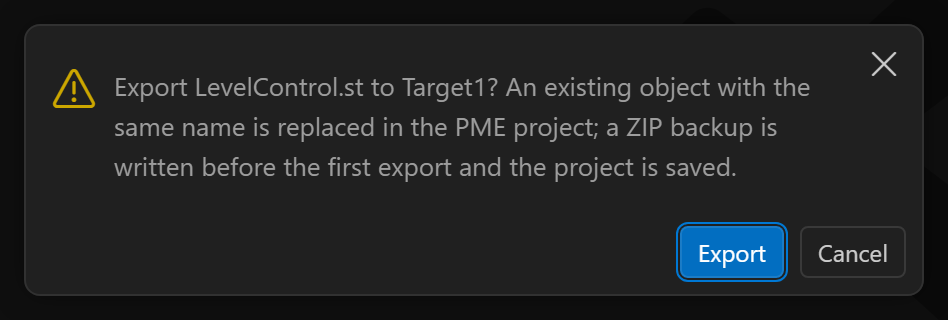

   *The file, the target and what happens: an object with the same name is replaced, a ZIP backup is written before the first export, the
   project is saved. **Export** starts it, **Cancel** (or `Esc`) does nothing.*

3. A notification **Exporting LevelControl.st to PME...** shows the progress — a second or two for a block. Then the result appears, and
   with PRO and **Compile after Export** set to `ask` (the default) the question about compiling:

   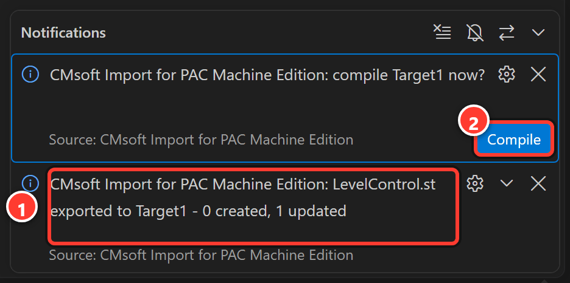

   *Both notifications, as the notification centre (the bell at the right of the status bar) lists them: (1) the result — "LevelControl.st
   exported to Target1 - 0 created, 1 updated"; (2) **Compile** compiles the target (chapter 9). Closing the question skips it. With `always` the compilation starts
   by itself, with `never` only the result appears. In the FREE plan the first export of a session also says once that compiling after an
   export is PRO (section 9.1).*

The log records the same:

```text
[info] Exporting e:\EmersonManualDemo\Workspace\PmeImport\ZZ_CMsoft_ManualDemo\Target1\Logic\LevelControl.st to Target1
[info] ZZ_CMsoft_ManualDemo: Backup of the project before the export to PME: C:\Users\Public\Documents\Emerson\PME\Backup\ZZ_CMsoft_ManualDemo-20261027-092650.zip
[info] LevelControl: Updated
[info] ZZ_CMsoft_ManualDemo: Project saved
[info] ✓ Exported LevelControl.st to Target1
[info] Compiling Target1 (PME Validate)
[info] Target1: 0 error(s), 0 warning(s) - compiled in 1.0 s
```

A failed export shows its error in a notification instead, for example *Block 'Lonely' does not exist in PME and its .xml is missing.*
(section 8.7).

### 8.3 Export a target folder — step by step

**Export Target Folder to PME** exports the folder of a target — `PmeImport/<project>/<target>/` — in one operation.

1. Right-click the target in the **Project** view, or the folder of the target in the **Explorer** (`Target1`), → **Export Target Folder to
   PME** (pictures in sections 5.4 and 5.5).

   A right-click on `Logic` or `Data Types` exports from the folder of the target as well, with only that part ticked — **Logic blocks**
   or **Data types** (section 10.7 does it so). Any other folder holds nothing to export and is refused before anything happens: *PmeImport
   is not the folder of a target - it holds no Logic, Data Types, Variables.xml, Hardware.xml or EGD file. …*

2. Tick what to export — click the check boxes — and click **OK**:

   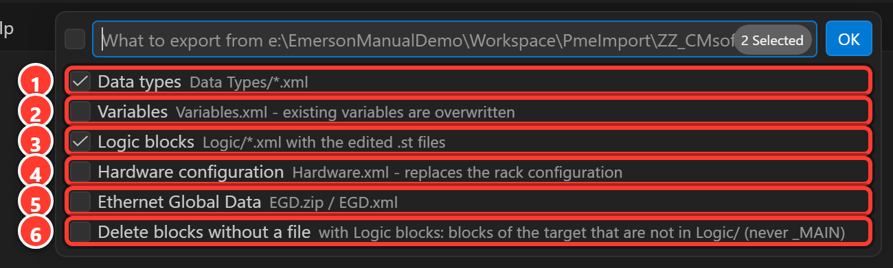

   *(1) **Data types** — `Data Types/*.xml`; (2) **Variables** — `Variables.xml`, existing variables are overwritten; (3) **Logic blocks** —
   `Logic/*.xml` with the edited `.st` files; (4) **Hardware configuration** — `Hardware.xml`, replaces the rack configuration; (5) **Ethernet
   Global Data** — `EGD.zip` / `EGD.xml`; (6) **Delete blocks without a file** — together with the logic blocks (section 8.5). When the list
   opens, **Data types** and **Logic blocks** are ticked; tick **Variables** when you changed the variable list.*

3. Confirm:

   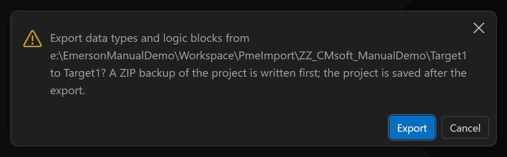

   *The parts in words — data types and logic blocks —, the folder and the target. The backup is written before the first export after
   connecting.*

4. The notification **Exporting to Target1...** shows the progress, then the result:

   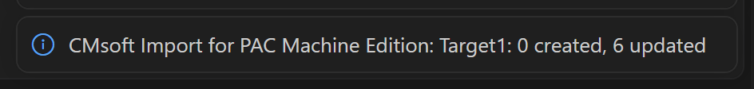

   *The numbers that PAC Machine Edition reports — here the data type and the five blocks. When files failed, the result is a warning that
   ends in "…, N error(s) - see the log", with the button **Show Logs**.*

5. With PRO and `ask`, the question *compile Target1 now?* follows, with **Compile** (chapter 9).

The log of this export:

```text
[info] Exporting e:\EmersonManualDemo\Workspace\PmeImport\ZZ_CMsoft_ManualDemo\Target1 to Target1 (udts, blocks)
[info] PumpData: Data type(s) exported to PME
[info] Alarms: Updated
[info] LevelControl: Edited LevelControl.st merged into the block
[info] LevelControl: Updated
[info] PumpFB: Updated
[info] PumpControl: Updated
[info] _MAIN: Updated
[info] ZZ_CMsoft_ManualDemo: Project saved
[info] ✓ Target1: 0 created, 6 updated
```

There is no backup line: the file export of section 8.2 had written the backup of this connection already.

**The order.** The parts are exported in a fixed order — data types, the variable list, the logic blocks, the hardware configuration,
Ethernet Global Data — so that a variable finds its data type and a block its variables. The blocks are sorted as well: a block that has an
instance of a function block comes after the file of that function block (`PumpFB` before `PumpControl`, which declares `Pump1Ctl` of the
type `PumpFB`); otherwise they go in alphabetical order. PAC Machine Edition refuses a block whose type it does not know yet (section 8.7).

**The variable list.** Tick **Variables** only when you changed the variable list: the export overwrites the variables of PAC Machine
Edition with the state of the file — also variables that were changed in PAC Machine Edition after the import. PAC Machine Edition lists the
elements of a structured variable and of a function block instance in the file as entries of their own, inside their variable — `Pump1.Cmd`,
`Pump1.Running`, … for a variable of the data type `PumpData`, `Pump1Ctl.Cmd`, … for an instance of `PumpFB`. Those entries are left out of
the export: PAC Machine Edition creates the elements with their variable. The log of the demo target, with **Variables** ticked alone:

```text
[info] Exporting e:\EmersonManualDemo\Workspace\PmeImport\ZZ_CMsoft_ManualDemo\Target1 to Target1 (variables)
[info] Variables: 27 element(s) of structured variables and function block instances left out - PME keeps them with their variable
[info] Variables: Variables exported to PME: 15
[info] ZZ_CMsoft_ManualDemo: Project saved
[info] ✓ Target1: 0 created, 15 updated
```

Imported again, the variable list of the target is the same as before: 46 variables and elements. A change to an element in the file — the
description of `Pump1.Cmd` — is therefore not exported: change it in PAC Machine Edition, or in the data type. (Up to version 1.1 the
elements were sent along, and PAC Machine Edition created a new variable for each — `Pump1_Cmd`, `Pump1Ctl_Reset`, …; section 16.3 says
how to remove them.)

### 8.4 Which files go where

What a file is, the extension decides by its extension and its content — not by the folder it is in:

| File | What the export does in PAC Machine Edition |
| --- | --- |
| `Logic/<block>.st` | The Structured Text is merged into the `<block>.xml` next to it — without that file, into the current XML of the block in PAC Machine Edition — and the block is replaced. A new block needs its `.xml` (section 8.7). A `.st` of a Ladder or FBD block is refused: *'…' is not a Structured Text block.* |
| `Logic/<block>.xml` | Creates or replaces the block — every block, when the file holds several. An edited `.st` next to it is merged first; the log says *Edited <block>.st merged into the block*. |
| `Data Types/<type>.xml` | Creates or replaces the data types of the file. |
| `Variables.xml` | Creates or overwrites the variables of the file, found by their names; variables that are not in the file stay. The elements of structured variables and function block instances are left out — PAC Machine Edition creates them with their variable (section 8.3). |
| `Hardware.xml` | Replaces the hardware configuration of the target (section 8.6). |
| `EGD.zip`, `EGD.xml` | Replaces the Ethernet Global Data of the target; an edited `EGD.xml` is packed into an archive first. **Export Target Folder** sends `EGD.xml` when it is newer than `EGD.zip`, otherwise the archive (section 8.6). |

Any other file — a note, a renamed copy, a file of another program — is refused: *'…' is not a PME file this extension can export.* A
block from another target folder or from a folder of your own works the same way, as long as it is a file of these kinds; the target is the
one you pick.

### 8.5 Deleting blocks without a file

**Delete blocks without a file**, ticked together with **Logic blocks** in **Export Target Folder to PME**, makes the folder the complete
list of the blocks: after the export of the blocks, every block of the target that has no `.xml` in `Logic/` is deleted in PAC Machine
Edition — `_MAIN` never. Use it after you deleted the files of a block that is no longer needed. The confirmation names the blocks:

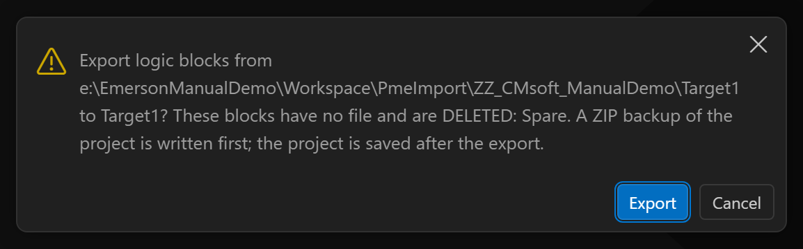

*The confirmation of an export of the logic blocks with **Delete blocks without a file**: "These blocks have no file and are DELETED:
Spare." — the block `Spare`, whose files had been deleted in the workspace.*

* Read the list before you click **Export**: a block that you have not imported yet, or that a colleague added in PAC Machine Edition, has
  no file and would be deleted. **Cancel** changes nothing. The dialog names up to 20 blocks, then *and N more*; when every block has its
  file it says *no block is deleted*.
* An empty `Logic` folder never deletes the program: the log says *Logic holds no block file - no block was deleted*.
* The log names every deleted block — *Spare: Deleted (no file in the folder)* — and the **Project** view is refreshed.
* The option works only together with **Logic blocks**. Ticked alone, the command exports nothing and says so: *"Delete blocks without a
  file" works together with "Logic blocks" - tick both. Nothing was exported.*
* The backup of section 8.1 is the way back.

### 8.6 Hardware configuration and Ethernet Global Data

Both are unticked in **Export Target Folder to PME**, and both replace what the target has:

* **Hardware configuration** — `Hardware.xml` replaces the rack configuration of the target: racks, modules and their parameters. While it
  reads the file, PAC Machine Edition reports warnings: 701 for the RX3i rack of the demo project, whose IP addresses had been set in the
  file (Appendix D.1). The log lists the first 25 and the count — *Hardware: 701 warnings from PAC Machine Edition in all (the first 25 are
  listed)* — and ends with *Hardware configuration exported to PME*; the target compiled without errors and warnings afterwards.
  Edit the parameters you understand, export, compile, and check the result in PAC Machine Edition's hardware configuration (section 6.7)
  before you download it.
* **Ethernet Global Data** — `EGD.zip` (as PAC Machine Edition exported it) or an edited `EGD.xml` replaces the exchanges of the target.
  *Not verified for this manual: the demo target has no Ethernet Global Data.*

### 8.7 New blocks

A new Structured Text block is two files in `Logic/`: the `.st` with the code and the `.xml` that tells PAC Machine Edition what the block is
— its kind, its interface, the variables it declares. The quickest way to the `.xml` is a similar block:

1. Copy the `.xml` of a block of the same kind — a block for a block, a function block for a function block — and rename it to the new
   name (`TestDryRun.xml`).
2. In the copy, change the name in `<pou name="…">` to the new name. Remove what belongs to the old block only, for example its calls of
   other blocks.
3. Write the `.st` (`TestDryRun.st`).
4. Export the `.st` (**Export File to PME**) or the folder (**Export Target Folder to PME**). The result says *TestDryRun.st exported to
   Target1 - 1 created, 0 updated*, the log *TestDryRun: Created*, and the **Project** view shows the new block.

Chapter 10 creates a block this way (section 10.12) and shows the files.

* **A new variable** that the block uses goes into the `<globalVars>` of the `<interface>` of its `.xml`: PAC Machine Edition creates it with
  the block. A variable that exists already keeps its definition in PAC Machine Edition.
* **A `.st` without its `.xml`** is refused: *Block 'Lonely' does not exist in PME and its .xml is missing.*
* **A type that PAC Machine Edition does not know yet.** A block that declares a variable of a data type or function block that is not in
  the project fails: *… a data type or function block it uses does not exist in PAC Machine Edition (0x80030002).* PAC Machine Edition
  leaves an empty block of that name behind, and the extension deletes it again — the message says so. Export the data type or the
  function block first; **Export Target Folder to PME** does that by itself (section 8.3).
* **A new block runs only when it is called** — from `_MAIN` or another block that runs (`TestDryRun();`).
* **A block keeps its language.** An `.xml` cannot turn an existing Ladder block into Structured Text (section 9.5).

### 8.8 The FREE limits

In the FREE plan an *operation* — one export command, one import command, one tool call — moves at most **10 objects**, and the next import
or export is available **15 minutes** after the previous one has ended (section 2.5); PRO and the free trial have no limits. An export
counts what it would write: a `.st` file is one block, a block `.xml` counts its blocks, a data type file its data types; the variable list,
the hardware configuration and Ethernet Global Data count one each. **Export Target Folder to PME** adds up the files of the parts you
ticked — the demo target with **Data types**, **Variables** and **Logic blocks** is 7 objects —; deleted blocks do not count.

An operation over the limit is refused **before anything is changed**: *Free plan limit: this operation would export … objects, but the
FREE plan allows up to 10 per operation. Split it into smaller batches or upgrade to CMsoft Import for PAC Machine Edition PRO.* (with the
number of objects in place of the dots). Within the 15 minutes:

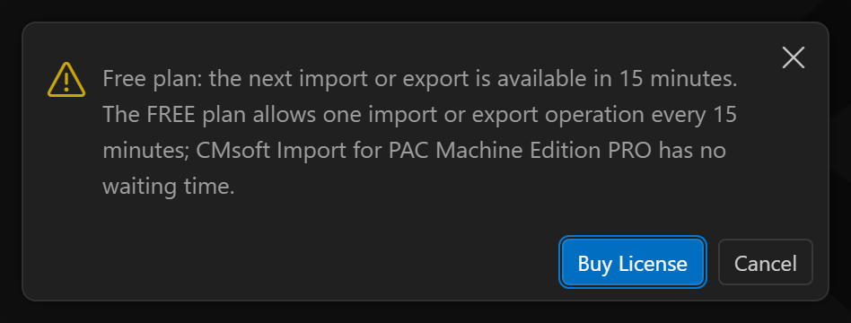

*The next import or export of the FREE plan: the time to wait. **Buy License** opens the license panel (chapter 15), where you buy a
subscription, start the free trial or activate a key.*

The waiting time counts from the end of the previous operation, applies to every VS Code window of the Windows user and survives a restart.
Export a few files at a time — every file of a folder with **Export File to PME**, or a folder with fewer parts ticked — or activate PRO.
Compiling has no limits (chapter 9).

### 8.9 Good habits

* **Commit before every export** (chapter 10). Git is your undo for the files; the backup of section 8.1 is your undo for the project.
* **Export small and often**, and compile after every export — an error is then easy to place.
* **Tick only what you changed** in **Export Target Folder to PME** — **Logic blocks** for code (a right-click on `Logic` ticks just them);
  **Variables** only with a changed variable list (section 8.3).
* **Edit an object in one place at a time** — in PAC Machine Edition or in VS Code. Import again after a change made in PAC Machine Edition,
  before you edit the files (section 7.7); the last export wins.
* **Never export untested code into the project of a running machine.** Export into a copy, compile, test (section 10.14), then bring the
  change into the project that you download.

---

## 9. Compiling (Validate) and the PROBLEMS panel

PAC Machine Edition compiles a target with **Validate**: it checks the hardware configuration, the variables and every block, and builds
the target. The extension runs it and turns its messages into entries of VS Code's **PROBLEMS** panel, on the line of the `.st` file they
are about. Compiling is FREE; compiling by itself after every export is PRO (section 9.1).

### 9.1 When a compilation runs

* **Compile Target (Validate)** — FREE, from:
  * the **Project** view: the second icon on the row of a target (section 5.4), or right-click a target, a group or an item of it;
  * the **Explorer**: right-click the folder of a target or a file in it;
  * the **editor** of an imported file: the icon **Compile Target (Validate)** in the title bar of the editor, or right-click in the text;
  * the Command Palette — the target of the file in the active editor, otherwise a choice of the targets.
* **Rebuild Target (Compile All Blocks)** — right-click a target in the **Project** view, or the Command Palette.
* **After an export** (**PRO**, as in CMsoft Import for TiaPortal), as the setting `emersonImport.compileAfterExport` says: `ask` (the
  default) shows a notification with a **Compile** button, `always` compiles at once, `never` does not. In the FREE plan the setting acts
  as `never`: the first export of a session says so once — *compile after export is a PRO feature* — with the buttons **Compile Target
  (Validate)** (compiles the target now, FREE) and **Buy License**; later exports of the session only write it to the log.
* An AI assistant runs it with the tool `pme_compile` (chapter 11) — `rebuild: true` for a rebuild.

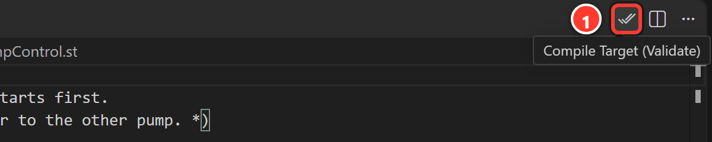

*(1) **Compile Target (Validate)** in the title bar of the editor of an imported file — here `PumpControl.st` — with its tooltip.*

PAC Machine Edition compiles the **project in PAC Machine Edition** — export an edited file first (chapter 8), the compilation does not
read the workspace — and **saves the project first**.

**Compile or rebuild.** Like PAC Machine Edition's own **Validate**, *Compile Target* compiles only what changed since the last
compilation: the other blocks are *up to date and do not require validation*. *Rebuild Target* first deletes the build output of the
target — PAC Machine Edition's **Clean Build Folders** — so that every block is compiled again; the compiled code is the same. Use it when
a compilation looks out of date, or before a download in PAC Machine Edition.

### 9.2 What you see while and after compiling

1. A notification while PAC Machine Edition compiles — one to three seconds for the demo target, longer for big ones (a target of 57 blocks:
   about 6 seconds, 2 to 3 when nothing changed):

   

2. The result, with **Show Problems**:

   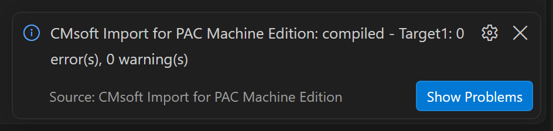

   *A clean target: 0 errors, 0 warnings.*

   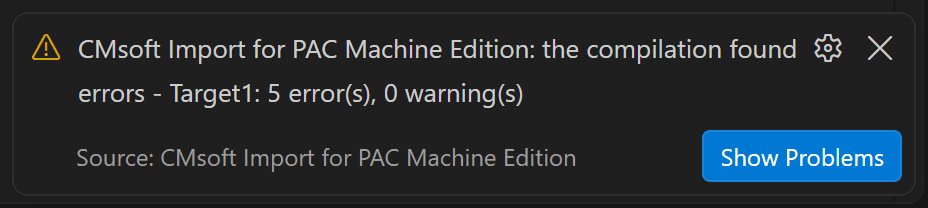

   *A target with errors: a warning notification with the counts.*

The log records the same, with the time the compilation took:

```text
[info] Compiling Target1 (PME Validate)
[info] Target1: 0 error(s), 0 warning(s) - compiled in 2.1 s
```

### 9.3 The PROBLEMS panel

Every error and warning of PAC Machine Edition becomes an entry of the **PROBLEMS** panel (**Show Problems**, or `Ctrl+Shift+M`):

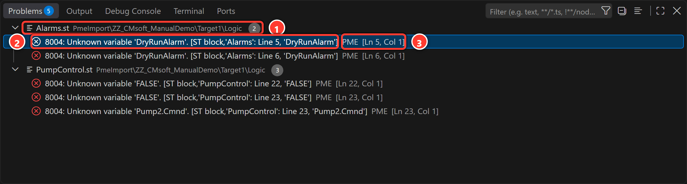

*(1) The file the messages belong to — the `.st` of the block. (2) An error: the number and the text of PAC Machine Edition, the block and the
line. (3) The source **PME** and the line. A click opens the file at that line.*

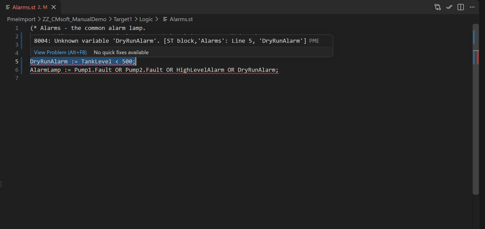

*The line of the error is underlined in the editor; the mouse over it shows the message.*

How an entry finds its place:

| The message names … | The entry is placed … |
| --- | --- |
| a Structured Text block and a line (`[ST block,'PumpControl': Line 12]`) | in `Logic/PumpControl.st`, at line 12 — the lines of the `.st` file are the lines PAC Machine Edition counts |
| a Ladder block (`[LD Block,'…': Rung 8]`) | in the block's `.xml`, at the top; the rung is in the text — the PLCopen XML of a Ladder block has no rungs, only the positions of its elements |
| a function block that differs from the Toolchest (`Function block PID version 1.7 in the target does not match version 1.8 in the Toolchest.`) | in the block's `.st` or `.xml`, at the top |
| the hardware configuration (`[HWC Location: …]`) | in `Hardware.xml`, at the top; the location is in the text |
| Ethernet Global Data (`[EGD …]`) | in `EGD.xml`, at the top |

A message about an item that has no file in the workspace — the target was not imported, or the message names no item — is counted in the
notification and written to the log, but has no entry in **PROBLEMS**. The entries of a target are replaced by its next compilation, so
**PROBLEMS** always shows the last result. The status bar counts them too (section 5.6).

Without problems the panel says so:


### 9.4 The same messages in PAC Machine Edition

The extension takes the messages from PAC Machine Edition's **Feedback Zone** — the same lines PAC Machine Edition shows there after
**Validate** (ribbon **Home**, group **Target**; picture in section 6.7), for example:

```text
Error 8004: Unknown variable 'TRUE'. [ST block,'PumpControl': Line 12, 'TRUE']
```

In **PROBLEMS** the word *Error* / *Warning* becomes the icon of the entry: `8004: Unknown variable 'TRUE'. [ST block,'PumpControl': Line 12,
'TRUE']`. The totals of PAC Machine Edition's last line (*Validating Complete - 0 error(s), 0 warning(s)* or *Validating Aborted - …*) are the
counts of the notification.

### 9.5 Rules and limits to know

* **Structured Text of PAC Machine Edition 10.7.** A BOOL takes `1` and `0` — `TRUE`, `FALSE` and `ON` are reported as *Unknown variable*. A block
  is called as `LevelControl();`, a function block instance as `Pump1Ctl(Cmd := …, Reset := …);` and its outputs are read as `Pump1Ctl.Fault`.
* **A block keeps its language.** PAC Machine Edition does not replace a block by one of another language on an export — a Ladder `_MAIN` stays
  Ladder.
* **Retentive.** Variables at `%I`, `%AI` and `%R` must be retentive: otherwise PAC Machine Edition sets it during the compilation and reports
  *Warning 4394*; it also makes non-BOOL symbolic variables and function block locals retentive (*Warning 4360*).
* **A new RX3i project does not validate as created**: *Error 8300: Invalid configuration for Ethernet module [HWC Location: 0.2.0, LAN 1:IP
  Address]* until the IP addresses of the Ethernet ports are set (Appendix D.1).
* **Compiling is a save.** PAC Machine Edition saves the project before it compiles; nothing has to be saved by hand.

---

## 10. Complete example: from an import to a tested change

This chapter walks through one change of a real program, from the first import to the last commit, and shows where to click and what you
see at each step. It uses the demo project of section 1.4 (Appendix D) and the loop of section 2.3:

```text
connect → import → commit → edit → export → compile → read PROBLEMS → fix → export → compile (clean) → review diff → commit
                                                                         └─ then: write a test block → export → compile → commit
```

Every output, message and picture of this chapter comes from running these steps with PAC Machine Edition 10.7.

### 10.1 The task

The station pumps a tank empty with two pumps (Appendix D). The operator asks for a **dry-run protection**:

> Below 5 % tank level no pump may run — whatever the level switches and the run requests say — and the common alarm lamp lights while
> the protection holds the pumps.

The tank level `TankLevel` counts 0 – 10000 for 0 – 100.00 %, so 5 % is `500`.

| Change | Block | What |
| --- | --- | --- |
| 1 | `PumpControl` | below `TankLevel` 500 both run commands are switched off, after every other rule of the block |
| 2 | `Alarms` | the alarm lamp lights below `TankLevel` 500 as well |
| 3 | new `TestDryRun` | a test block that checks the protection |

The change is typed in with **three mistakes** that programmers really make — one of them carried over from another PLC system — so
that you see how the messages of PAC Machine Edition reach the **PROBLEMS** panel.

### 10.2 Before you start

* **The demo project** `ZZ_CMsoft_ManualDemo` with the objects of Appendix D in the project store of PAC Machine Edition — Appendix D.9 says
  how to create it — and PAC Machine Edition **closed** (section 4.2).
* VS Code with the extension and an **empty folder** opened as the workspace — here `PumpStation`.
* **Git** — not needed by the extension, but this chapter uses it as the undo for every step.
* **PRO or the free trial** for **Prepare Workspace** and the compilation after an export. In the FREE plan skip **Prepare Workspace**,
  compile with **Compile Target (Validate)** after every export, and wait 15 minutes between two imports or exports (section 8.8);
  everything else stays the same.

### 10.3 Step 1 — Connect

Click **Connect to PAC Machine Edition** (section 6.1), open the folder `ZZ_CMsoft_ManualDemo` of the project store and pick
`ZZ_CMsoft_ManualDemo.SwxCF`. After 10 to 30 seconds the **Project** view shows `Target1`, and the status bar item reads
**PME: ZZ_CMsoft_ManualDemo**.

### 10.4 Step 2 — Prepare the workspace and start a Git repository

1. Run **Prepare Workspace** (toolbar of the **Connection** view or the Command Palette, section 5.8) **PRO**. It writes the instructions for
   AI assistants, `Tools/` and a `.gitignore` that keeps `.pme/` — the connection details with their tokens — out of Git:

   

   *The result names what was written; **Open Instructions** opens the instructions for the assistants.*

2. Start the repository: Command Palette → **Git: Initialize Repository** (or **Initialize Repository** in the **Source Control** view),
   the workspace folder. Then commit the files of **Prepare Workspace** — type a message in **Source Control** and click **Commit**:

   

   *The message and the eleven new files (`U` = untracked) of **Prepare Workspace**. The `.pme` folder is not among them: the `.gitignore`
   excludes it.*

   In the terminal the same is:

   ```powershell
   git init
   git add -A
   git commit -m "Prepare Workspace for CMsoft Import for PAC Machine Edition"
   ```

### 10.5 Step 3 — Import

1. In the **Project** view click **Import Target to Workspace** on the row of `Target1` (section 7.2). The result: *Target1 - 8 items
   imported* — five blocks, the data type, the variable list and the hardware configuration.
2. **Commit the start state** — your undo for everything that follows:

   ```powershell
   git add -A
   git commit -m "Import Target1 of ZZ_CMsoft_ManualDemo (start state)"
   ```

### 10.6 Step 4 — Change the code

Open `PmeImport/ZZ_CMsoft_ManualDemo/Target1/Logic/PumpControl.st` and `Alarms.st` (double-click in the Explorer, or `Ctrl+P` and the name)
and change them as the diffs show — lines with `+` are new, lines with `-` go. **Type the marked lines exactly as shown — they hold the
mistakes of this chapter.**

`PumpControl.st` — a note in the header, and the protection after the fault rules, before the pumps are driven:

```diff
 (* PumpControl - which pump runs.
    LeadPump (1 or 2) selects the pump that starts first.
-   A pump with a fault hands its request over to the other pump. *)
+   A pump with a fault hands its request over to the other pump.
+   Below 5 % (TankLevel 500) no pump runs: the dry-run protection. *)
 IF LeadPump = 2 THEN
 ...
 IF Pump2.Fault THEN
     Pump1.Cmd := Pump1.Cmd OR Pump2.Cmd;
 END_IF;
 
+(* Dry-run protection: no pump runs below 5 % (TankLevel 500). *)
+IF TankLevel < 500 THEN
+    Pump1.Cmd := FALSE;                 ← mistake 1: PAC Machine Edition 10.7 has no FALSE
+    Pump2.Cmnd := FALSE;                ← mistake 2: the member is called Cmd
+END_IF;
+
 Pump1Ctl(Cmd := Pump1.Cmd, Feedback := Pump1_Feedback, Overload := Pump1_Overload, Reset := ResetButton);
```

`Alarms.st` — a new variable for the alarm:

```diff
 (* Alarms - the common alarm lamp.
-   On while a pump has a fault or the tank level is above 95 % (9500). *)
+   On while a pump has a fault, the tank level is above 95 % (9500)
+   or below 5 % (500): the dry-run protection has stopped the pumps. *)
 HighLevelAlarm := TankLevel > 9500;
-AlarmLamp := Pump1.Fault OR Pump2.Fault OR HighLevelAlarm;
+DryRunAlarm := TankLevel < 500;      ← mistake 3: a variable that nobody declared
+AlarmLamp := Pump1.Fault OR Pump2.Fault OR HighLevelAlarm OR DryRunAlarm;
```

(The arrows and the text after them are notes of this manual — do not type them.) Save both files (`Ctrl+S`):


*(1) The protection, lines 20 to 24 — with mistakes 1 and 2 in lines 22 and 23. The tab shows `M`: modified since the last commit. The
bars in the margin mark the changed lines (blue) and the new ones (green).*

The editor finds nothing wrong: the `.st` files are plain text, and only PAC Machine Edition checks them — at the compilation.

### 10.7 Step 5 — Export the changes

1. In the **Explorer**, right-click the folder `Logic` of the target (`PmeImport/ZZ_CMsoft_ManualDemo/Target1/Logic`) → **Export Target
   Folder to PME** (section 8.3). The command exports from the folder of the target, with only the logic blocks ticked — only the code
   changed.
2. Click **OK**:

   

   *(1) **Logic blocks**, ticked because the command was started on `Logic`; the data types and the variable list stay out.*

3. Confirm: *Export logic blocks from …\PumpStation\PmeImport\ZZ_CMsoft_ManualDemo\Target1 to Target1? A ZIP backup of the project is
   written first; the project is saved after the export.* → **Export**.
4. The result *Target1: 0 created, 5 updated* and the question *compile Target1 now?* appear. Click **Compile**.

The log shows the backup of this connection, the two edited `.st` files merged into their blocks, and every block of the folder written:

```text
[info] Exporting e:\EmersonManualDemo\PumpStation\PmeImport\ZZ_CMsoft_ManualDemo\Target1 to Target1 (blocks)
[info] ZZ_CMsoft_ManualDemo: Backup of the project before the export to PME: C:\Users\Public\Documents\Emerson\PME\Backup\ZZ_CMsoft_ManualDemo-20261026-221651.zip
[info] Alarms: Edited Alarms.st merged into the block
[info] Alarms: Updated
[info] LevelControl: Updated
[info] PumpFB: Updated
[info] PumpControl: Edited PumpControl.st merged into the block
[info] PumpControl: Updated
[info] _MAIN: Updated
[info] ZZ_CMsoft_ManualDemo: Project saved
[info] ✓ Target1: 0 created, 5 updated
```

PAC Machine Edition took the code with the mistakes: an export only transfers the files. Whether the code is correct is decided by the
compilation.

### 10.8 Step 6 — Read the compile result in PROBLEMS

The compilation takes one or two seconds and ends with the warning *the compilation found errors - Target1: 5 error(s), 0 warning(s)*
(the picture in section 9.2 is this notification). Click **Show Problems** — or press `Ctrl+Shift+M` —: the **PROBLEMS** panel lists the
five errors under the two files (the picture in section 9.3 is this panel):

| File | Entry | Line | Meaning |
| --- | --- | --- | --- |
| `Alarms.st` | *8004: Unknown variable 'DryRunAlarm'. [ST block,'Alarms': Line 5, 'DryRunAlarm']* | 5 | Mistake 3: `DryRunAlarm` is not a variable of the project. |
| `Alarms.st` | *8004: Unknown variable 'DryRunAlarm'. [ST block,'Alarms': Line 6, 'DryRunAlarm']* | 6 | The same variable, where it is read. |
| `PumpControl.st` | *8004: Unknown variable 'FALSE'. [ST block,'PumpControl': Line 22, 'FALSE']* | 22 | Mistake 1: a BOOL takes `0` and `1` in PAC Machine Edition 10.7 (section 9.5). |
| `PumpControl.st` | *8004: Unknown variable 'FALSE'. [ST block,'PumpControl': Line 23, 'FALSE']* | 23 | Mistake 1 again. |
| `PumpControl.st` | *8004: Unknown variable 'Pump2.Cmnd'. [ST block,'PumpControl': Line 23, 'Pump2.Cmnd']* | 23 | Mistake 2: the member of `PumpData` is `Cmd`. |

Click an entry: the file opens at the line, which is underlined in red, and the mouse over the underline shows the message (picture in
section 9.3). The line numbers are those of the `.st` files — PAC Machine Edition counts the lines of the Structured Text the same way.

The log records the compilation as well:

```text
[info] Compiling Target1 (PME Validate)
[info] Target1: 5 error(s), 0 warning(s) - compiled in 1.7 s
```

### 10.9 Step 7 — Fix the problems

1. `PumpControl.st`, lines 22 and 23: `0` instead of `FALSE`, and the member `Cmd`.
2. `Alarms.st`: `DryRunAlarm` would be a new global variable, which needs a declaration (section 8.7). The lamp does not need it — the
   condition can go into the line of the lamp itself.

```diff
 IF TankLevel < 500 THEN
-    Pump1.Cmd := FALSE;
-    Pump2.Cmnd := FALSE;
+    Pump1.Cmd := 0;
+    Pump2.Cmd := 0;
 END_IF;
```

```diff
 HighLevelAlarm := TankLevel > 9500;
-DryRunAlarm := TankLevel < 500;
-AlarmLamp := Pump1.Fault OR Pump2.Fault OR HighLevelAlarm OR DryRunAlarm;
+AlarmLamp := Pump1.Fault OR Pump2.Fault OR HighLevelAlarm OR TankLevel < 500;
```

Save both files. The red underlines and the five entries stay — **PROBLEMS shows the last compilation** (section 9.3), and the compilation
reads the project in PAC Machine Edition, not the files. Export and compile again.

### 10.10 Step 8 — Export and compile again

Repeat step 5: right-click `Logic` → **Export Target Folder to PME** → **OK** → **Export** → *Target1: 0 created, 5 updated* → **Compile**. This
time:


*The notification "compiled - Target1: 0 error(s), 0 warning(s)" and the **PROBLEMS** panel without entries.*

```text
[info] Compiling Target1 (PME Validate)
[info] Target1: 0 error(s), 0 warning(s) - compiled in 1.0 s
```

The change is in PAC Machine Edition, and the target compiles without errors and warnings.

### 10.11 Step 9 — Review the change and commit

Open **Source Control** (`Ctrl+Shift+G`) and click a changed file — its diff opens next to the list:


*(1) The commit message. (2) `Alarms.st` — with `PumpControl.st` below it, the only changed files. (3) The protection in the diff of
`PumpControl.st`: the state of the last commit on the left, the new one on the right, the added lines in green.*

The diff is your review: only what you meant to change has changed. The `.xml` files of the blocks are not in the list — the export merged
the `.st` files into the blocks in PAC Machine Edition and left the `.xml` files of the workspace as they were (section 10.15 brings them up
to date). Commit:

```powershell
git add -A
git commit -m "Dry-run protection: no pump runs below 5 % tank level, the alarm lamp lights"
```

### 10.12 Step 10 — Write a test block

Nothing in the project proves yet that the protection works. A *test block* is an ordinary block that sets the inputs of a situation, runs
the blocks under test and writes the verdict into a variable. `TestDryRun` sets the tank level to 4 % with both pumps requested, runs
`PumpControl` and `Alarms`, and sets `DryRunTestOk` to 1 when both contactors stay off and the alarm lamp lights:

| Stimulus | Expected | `DryRunTestOk` |
| --- | --- | --- |
| `TankLevel` 400 (4 %), `LeadRequest` 1, `LagRequest` 1 | `Pump1_Contactor` 0, `Pump2_Contactor` 0, `AlarmLamp` 1 | 1 = the protection works, 0 = it does not |

A new block is two files in `Logic/` (section 8.7):

1. `TestDryRun.st` — in the Explorer right-click `Logic` → **New File…** → `TestDryRun.st`:

   ```text
   (* TestDryRun - checks the dry-run protection.
      Call it ONLY on a test controller or in a simulation, never on the plant:
      it overwrites the tank level and the run requests of the station.
      DryRunTestOk is 1 when, at 4 % (TankLevel 400), both pumps stay off
      and the alarm lamp lights. *)
   TankLevel := 400;
   LeadRequest := 1;
   LagRequest := 1;
   PumpControl();
   Alarms();
   DryRunTestOk := NOT Pump1_Contactor AND NOT Pump2_Contactor AND AlarmLamp;
   ```

2. `TestDryRun.xml` — a copy of `_MAIN.xml`, the block that calls other blocks: copy it, rename the copy, and change three things —
   the name in `<pou name="TestDryRun"`, the list of called blocks (`PouReferences`: without `LevelControl`), and the empty `<interface/>`,
   which now declares the new variable `DryRunTestOk`:

   ```xml
   <?xml version="1.0" encoding="UTF-8"?>
   <project>
     <fileHeader companyName="Emerson" productName="PAC Machine Edition" productVersion="10.7" creationDateTime="2010-03-26T00:00:00"/>
     <contentHeader name="LDPROG1">
       <addDataInfo name="www.ge-ip.com" vendor="Emerson"/>
     </contentHeader>
     <types>
       <pous>
         <pou name="TestDryRun" pouType="function">
           <addData name="www.ge-ip.com">
             <BlockType>BLK</BlockType>
             <SizeData ExtraLocalWords="128" ExtraDiscreteSpace="32" ExtraNonDiscreteSpace="32" FixedDiscreteSize="0" FixedNonDiscreteSize="0" LocalMemoryAccess="2" StackSize="64"/>
             <VersionSettings Version="0.0"/>
             <PouReferences>
               <PouReference>PumpControl</PouReference>
               <PouReference>Alarms</PouReference>
             </PouReferences>
           </addData>
           <body>
             <st>(* _MAIN - runs every scan: level control, pump control, alarms. *)&lt;br/&gt;LevelControl();&lt;br/&gt;PumpControl();&lt;br/&gt;Alarms();&lt;br/&gt;</st>
           </body>
           <interface>
             <globalVars>
               <variable name="DryRunTestOk">
                 <type>
                   <BOOL/>
                 </type>
                 <documentation>1 = the dry-run protection works (TestDryRun)</documentation>
               </variable>
             </globalVars>
           </interface>
         </pou>
       </pous>
     </types>
   </project>
   ```

   The `<st>` still holds the text of `_MAIN`: leave it — the export replaces it with `TestDryRun.st`.


*`TestDryRun.st` in the editor; the tab shows `U` — untracked, a new file for Git.*

The test overwrites `TankLevel`, an analog input, and the run requests, and it drives the contactor outputs through `PumpControl`: that is
why its header says where it may run. Nothing calls it yet, so it does not run in the controller.

### 10.13 Step 11 — Export and compile the test

1. Right-click `TestDryRun.st` in the Explorer → **Export File to PME** → **Export**. The extension merges the `.st` into the `.xml` next to
   it, and PAC Machine Edition creates the block and its variable.
2. The result *TestDryRun.st exported to Target1 - 1 created, 0 updated* and the question *compile Target1 now?* appear. Click **Compile**
   — *compiled - Target1: 0 error(s), 0 warning(s)*.

```text
[info] Exporting e:\EmersonManualDemo\PumpStation\PmeImport\ZZ_CMsoft_ManualDemo\Target1\Logic\TestDryRun.st to Target1
[info] TestDryRun: Created
[info] ZZ_CMsoft_ManualDemo: Project saved
[info] Project ZZ_CMsoft_ManualDemo: 1 target(s)
[info] ✓ Exported TestDryRun.st to Target1
[info] Compiling Target1 (PME Validate)
[info] Target1: 0 error(s), 0 warning(s) - compiled in 1.0 s
```

The **Project** view reads the project again after a block was created:


*(1) The new block `TestDryRun`, Structured Text, in the **Logic** group of `Target1`.*

The test block is compiled with the program from now on. A later change that breaks what the test relies on — a renamed member of
`PumpData`, a removed variable — fails the very next compilation, in `TestDryRun.st`, the same way as the mistakes of step 6.

### 10.14 Step 12 — Run the test

The extension imports, exports and compiles; **running** the test needs a controller and is done in PAC Machine Edition. *This step was not
run for this manual — no controller and no simulation were connected.* The way to do it:

1. **Open Project in PAC Machine Edition** (section 6.7).
2. Call the test from `_MAIN` — add the line `TestDryRun();` at its end — **on a test controller or in a simulation only**, never in a
   controller that runs the plant.
3. Download, go online and watch `DryRunTestOk`: 1 means the protection works. Watch `Pump1_Contactor`, `Pump2_Contactor` and `AlarmLamp`
   as well — the test drives them.
4. Remove the call before the project goes back to the plant, close PAC Machine Edition and import the target again — the `_MAIN.xml` and
   `_MAIN.st` of the workspace then match the project again.

When the test fails you have found a real problem: fix the blocks in VS Code, export, compile, run the test again. Commit the test block
(the commit of this step in the run of this chapter: *Test block TestDryRun for the dry-run protection*):

```powershell
git add -A
git commit -m "Test block TestDryRun for the dry-run protection"
```

### 10.15 Step 13 — Import again, back up and the final commit

The exports merged the `.st` files into the blocks in PAC Machine Edition; the `.xml` files of the workspace still hold the text that they
were imported with — `TestDryRun.xml` even the text of `_MAIN`. Import the target again (**Import Target to Workspace**, *Target1 - 9 items
imported*), and Git shows what PAC Machine Edition has now:

```text
 M PmeImport/ZZ_CMsoft_ManualDemo/Target1/Logic/Alarms.xml
 M PmeImport/ZZ_CMsoft_ManualDemo/Target1/Logic/PumpControl.xml
 M PmeImport/ZZ_CMsoft_ManualDemo/Target1/Logic/TestDryRun.xml
 M PmeImport/ZZ_CMsoft_ManualDemo/Target1/Variables.xml
```

* `Alarms.xml` and `PumpControl.xml` carry the new Structured Text; PAC Machine Edition also lists `TankLevel` among the variables that
  `PumpControl` uses.
* `TestDryRun.xml` has its own Structured Text and every variable the block uses.
* `Variables.xml` has the new variable `DryRunTestOk`, which PAC Machine Edition created with the block.
* The `.st` files did not change: they are what you exported.

Commit it — the files now match the project — and keep a backup of the project that belongs to this commit (**Back Up Project (ZIP)**,
section 6.8):

```powershell
git add -A
git commit -m "Import Target1 again: the .xml files as PAC Machine Edition has them now"
git log --oneline
```

```text
9cd2c24 Import Target1 again: the .xml files as PAC Machine Edition has them now
ca7fcf6 Test block TestDryRun for the dry-run protection
b39aa9d Dry-run protection: no pump runs below 5 % tank level, the alarm lamp lights
848bf7e Import Target1 of ZZ_CMsoft_ManualDemo (start state)
6ab546b Prepare Workspace for CMsoft Import for PAC Machine Edition
```

Appendix D.10 lists the finished blocks.

### 10.16 The loop on one page

| # | Step | Where to click | Check |
| --- | --- | --- | --- |
| 1 | Commit the state | **Source Control** → **Commit** | `git status` clean |
| 2 | Edit the files | Explorer, editor | the tab shows `M` |
| 3 | Export | right-click `Logic` → **Export Target Folder to PME** → **OK** → **Export** (or **Export File to PME** on one file) | *0 created, N updated*, no errors |
| 4 | Compile | the question → **Compile** (FREE: **Compile Target (Validate)**) | the result notification |
| 5 | Read PROBLEMS | **Show Problems** or `Ctrl+Shift+M`; click an entry | the file and the line |
| 6 | Fix, back to 3 | — | until *0 error(s), 0 warning(s)* |
| 7 | Review | **Source Control** → click the file | only the intended lines changed |
| 8 | Test | a test block, run in PAC Machine Edition on a test controller | the verdict variable |
| 9 | Import again and commit | **Import Target to Workspace**, **Source Control** → **Commit** | the files match the project |

An AI assistant can do steps 2 to 6 for you: chapter 11 shows `@pme` and the Copilot tools, chapters 12 and 13 the same loop through MCP
and the CLI. Whoever runs the loop, the rules stay the same: small steps, a compilation after every export, a commit of what works.

---

## 11. AI assistants: Copilot tools and the `@pme` chat participant **PRO**

### 11.1 What you get

The extension gives the chat of VS Code **16 tools** with the prefix `pme_` (the *Language Model Tools*; the complete list is in Appendix B). A
model that has these tools can connect to PAC Machine Edition, list targets and blocks, import them into the workspace, export edited files,
compile and read the problems — the same operations as the menus, with the same rules. You reach them in three ways:

| Way | How | Needs |
| --- | --- | --- |
| **`@pme`** chat participant | Type `@pme` and your request in the Chat view. The participant sends your request and the 16 `pme_*` tools to the model selected in the chat, and runs the tools the model asks for. | A chat model (GitHub Copilot or another provider of VS Code chat models) |
| **Agent mode** of Copilot Chat | The model chooses the tools itself, next to its own tools for files and the terminal. Type `#` in the input box to add a tool by name (section 11.5). | Copilot with Agent mode |
| **MCP / CLI** | The same tools for external agents and for scripts — chapters 12 and 13. | – |

All three need **PRO** or the free trial. In the FREE plan `@pme` answers **CMsoft Import for PAC Machine Edition PRO required.** *This feature
requires a CMsoft Import for PAC Machine Edition PRO subscription. Activate a license key or buy a subscription to unlock it.* with the button
**Manage License / Subscription**; a tool called in Agent mode answers `LICENSE_REQUIRED`.

**What `@pme` can and cannot do.** `@pme` gives the model the 16 tools of the extension and nothing else: it works on PAC Machine Edition and
moves files between PAC Machine Edition and the workspace, but it does not read or edit the files of your workspace. It tells you what to
change, you change it — or you use Agent mode (or an agent of chapter 12), whose model edits files with its own tools and uses the `pme_*`
tools for PAC Machine Edition.

> **About the pictures of this chapter.** They were taken without a Copilot subscription: the chat answers come from a small scripted
> stand-in model that the author wrote to drive the tool calls, labelled **Demo model** in the pictures. The tool calls, the confirmations and
> every result in the answers — the list of the blocks, the export, the compile messages — are the real ones of the extension and of PAC
> Machine Edition. A real model words its answers differently and may take other steps, but it has the same tools and meets the same
> confirmations. Agent mode needs Copilot and was not run for this manual.

### 11.2 First request with `@pme`

1. Open the chat: **View → Chat** or `Ctrl+Alt+I`.
2. Check the **model** in the picker below the input box.
3. Type `@pme` followed by a request and press `Enter`:


*The request **@pme What is in my open project? List the blocks of Target1.** The participant answers as **PME Assistant**. The line
**Completed 8 steps** sums up the tool activity of this request: the model called `pme_connect`, `pme_list_devices` and `pme_list_items` and
wrote the answer — the table is the real result of `pme_list_items`, the ten items of `Target1` after chapter 10 with their kind, language and
group. Below the input box: the mode **Ask** and the model.*

`@pme` is *sticky*: it stays in the input box for the next messages of the conversation. A request can use up to **12** model ↔ tool round
trips; after that `@pme` stops with *Stopped after 12 tool rounds - ask me to continue.* — send another request to go on from there.

The built-in rules of `@pme` (they are part of its instructions to the model):

* connect first (`pme_connect`); when PAC Machine Edition is open in a window, ask you to save your work and close it — never end its processes;
  find targets and items with `pme_list_devices` / `pme_list_items` instead of guessing;
* change Structured Text in the `.st` file only; change Ladder blocks only when you ask, and keep their PLCopen structure intact;
* after every export **always** compile (`pme_compile`) and read the problems;
* when the work is done, `pme_disconnect` closes the hidden PAC Machine Edition; `pme_open_in_pme` shows you the project instead — for the
  download to the controller, which the extension does not do;
* never delete or move your files unless you ask;
* never claim that generated code is verified or safe to run, and remind you to review and test it before it reaches a real machine.

### 11.3 What to ask — examples

| You say | Typical tools the model calls |
| --- | --- |
| *Connect to ZZ_CMsoft_ManualDemo and list its targets and blocks.* | `pme_connect` with the project name, `pme_list_devices`, `pme_list_items` |
| *Which projects are in the project store? Open ZZ_CMsoft_ManualDemo.* | `pme_list_projects`, `pme_select_project` |
| *Import Target1 into the workspace.* | `pme_import_device` (one item: `pme_import_item`) |
| *I changed PumpControl.st. Export it to Target1, compile and tell me the problems.* | `pme_export_file` — with a confirmation (section 11.4) —, `pme_compile` |
| *Export the logic blocks of Target1 and compile.* | `pme_export_folder` with `parts: ["blocks"]` — with a confirmation —, `pme_compile` |
| *What does the last compilation report for PumpControl?* | `pme_get_problems` with `fileFilter` |
| *Rebuild Target1.* | `pme_compile` with `rebuild: true` |
| *Back up the project.* | `pme_backup_project` |
| *I am done — close PAC Machine Edition.* | `pme_disconnect` |
| *Show me the project in PAC Machine Edition.* | `pme_open_in_pme` — with a confirmation |

Three habits make the answers better: name the **target** (`Target1`), name the **files**, and say whether the model may **export** (change
the project in PAC Machine Edition) or only import and read. Ask for the logic blocks when a whole folder is to go back — the variable list
as imported should not travel unchanged (section 8.3).

### 11.4 Confirmations — you stay in control

Every tool that **changes the project in PAC Machine Edition** asks before it runs. The confirmation appears in the chat:


*The confirmation **Export to PME** names the file and the target — "Existing objects are overwritten in the PME project." — and shows the
input of the call (**See more** shows all of it). (1) **Allow in this Session** — the default button — runs the tool; (2) **Skip** does not run
it, and the model is told that you declined. Above, the answer says **1 confirmation pending**.*

The arrow next to the default button sets the scope of the permission:


*The scopes are those of every tool of the VS Code chat: **Allow Once** — this call only; **Allow in this Session** — for the rest of the chat
session; **Allow in this Workspace** — for this folder; **Always Allow** — everywhere, without asking again for this tool. Choose the narrowest
scope that suits you.*

When you allow it, the tool runs and the model reports the result:


*`PumpControl.st` had a mistake — `Pump1.Cmd := FALSE;` in line 22. The answer reports the export (**1 block updated, the project saved**), the
compilation (**1 error(s), 0 warning(s)**) and the message of PAC Machine Edition with its line, and says what to change.*

The confirmed tools:

| Tool | Confirmation |
| --- | --- |
| `pme_export_file` | **Export to PME** — *Export `<file>` to **<target>**? Existing objects are overwritten in the PME project.* |
| `pme_export_folder` | **Export to PME** — *Export the workspace folder of **<target>** (`<parts>`) to the PME project? A ZIP backup of the project is written first.* With `deleteMissing: true` it adds *Blocks without a file in the folder are **deleted**.* |
| `pme_open_in_pme` | **Open in PAC Machine Edition** — *Show the project in a PAC Machine Edition window? The automation session ends - connect again later to import or export.* |
| every other tool | none — they read PAC Machine Edition, write files into the workspace (the imports), compile or back up the project |

An import changes nothing in PAC Machine Edition, but it overwrites the imported files of the target (section 7.7): commit before you let a
model import.

The setting **Auto Confirm Exports** switches the confirmations of the two exports off:


*(1) The search `emersonImport.lmTools` in the Settings editor (`Ctrl+,`). (2) **Auto Confirm Exports** (`emersonImport.lmTools.autoConfirmExports`,
default off). The hand-over to a PAC Machine Edition window (`pme_open_in_pme`) asks in any case.*

Switch it on only in a project that is under version control and has a backup — a model can overwrite many blocks in a few seconds. MCP
clients and scripts never see a confirmation (chapters 12 and 13).

### 11.5 Using the tools by name — Agent mode and `#pme_…`

In Copilot's **Agent mode** the model chooses the tools itself. You can also name a tool in a request: type `#` in the input box and start
typing `pme`:


*The entries **#pme_backup_project**, **#pme_compile**, **#pme_connect**, … add one tool each (the list goes on below). The first entry,
**#pme-(emerson-import)** — "PME (emerson-import): All Tools" —, adds all 16.*

Example: `Compile Target1 and list the errors #pme_compile #pme_get_problems`. When the tools do not appear in Agent mode, open the tool
picker of the chat (**Configure Tools…**, next to the input box) and make sure that the tools of **CMsoft Import for PAC Machine Edition** are
enabled.

### 11.6 The compile-and-fix loop

The loop of chapter 10 in tool calls:

```text
1. edit the .st file                          Agent mode: the model, with its own edit tool; @pme: you, as the answer says
2. pme_export_file { device, filePath }       → the block in PAC Machine Edition (confirmed)
3. pme_compile { device }                     → errorCount, warningCount and the problems: block, file, line, message
4. back to 1 until errorCount is 0
```

* The problems are the entries of the **PROBLEMS** panel (chapter 9) — `.st` file and line for Structured Text. `pme_get_problems` reads them
  again later, filtered by file or severity.
* `pme_export_folder` with `parts: ["blocks"]` sends every block of the target at once (section 8.3).
* With `@pme`, the request after your fix closes the loop:


*After line 22 was fixed: **@pme I fixed line 22. Export PumpControl.st again and compile.** — the export, then **0 error(s), 0 warning(s)**.*

Ask the model to **explain each change**, read the diff in **Source Control**, and run your tests before you accept the result. Chapter 12
shows the same loop with an agent that edits the files itself.

### 11.7 Exports that replace or delete

The tools change nothing in a controller: the extension does not download. They change the **project** in PAC Machine Edition, and the
next download takes what is there. The calls to watch:

* `pme_export_file` and `pme_export_folder` **replace** blocks, data types and variables of the same name. `parts` with `variables`
  sends the variable list (mind the warning of section 8.3), `hardware` replaces the rack configuration.
* `pme_export_folder` with `deleteMissing: true` **deletes** every block of the target that has no file in the folder — `_MAIN` never. Its
  confirmation says so in bold. A model should never add `deleteMissing` unless you asked for it.
* `pme_open_in_pme` ends the session and gives the project to a PAC Machine Edition window — the place for the download, which stays a
  decision of a person at PAC Machine Edition.

Keep the confirmations on, commit before an AI session, and keep the backup that the first export of a session writes (section 8.1).

### 11.8 What the assistant knows about your project

**Prepare Workspace** (section 5.8) puts instructions where assistants look for them:

* `.github/instructions/emerson-import.instructions.md` — read by Copilot for every file (`applyTo: "**"`): the folders of the import, the file
  formats, the workflow *connect → import → edit → export → compile → read problems* and the rules of this chapter;
* `.github/instructions/emerson-import-cli.instructions.md` — the MCP server and the CLI bridge (chapters 12 and 13);
* a section in `AGENTS.md`, `CLAUDE.md` and `.github/copilot-instructions.md` — read by Claude Code, Codex, Cursor and similar agents;
* `.github/ProjectDescription.md` — the description of *your* project. The instructions ask the assistant to fill it in — with Mermaid diagrams
  of the structure, the communication and the data flow — when it is still empty, and to keep it up to date when blocks are added, removed or
  renamed.

Add the rules of your project — naming, units, forbidden constructs, which blocks must not be touched — to these files **outside** the
`cmsoft:begin` / `cmsoft:end` sections: assistants follow them in every session, and **Prepare Workspace** keeps them when it updates its own
sections.

### 11.9 Responsibility

A model can write plausible code that is wrong. What an assistant writes is generated automatically, may be incorrect, incomplete or unsafe,
and is **not reviewed or verified by CMsoft** — you are responsible for it as if you had written it yourself (clauses 14.2 and 14.3 of
`LICENSE.md`). The extension makes mistakes cheap to find — every export can be followed by a compilation, the problems point at lines, Git
shows every change — but it cannot judge whether a program is *safe*. Review the code, test it on a test controller or a simulation, and get the
usual approvals before anything reaches a real machine. Section 15.10 sums up the disclaimer of liability.

**Safety programs.** The extension can import and export the programs of safety-rated controllers, but it says nothing about their functional
safety. A change to a safety program — whether you, a script or an assistant made it — must be reviewed by a qualified person **other than the
one who made it** and must pass your safety acceptance procedure before it is downloaded to a controller. Do not let an assistant export a
safety program to PAC Machine Edition without that independent review (clause 14.6 of `LICENSE.md`).

**Your data and the AI provider.** A model that calls the tools receives their results — block names, variables, compile messages — and the
assistant normally sends them to its provider. Whether project data may leave your computer is your decision and may be restricted by your
customer or by law (clause 14.8 of `LICENSE.md`).

---

## 12. The MCP server — drive PAC Machine Edition from any AI agent

### 12.1 What it is

The **Model Context Protocol (MCP)** is an open standard that lets AI applications use tools. The extension runs an **MCP server** inside
VS Code that offers the same **16 `pme_*` tools** as chapter 11 to every MCP client: Copilot's Agent mode, Claude Code, Cursor, your own
scripts.

| Property | Value |
| --- | --- |
| Transport | *Streamable HTTP*; the answers are plain JSON |
| Address | `http://127.0.0.1:<port>/mcp` — **this computer only**; the port is chosen anew every time the server starts |
| Authentication | the header `Authorization: Bearer <token>` (or `x-pme-token: <token>` for clients that cannot set `Authorization`); the token is generated anew every time the server starts |
| Switch | **on by default** — setting `emersonImport.mcp.enabled` |
| Tools | the 16 tools of Appendix B; names, descriptions and input schemas are the ones VS Code shows to Copilot |
| License | every call passes the license check — without PRO or the trial every tool answers `LICENSE_REQUIRED` |

> **No confirmations.** An MCP client has no window in VS Code: the export tools **change the project in PAC Machine Edition without
> asking** — overwrite blocks, and delete blocks when a call says `deleteMissing: true`. Running the server is the permission. Work in a
> project that is under version control and backed up, and connect only clients you trust.
>
> **Protect the token.** Any program that can read `.pme\mcp.json` — in the workspace or in the storage of the extension — can drive PAC
> Machine Edition. Keep the folder out of Git and out of shared folders (**Prepare Workspace** adds it to `.gitignore`), and switch the
> server off (`emersonImport.mcp.enabled` = `false`) if you do not use it (clause 14.7 of `LICENSE.md`).

### 12.2 Where the connection details are

While the server runs, it writes its address and token into a **state file**, `.pme\mcp.json`:


*The file holds `version`, `host`, `port`, `token` (hidden in this picture: 64 hexadecimal characters), `endpoint` and `transport`. A new port
and a new token are generated every time the server starts; the file is deleted when the server stops.*

* In a workspace used for PAC Machine Edition work — it has a `.pme` or `PmeImport` folder, or you connected, exported or called a tool in it
  — the file is in the **workspace**: `<workspace>\.pme\mcp.json`.
* A copy is **always** in the storage of the extension: `%APPDATA%\Code\User\globalStorage\mariuszczyrnek.emerson-import\.pme\mcp.json`.
  Use it from other folders.
* `emersonImport.mcp.writeWorkspaceStateFile` (default on) decides whether the workspace copy is written.
* **Never write the port or the token into scripts, settings or Git.** Read the file every time.

Check that the server is there — `GET /health` needs no token and lists the tools:

```powershell
$s = Get-Content .pme\mcp.json | ConvertFrom-Json
curl.exe -s "http://$($s.host):$($s.port)/health"
```

```json
{
  "success": true,
  "transport": "streamable-http",
  "endpoint": "/mcp",
  "tools": [ "pme_connect", "pme_disconnect", "pme_list_projects", "pme_select_project", "pme_list_devices", "pme_list_items",
             "pme_import_item", "pme_import_device", "pme_import_project", "pme_export_file", "pme_export_folder", "pme_compile",
             "pme_get_problems", "pme_refresh", "pme_backup_project", "pme_open_in_pme" ]
}
```

### 12.3 VS Code (Copilot agent mode) — nothing to configure

VS Code 1.99 or newer finds the server by itself. Open the Command Palette (`F1`) and run **MCP: List Servers**:


*(1) **PME (emerson-import)** — the server of the extension — with the state **Running**.*

Pick the server for its actions:


*VS Code is the MCP client here: **Stop Server** and **Restart Server** disconnect and connect VS Code; **Show Output** opens VS Code's log
of the connection; **Configure Model Access** concerns *sampling* (a server that asks the models of VS Code for help), which this server does
not use.*

Copilot's **Agent mode** can then use the tools without any configuration. It reaches the same tools by two routes — as the extension's own
tools (chapter 11) and as the tools of the MCP server **PME (emerson-import)**: the entry **#pme-(emerson-import)** of section 11.5 is that
server. They do the same work, but the confirmations of section 11.4 belong to the extension's own tools — over MCP the extension asks
nothing. If you want those confirmations, switch the server off in the tool picker of the chat (**Configure Tools…**). *Agent mode was not
run for this manual (it needs Copilot).*

To stop the server completely, set `emersonImport.mcp.enabled` to `false`. **CMsoft Import for PAC Machine Edition: Start MCP Server** (or the
row **MCP server** of the **Connection** view) says where the server runs, or offers to switch it on when the setting is off. Switching the
setting off and on again restarts the server with a new port and a new token.

### 12.4 Claude Code

Claude Code connects to a *Streamable HTTP* server with a header. The port and the token change with every start of the server, so create
the configuration from the state file each time — in the workspace folder, with VS Code running and the extension connected:

```powershell
$s = Get-Content .pme\mcp.json | ConvertFrom-Json
$cfg = @{ mcpServers = @{ pme = @{ type = 'http'; url = "http://$($s.host):$($s.port)$($s.endpoint)";
                                   headers = @{ Authorization = "Bearer $($s.token)" } } } }
$cfg | ConvertTo-Json -Depth 6 | Set-Content "$env:TEMP\pme-mcp.json" -Encoding utf8

claude --mcp-config "$env:TEMP\pme-mcp.json" --strict-mcp-config
```

`--strict-mcp-config` makes Claude Code use only this server. In Claude Code the tools are called `mcp__pme__pme_list_devices` and so on
(`mcp__<server name>__<tool>`). **Delete the temporary file when you are done — it contains the token:**
`Remove-Item "$env:TEMP\pme-mcp.json"`.

*Run by the author with Claude Code 2.1.310*, first one call:

```powershell
claude -p "Use the pme MCP server: call pme_list_devices and answer with the target names and their types only." `
       --mcp-config "$env:TEMP\pme-mcp.json" --strict-mcp-config --allowedTools "mcp__pme__pme_list_devices"
```

```text
The project has one target:

| Target | Type |
| --- | --- |
| Target1 | plc (PACSystems RX3i) |
```

`--allowedTools` lets a tool run without asking. In a non-interactive call (`-p`) a tool that is not allowed is refused — Claude Code then
reads *Claude requested permissions to use mcp__pme__pme_connect, but you haven't granted it yet.* and carries on without it.

Then the compile-and-fix loop of section 11.6, with an agent that edits the file itself. `PumpControl.st` of chapter 10 had the mistake
`Pump1.Cmd := FALSE;` in line 22:

```powershell
claude -p "PmeImport/ZZ_CMsoft_ManualDemo/Target1/Logic/PumpControl.st was edited. Export it to Target1 with pme_export_file, compile Target1 with pme_compile, fix the errors in the .st file, then export and compile again until Target1 compiles without errors. Answer in two sentences: what was wrong and what you changed." `
       --mcp-config "$env:TEMP\pme-mcp.json" --strict-mcp-config `
       --allowedTools "mcp__pme__pme_export_file" "mcp__pme__pme_compile" "mcp__pme__pme_get_problems" "Read" "Edit"
```

Claude Code read the file and looked at the change with Git, then called `pme_export_file` (*PumpControl: Updated*) and `pme_compile` —
1 error, *8004: Unknown variable 'FALSE'. [ST block,'PumpControl': Line 22, 'FALSE']* —, searched the blocks for how they set a BOOL,
changed the line with its own edit tool, called `pme_export_file` and `pme_compile` again — 0 errors, 0 warnings — and answered:

```text
Line 22 of `PumpControl.st` set `Pump1.Cmd := FALSE;`, but PME's Structured Text doesn't accept `FALSE` and read it as a variable name,
so compiling Target1 failed with error 8004 "Unknown variable 'FALSE'". I changed it back to `Pump1.Cmd := 0;`, matching how the other
blocks set BOOL values, then exported it again: Target1 now compiles with 0 errors and 0 warnings, and the file is the same as the
committed version again.
```

The run took 15 turns and 51 seconds. The **Output** log of the extension shows the two exports and the two compilations as if you had run
them yourself. Claude Code also reads `CLAUDE.md` and `AGENTS.md` that **Prepare Workspace** wrote: they tell it the rules of section 11.8.

To register the server permanently instead, Claude Code has a command for it (syntax of version 2.1; run it again after every restart of the
server — the port and the token change). *Not run for this manual: it changes the configuration of Claude Code.*

```powershell
claude mcp remove pme 2>$null
claude mcp add --transport http pme "http://$($s.host):$($s.port)$($s.endpoint)" --header "Authorization: Bearer $($s.token)"
```

### 12.5 Cursor, Claude Desktop and other clients

Any client that supports **Streamable HTTP with a custom header** can use the server. The configuration has the same three parts — a name,
the URL, the header — but the file and its keys differ from client to client. A typical JSON form:

```json
{
  "mcpServers": {
    "pme": {
      "type": "http",
      "url": "http://127.0.0.1:<port>/mcp",
      "headers": { "Authorization": "Bearer <token>" }
    }
  }
}
```

Fill `<port>` and `<token>` from `.pme\mcp.json`, and refresh them after every restart of the server. Clients that can only start local
programs (*stdio*) reach the server through a bridge such as `mcp-remote`. *These clients were not tested for this manual; see the
documentation of your client for the file name and the keys.*

### 12.6 Your own client — a complete example

The protocol is short. A client does three things:

1. **`initialize`** — an HTTP `POST` to the endpoint with the header `Authorization`. The answer carries the header **`mcp-session-id`**: send
   it with every following request.
2. **`notifications/initialized`** — a notification; the server answers HTTP 202 without a body.
3. **`tools/list`** and **`tools/call`** — as often as needed.

#### PowerShell

Save it as `Tools\mcp_example.ps1` in the workspace:

```powershell
# Minimal MCP client (Streamable HTTP) for the CMsoft Import for PAC Machine Edition MCP server - Windows PowerShell 5.1 or PowerShell 7.
# The endpoint and the per-session token come from .pme/mcp.json - never hard-code them.
# Run it in the workspace folder while VS Code is connected to PAC Machine Edition:  .\mcp_example.ps1
$state   = Get-Content '.pme\mcp.json' | ConvertFrom-Json
$url     = "http://$($state.host):$($state.port)$($state.endpoint)"
$headers = @{ Authorization = "Bearer $($state.token)"; Accept = 'application/json, text/event-stream' }
$script:id = 0

function Invoke-Mcp([string]$Method, $Params = @{}) {
    $script:id++
    $body = @{ jsonrpc = '2.0'; id = $script:id; method = $Method; params = $Params } | ConvertTo-Json -Depth 10 -Compress
    $resp = Invoke-WebRequest $url -Method Post -Headers $headers -ContentType 'application/json' -Body $body -UseBasicParsing
    if (-not $headers.ContainsKey('mcp-session-id') -and $resp.Headers['mcp-session-id']) {
        $headers['mcp-session-id'] = [string]$resp.Headers['mcp-session-id']
    }
    ($resp.Content | ConvertFrom-Json).result
}

function Invoke-Tool([string]$Name, $Arguments = @{}) {
    $result = Invoke-Mcp 'tools/call' @{ name = $Name; arguments = $Arguments }
    $result.content[0].text | ConvertFrom-Json
}

# 1. Handshake
$null = Invoke-Mcp 'initialize' @{ protocolVersion = '2025-06-18'; capabilities = @{}; clientInfo = @{ name = 'ps-example'; version = '1.0' } }
Invoke-WebRequest $url -Method Post -Headers $headers -ContentType 'application/json' -UseBasicParsing `
    -Body '{"jsonrpc":"2.0","method":"notifications/initialized"}' | Out-Null

# 2. Discover the tools
$tools = (Invoke-Mcp 'tools/list').tools
'{0} tools, e.g. {1}' -f $tools.Count, (($tools | Select-Object -First 4).name -join ', ')

# 3. Call tools: the blocks of Target1 and a validation
(Invoke-Tool 'pme_list_items' @{ device = 'Target1' }).items | Format-Table name, kind, language
$result = Invoke-Tool 'pme_compile' @{ device = 'Target1' }
$result.data.compile | Select-Object errorCount, warningCount | Format-List
```

Run it in the terminal of VS Code, in the workspace folder (the extension must be connected — or let the script call `pme_connect` first):

```powershell
.\Tools\mcp_example.ps1
```


*The 16 tools are found, the items of `Target1` are listed — the demo project after chapter 10 — and the validation reports 0 errors and 0
warnings.*

#### Python

The same with the standard library only — save it as `Tools\mcp_example.py` and run `python Tools\mcp_example.py` in the workspace folder:

```python
#!/usr/bin/env python3
"""Minimal MCP client (Streamable HTTP) for the CMsoft Import for PAC Machine Edition MCP server - standard library only.

The endpoint and the per-session token come from .pme/mcp.json - never hard-code them.
Run it in the workspace folder while VS Code is connected to PAC Machine Edition:  python mcp_example.py
"""
import json
import urllib.request
from pathlib import Path

state = json.loads((Path.cwd() / ".pme" / "mcp.json").read_text(encoding="utf-8"))
url = f"http://{state['host']}:{state['port']}{state['endpoint']}"
headers = {
    "Authorization": f"Bearer {state['token']}",
    "Content-Type": "application/json",
    "Accept": "application/json, text/event-stream",
}
next_id = 0


def rpc(method, params=None, notify=False):
    """Send one JSON-RPC message; returns the 'result' (None for notifications)."""
    global next_id
    body = {"jsonrpc": "2.0", "method": method, "params": params or {}}
    if not notify:
        next_id += 1
        body["id"] = next_id
    request = urllib.request.Request(url, json.dumps(body).encode("utf-8"), headers, method="POST")
    with urllib.request.urlopen(request, timeout=600) as response:
        session = response.headers.get("mcp-session-id")
        if session:
            headers["mcp-session-id"] = session  # the server assigns the session on `initialize`
        raw = response.read().decode("utf-8")
    if notify or not raw.strip():
        return None
    message = json.loads(raw)
    if "error" in message:
        raise RuntimeError(message["error"])
    return message["result"]


def tool(name, **arguments):
    result = rpc("tools/call", {"name": name, "arguments": arguments})
    return json.loads(result["content"][0]["text"])


# 1. handshake
rpc("initialize", {"protocolVersion": "2025-06-18", "capabilities": {},
                   "clientInfo": {"name": "python-example", "version": "1.0"}})
rpc("notifications/initialized", notify=True)

# 2. discover the tools
tools = rpc("tools/list")["tools"]
print(f"{len(tools)} tools, e.g. {', '.join(t['name'] for t in tools[:4])}")

# 3. call tools: the targets, the blocks of Target1, a validation
for target in tool("pme_list_devices")["data"]:
    print("target:", target["name"], target["typeName"])
for item in tool("pme_list_items", device="Target1")["items"]:
    print(f"  {item['name']:<14} {item['kind']:<9} {item.get('language') or ''}")
result = tool("pme_compile", device="Target1")
summary = result["data"]["compile"]
print("validate Target1: errors =", summary["errorCount"], "warnings =", summary["warningCount"])
```

Its output on the demo project:

```text
16 tools, e.g. pme_connect, pme_disconnect, pme_list_projects, pme_select_project
target: Target1 PACSystems RX3i
  Variables      tags      XML
  Hardware       other     HWC
  EGD            other     EGD
  Alarms         program   ST
  LevelControl   program   ST
  PumpControl    program   ST
  PumpFB         function  ST
  TestDryRun     program   ST
  _MAIN          program   ST
  PumpData       type      UDT
validate Target1: errors = 0 warnings = 0
```

#### What goes over the wire

The answer to `initialize` names the server and its version:

```json
{ "result": { "protocolVersion": "2025-06-18", "capabilities": { "tools": {} },
              "serverInfo": { "name": "emerson-import", "version": "1.2.1" } }, "jsonrpc": "2.0", "id": 1 }
```

A tool call and its result — every tool answers with **one text item that holds a JSON document**; parse it as the examples do:

```json
→ { "jsonrpc": "2.0", "id": 2, "method": "tools/call", "params": { "name": "pme_list_devices", "arguments": {} } }
← { "result": { "content": [ { "type": "text", "text": "{\n  \"success\": true,\n  \"data\": [\n    {\n      \"id\": \"Target1\", … }" } ] }, "jsonrpc": "2.0", "id": 2 }
```

The text, parsed:

```json
{ "success": true, "data": [ { "id": "Target1", "name": "Target1", "kind": "plc", "typeName": "PACSystems RX3i", "itemCount": 10 } ] }
```

A tool that fails — a wrong target, the license, PAC Machine Edition not connected — sets **`isError: true`** and puts the reason into the
JSON, here for `pme_list_items` with `device: "NoSuchTarget"`:

```json
{ "result": { "content": [ { "type": "text", "text": "{ … \"error\": \"Target 'NoSuchTarget' not found.\", … }" } ], "isError": true }, "jsonrpc": "2.0", "id": 3 }
```

```json
{ "success": false, "error": "Target 'NoSuchTarget' not found.", "details": "Targets: Target1" }
```

### 12.7 Typical agent sessions

| Goal | Calls, in order |
| --- | --- |
| Look around | `pme_connect` (with `projectName`; or `pme_list_projects` → `pme_select_project`) → `pme_list_devices` → `pme_list_items` |
| Bring the program into the workspace | `pme_import_device` (or `pme_import_item`, `pme_import_project`) |
| Change code and check it | edit the `.st` files → `pme_export_file` (or `pme_export_folder` with `parts: ["blocks"]`) → `pme_compile` → fix → repeat |
| Read the problems again | `pme_get_problems` with `fileFilter` / `severity` |
| After a change made in PAC Machine Edition by hand | `pme_refresh` — the lists of `pme_list_items` are a snapshot of the project structure |
| Finish | `pme_backup_project` → `pme_disconnect` (or `pme_open_in_pme` for work in PAC Machine Edition) |

The rules for every client: `pme_connect` first; `pme_list_items` instead of guessing names; **compile after every export**; never end
PAC Machine Edition processes — ask the user to close a PAC Machine Edition window instead. **Prepare Workspace** writes them into
`AGENTS.md` and `CLAUDE.md`, so agents that read those files know them.

### 12.8 Things that go wrong

The answers below are the real ones of the server.

| Symptom | Cause and remedy |
| --- | --- |
| `.pme\mcp.json` does not exist | The server is off, or the workspace is not used for PAC Machine Edition work yet. Use the copy in the storage of the extension (section 12.2), switch `emersonImport.mcp.enabled` on, run **Start MCP Server**, or connect once. |
| HTTP **401** `{ "success": false, "error": "Unauthorized" }` | A wrong or old token — the server was restarted. Read `.pme\mcp.json` again. |
| HTTP **400** *The first request must be an MCP initialize request* | Send `initialize` first, without a session id. |
| HTTP **404** *Session not found - initialize again* | The `mcp-session-id` is not one of this server — an old one, or the session was closed. Start with `initialize` again. |
| HTTP **404** *Not found* | A path other than `/mcp` (and `/health`). |
| Connection refused | VS Code is closed, the extension has not started yet, or the port is old. |
| A tool answers `LICENSE_REQUIRED` | The tools need PRO or the trial (chapter 15). |
| A tool answers *Not connected to PME.* — *Call pme_connect first.* | Connect first: `pme_connect`, or **Connect** in VS Code. |
| `pme_export_folder` answers *Nothing to export: … holds none of the selected parts …* | `folder` is not the folder of a target (`Logic` below it, another folder), or none of the `parts` has a file there. Nothing was changed. Leave `folder` out — the folder the target was imported into —, or name the target folder (section 8.3). |
| `pme_export_folder` answers *Deleting blocks without a file needs the logic blocks …* | `deleteMissing: true` without `blocks` in `parts`. Nothing was exported (section 8.5). |
| A tool takes long | PAC Machine Edition is working — starting it takes 10 to 30 seconds, an import of a big target minutes. Use long time-outs; the extension runs one PAC Machine Edition operation at a time, so parallel calls wait for each other. |

---

## 13. The CLI bridge — drive PAC Machine Edition from scripts **PRO**

### 13.1 What it is

The **CLI bridge** lets PowerShell, Python, a build server or any other program call the operations of the extension — the same as the
menus, the Copilot tools and MCP — without a model in between. The extension listens on `127.0.0.1`; a script sends one JSON request per
operation and gets one JSON result back.

| Property | Value |
| --- | --- |
| Address | `http://127.0.0.1:<port>/api` — this computer only; a new port and a new token every time the bridge starts |
| Authentication | `Authorization: Bearer <token>` (or the header `x-pme-token: <token>`) |
| Switch | **off by default** — setting `emersonImport.cli.enabled`; the commands need **PRO** or the trial |
| Commands | **18**: the 16 tools of Appendix B without the prefix `pme_`, plus `current_project` and `get_logs` |
| Helper | `scripts\emerson-import-cli.js` in the folder of the extension — a command line for the same API, run by the PowerShell function `emerson-import` (section 13.4) |

> **No confirmations.** Like MCP, the bridge has no window in VS Code: `export_file` and `export_folder` change the project in PAC Machine
> Edition when a script calls them, and `export_folder` with `--deleteMissing true` deletes blocks. Use it in projects under version
> control, and protect `.pme\cli.json` like a password: whoever can read it can drive PAC Machine Edition (clause 14.7 of `LICENSE.md`).

### 13.2 Switch it on

* click the row **CLI bridge** of the **Connection** view (`off` → `on`, section 5.3);
* or run **CMsoft Import for PAC Machine Edition: Toggle CLI Bridge** from the Command Palette;
* or set `emersonImport.cli.enabled` to `true`.


*(1) The row **CLI bridge** reads **on**. The notification says: "CLI bridge enabled - connection details in .pme/cli.json."*

The row and the command switch the bridge on only with PRO or the trial; without them a dialog says that *"CLI bridge" requires a CMsoft
Import for PAC Machine Edition PRO subscription* and offers **Buy License** (chapter 15). (Switched on through the setting, the bridge runs,
but every command answers `LICENSE_REQUIRED`.) The bridge stops when you switch it off — *CLI bridge
disabled.* — or close VS Code. The setting is stored in your user settings, so the bridge starts again with the next VS Code window.

### 13.3 The state file `.pme\cli.json`

As soon as the bridge runs, it writes its address into `.pme\cli.json`:


*`version`, `host`, `port` and `token` (hidden in this picture). The file is in the workspace when the workspace is used for PAC Machine
Edition work, and always in the storage of the extension
(`%APPDATA%\Code\User\globalStorage\mariuszczyrnek.emerson-import\.pme\cli.json`); it is deleted when the bridge stops.*

Scripts must **read this file every time** — never hard-code the port or the token, never commit the file. The setting
`emersonImport.mcp.writeWorkspaceStateFile` decides about the workspace copy of both state files (`cli.json` and `mcp.json`, section 12.2).

### 13.4 The helper `emerson-import`

The helper reads `.pme\cli.json` of the current folder, sends the request and prints the JSON answer. It is part of the extension —
`%USERPROFILE%\.vscode\extensions\mariuszczyrnek.emerson-import-<version>\scripts\emerson-import-cli.js` — and runs on the runtime built into
VS Code: Node.js does not have to be installed. A PowerShell function makes it short — put it into your profile (`notepad $PROFILE`) or paste
it into the terminal:

```powershell
function emerson-import {
    $cli = Get-ChildItem "$env:USERPROFILE\.vscode\extensions\MariuszCzyrnek.emerson-import-*\scripts\emerson-import-cli.js" |
           Sort-Object LastWriteTime | Select-Object -Last 1
    $code = Join-Path (Split-Path (Split-Path (Get-Command code).Source)) 'Code.exe'
    $env:ELECTRON_RUN_AS_NODE = '1'   # Code.exe works as Node.js while this is set
    try { & $code $cli.FullName @args | ForEach-Object { $_ } }   # the pipe makes PowerShell wait for the answer
    finally { Remove-Item Env:ELECTRON_RUN_AS_NODE }
}
```

`Get-Command code` finds the `code` command that the VS Code installer puts on the PATH; `Code.exe` is two folders above it. While
`ELECTRON_RUN_AS_NODE` is set, `Code.exe` runs the script the way Node.js would, and the pipe into `ForEach-Object` makes PowerShell wait for
the answer. If Node.js is installed, `node $cli.FullName @args` does the same.

Use it in the workspace folder (the terminal of VS Code starts there):

```powershell
emerson-import current_project --pretty
emerson-import list_items --device Target1 --limit 2 --pretty
(emerson-import compile --device Target1 | ConvertFrom-Json).data.compile | Select-Object errorCount, warningCount
```


*`current_project`: connected to **ZZ_CMsoft_ManualDemo** in PAC Machine Edition 10.7; `list_items` returns the first two of the ten items of
`Target1`; the answer of `compile` reduced to the two counts with PowerShell.*

Syntax: `emerson-import <command> [--name value …] [options]`.

| Option | Meaning |
| --- | --- |
| `--<argument> <value>` | An argument of the command, for example `--device Target1`. `true` / `false` and numbers become booleans and numbers; an argument without a value is `true`. |
| `--pretty` | Indents the JSON answer. |
| `--workspace <folder>` | The folder that holds `.pme\cli.json` (default: the current folder). |
| `--state <file>` | The path of a state file; the environment variable `PME_CLI_STATE` does the same. Use it for the copy in the storage of the extension. |
| `--help` | The usage. |

**Exit codes:** `0` — the command succeeded; `2` — the command ran but answered `"success": false` (the JSON says why); `1` — the bridge could not be
reached or there is no state file (the message is on standard error), or no command was given.

The list `parts` of `export_folder` is written with commas: `emerson-import export_folder --device Target1 --parts blocks` exports the logic
blocks only (*0 created, 6 updated* on the demo project after chapter 10), `--parts udts,blocks` the data types and the blocks.

### 13.5 The raw HTTP API

Without the helper, the protocol is one `POST`:

```powershell
$s = Get-Content .pme\cli.json | ConvertFrom-Json
$h = @{ Authorization = "Bearer $($s.token)" }
Invoke-RestMethod -Method Post -Uri "http://$($s.host):$($s.port)/api" -Headers $h -ContentType 'application/json' `
                  -Body '{"command":"current_project"}' | ConvertTo-Json
Invoke-RestMethod "http://$($s.host):$($s.port)/health" | Select-Object success, @{n="commands";e={$_.commands.Count}}
```


*The answer of `current_project`, and `GET /health`, which needs no token and lists the 18 command names.*

The request body is `{ "command": "<name>", "args": { … } }` — the export of the logic blocks only, for example:

```json
{ "command": "export_folder", "args": { "device": "Target1", "parts": [ "blocks" ] } }
```

A command name may be written with or without `pme_`, in any case. The answers of the bridge:

| Request | Answer |
| --- | --- |
| a wrong token | HTTP **401** `{ "success": false, "error": "Unauthorized" }` |
| another path or method than `POST /api` (and `GET /health`) | HTTP **404** `{ "success": false, "error": "Not found" }` |
| a body that is not JSON | HTTP **400** `{ "success": false, "error": "Invalid JSON body" }` |
| an unknown command | HTTP 200 `{ "success": false, "error": "Unknown command: …", "commands": [ … ] }` |
| a command | HTTP 200 and the result of the operation |

### 13.6 The commands

| Command | Arguments (`*` = required) | What it does |
| --- | --- | --- |
| `connect` | `projectName` | Starts PAC Machine Edition hidden and opens the project of the store; connected already, it keeps the connection and opens `projectName` in it. Without `projectName` and a connection, the error lists the projects of the store. |
| `disconnect` | – | Closes the project and quits PAC Machine Edition |
| `current_project` | – | `{ connected, projectName, systemName, demoMode }` |
| `list_projects`, `select_project` | – / `projectName*` | The projects of the store; open another one |
| `refresh` | – | Reads the project structure again |
| `list_devices` | – | The targets: `id`, `name`, `kind`, `typeName`, `itemCount` |
| `list_items` | `device*`, `nameFilter`, `limit` (default and maximum 200), `offset` | The items of a target, paged: `{ success, total, offset, returned, items }` |
| `import_item`, `import_device`, `import_project` | `device*`, `item*` / `device*` / – | **Import** — PAC Machine Edition → files (chapter 7) |
| `export_file` | `device*`, `filePath*` (absolute), `overwrite` (default `true`) | **Export** of one file → PAC Machine Edition (section 8.2) |
| `export_folder` | `device*`, `folder`, `parts` (`udts`, `variables`, `blocks`, `hardware`, `egd`), `deleteMissing` | **Export** of a target folder (section 8.3); without `folder`: the folder the target was imported into; without `parts`: `udts`, `variables`, `blocks`. Deletes nothing unless `deleteMissing: true` — together with `blocks` (section 8.5) |
| `compile` | `device*`, `rebuild` | Compiles the target (chapter 9): `{ data: { compile: { errorCount, warningCount, messages, … }, problems: [ … ] } }`; fills PROBLEMS |
| `get_problems` | `fileFilter`, `severity` (`error`, `warning`, `all`), `limit` | The problems of the last compilations: `device`, `itemName`, `file`, `line`, `severity`, `message` |
| `backup_project` | `filePath` | A ZIP backup of the project (section 6.8) |
| `open_in_pme` | – | Hands the project over to a PAC Machine Edition window and ends the connection (section 6.7) |
| `get_logs` | `level`, `limit` (default 200), `contains` | The recent lines of the log of the extension |

The answers are `{ "success": true, "data": … }` (`list_items`: the fields named above) or `{ "success": false, "error": "…" }` — the same JSON
that the tools return to a model (chapter 12). *Import* and *export* keep their direction (section 1.3): the `import_*` commands read PAC
Machine Edition and write files; `export_file` and `export_folder` change the project in PAC Machine Edition.

### 13.7 A script that fails the build when the target does not compile

`Tools\cli_check.py` compiles a target and prints every problem as `file:line: severity: message` — the form that editors, build servers and
terminals turn into links. Save it in the workspace:

```python
#!/usr/bin/env python3
r"""Validate a target through the CMsoft Import for PAC Machine Edition CLI bridge and print the problems as file:line: message.

Exit code: 0 = no errors, 2 = errors (or the validation could not run), 1 = the bridge could not be reached.
Usage:  python Tools\cli_check.py [target]        (default target: Target1; run it in the workspace folder)
"""
import json
import sys
import urllib.request
from pathlib import Path

target = sys.argv[1] if len(sys.argv) > 1 else "Target1"
workspace = Path(__file__).resolve().parent.parent
state_file = workspace / ".pme" / "cli.json"
try:
    state = json.loads(state_file.read_text(encoding="utf-8"))
except OSError:
    print(f"no {state_file.relative_to(workspace)} - switch the CLI bridge on in VS Code", file=sys.stderr)
    sys.exit(1)


def call(command, **args):
    """One call of the CLI bridge: POST /api {command, args} -> the JSON result."""
    request = urllib.request.Request(
        f"http://{state['host']}:{state['port']}/api",
        json.dumps({"command": command, "args": args}).encode("utf-8"),
        {"Authorization": f"Bearer {state['token']}", "Content-Type": "application/json"},
        method="POST",
    )
    with urllib.request.urlopen(request) as response:  # no time-out: a validation can take minutes
        return json.load(response)


try:
    result = call("compile", device=target)
except OSError as error:
    print(f"cannot reach the CLI bridge: {error}", file=sys.stderr)
    sys.exit(1)

if not result.get("success"):
    print(f"validate {target}: {result.get('error')}", file=sys.stderr)
    sys.exit(2)
summary = result["data"]["compile"]
errors = summary.get("errorCount", 0)
print(f"validate {target}: errors={errors} warnings={summary.get('warningCount', 0)}")
for problem in result["data"]["problems"]:
    where = problem["file"] or problem["itemName"]
    try:
        where = str(Path(where).relative_to(workspace))
    except ValueError:
        pass
    print(f"{where}:{problem['line']}: {problem['severity']}: {problem['message']}")
sys.exit(0 if errors == 0 else 2)
```

The three outcomes, on the demo project after chapter 10:

```text
> python Tools\cli_check.py
validate Target1: errors=0 warnings=0
> echo $LASTEXITCODE
0
```

With the mistake `Pump1.Cmd := FALSE;` put back into line 22 of `PumpControl.st` and exported with
`emerson-import export_file --device Target1 --filePath "$PWD\PmeImport\ZZ_CMsoft_ManualDemo\Target1\Logic\PumpControl.st"`:

```text
> python Tools\cli_check.py
validate Target1: errors=1 warnings=0
PmeImport\ZZ_CMsoft_ManualDemo\Target1\Logic\PumpControl.st:22: error: 8004: Unknown variable 'FALSE'. [ST block,'PumpControl': Line 22, 'FALSE']
> echo $LASTEXITCODE
2
```

With the CLI bridge switched off:

```text
> python Tools\cli_check.py
no .pme\cli.json - switch the CLI bridge on in VS Code
> echo $LASTEXITCODE
1
```

A build job can run the script after an export and stop on exit code `2`.

### 13.8 More examples

**Import the target and commit** — a snapshot of the project in Git (PowerShell):

```powershell
emerson-import import_device --device Target1 | Out-Null
git add -A
git commit -m "PME snapshot $(Get-Date -Format s)"
```

**Export a changed block, compile, stop on errors:**

```powershell
emerson-import export_file --device Target1 --filePath "$PWD\PmeImport\ZZ_CMsoft_ManualDemo\Target1\Logic\PumpControl.st" | Out-Null
python Tools\cli_check.py
if ($LASTEXITCODE -ne 0) { exit $LASTEXITCODE }
```

**The log of the last operations:** `emerson-import get_logs --limit 20 --contains Target1 --pretty`.

**The example of Prepare Workspace.** **Prepare Workspace** (section 5.8) puts `Tools\pme_cli_example.py` and its description
`Tools\pme_cli_example.md` into the workspace: a complete client of the bridge in Python. *It was not run for this manual — read its description
for its options.*

### 13.9 Things that go wrong

| Symptom | Cause and remedy |
| --- | --- |
| *No CLI state file found (…\.pme\cli.json). Enable "emersonImport.cli.enabled" in VS Code.* (helper, exit 1) | The bridge is off, VS Code is closed, or you are in another folder. Switch the bridge on (section 13.2), use `--workspace`, or `--state` with the copy in the storage of the extension. |
| *no .pme\cli.json - switch the CLI bridge on in VS Code* (`cli_check.py`, exit 1) | The same. |
| *The term 'code' is not recognized …* in the function `emerson-import` | VS Code was installed without *Add to PATH*. Write the full path of `Code.exe` into `$code` — for an installation for the current user `$code = "$env:LOCALAPPDATA\Programs\Microsoft VS Code\Code.exe"` — or use the raw HTTP API (section 13.5). |
| HTTP 401 *Unauthorized* | The token is old — the bridge was restarted. Read the state file again. |
| `LICENSE_REQUIRED` in the answer | The commands need PRO or the trial (chapter 15). |
| *Unknown command: …* | A typo; the answer lists the valid names (`GET /health` as well). |
| *Target '…' not found.* — *Targets: Target1* | A wrong target name; `list_devices` lists them. |
| *Nothing to export: … holds none of the selected parts …* | `export_folder` with a `--folder` that is not the folder of a target (`Logic` below it, another folder). Nothing was changed (section 8.3). |
| *Deleting blocks without a file needs the logic blocks …* | `export_folder --deleteMissing true` without `blocks` in `--parts`. Nothing was exported (section 8.5). |
| Long operations seem to hang | PAC Machine Edition is working — connecting takes 10 to 30 seconds, an import of a big target minutes. The helper waits as long as it takes; the extension runs one PAC Machine Edition operation at a time, so a second call waits for the first. |

---

## 14. Settings

### 14.1 Where to change them

Open **File → Preferences → Settings** (`Ctrl+,`) and type `emersonImport` into the search box. All 13 settings of the extension appear:


*(1) The search box with `emersonImport` — **13 Settings Found**. (2) The list. Above it, the tabs **User** (all your workspaces) and
**Workspace** (only this folder; stored in `.vscode/settings.json`, so a team can share it through Git).*

Which scope to choose: put **team rules** (`importFolderName`, `formatXml`, `compileAfterExport`) into the *Workspace* settings and commit them; keep
**personal values** (`autoConnect`, `demoMode`, the license server) in the *User* settings. `lmTools.autoConfirmExports` lets Copilot change the
PAC Machine Edition project without asking: set it in the *User* settings of the people who may allow that — VS Code applies a workspace setting
to everyone who opens the folder. Before you trust a repository that you did not create yourself, read its `.vscode/settings.json`.

### 14.2 Reference

| Setting | Type | Default | What it does |
| --- | --- | --- | --- |
| `emersonImport.demoMode` | boolean | `false` | Connect to a simulated PME project instead of the real application - for trying the extension, presentations and development without PME installed. |
| `emersonImport.importFolderName` | string | `"PmeImport"` | Workspace folder PME projects are imported into (<folder>/<project>/<target>/...). |
| `emersonImport.autoConnect` | boolean | `false` | Connect to PME when a workspace opens. |
| `emersonImport.showDetails` | boolean | `false` | Write the details of failed bridge calls (stack traces, hints) to the output channel. |
| `emersonImport.formatXml` | boolean | `true` | Import the XML files PME writes on one line (logic blocks, data types, Variables.xml, Hardware.xml) indented - one element per line, so they can be read, compared and edited. The export to PME removes the indentation again: PME gets its own one-line form. Off: the files stay exactly as PME writes them. |
| `emersonImport.compileAfterExport` | string | `"ask"` | Compile the target (PME Validate) after a file or a target folder was exported to PME (PRO). In the FREE plan the setting acts as never - compile with Compile Target (Validate). Values: `ask`, `always`, `never`. |
| `emersonImport.lmTools.autoConfirmExports` | boolean | `false` | Let the Copilot tools that write into PME (pme_export_file, pme_export_folder) change the project without asking first. |
| `emersonImport.mcp.enabled` | boolean | `true` | Run the localhost MCP server (Streamable HTTP) exposing the pme_* tools to MCP clients (Claude, Copilot, other agents). The endpoint and its Bearer token are written to .pme/mcp.json while it runs. MCP clients act without confirmation dialogs: the export tools change the PME project directly. |
| `emersonImport.mcp.writeWorkspaceStateFile` | boolean | `true` | Also write .pme/mcp.json and .pme/cli.json into workspaces used for PME work (otherwise only into the extension's global storage). |
| `emersonImport.cli.enabled` | boolean | `false` | Run the localhost JSON CLI bridge for external scripts and write .pme/cli.json (PRO). |
| `emersonImport.license.serverUrl` | string | `"https://extensions.cmsoft.com.pl/api/v1"` | Base URL of the license server (HTTPS only). Used by the 'Buy online' purchase wizard, free trials and subscription renewals of the license panel. |
| `emersonImport.license.contactEmail` | string | `"subscription@cmsoft.com.pl"` | E-mail address the activation request token is sent to (mailto: delivery). |
| `emersonImport.license.purchaseUrl` | string | `"https://extensions.cmsoft.com.pl/pricing"` | URL of the CMsoft Import for PAC Machine Edition PRO subscription purchase page (?product=<slug> is appended). |

Notes:

* `emersonImport.formatXml`: on (the default), the XML files PAC Machine Edition writes on one line are imported indented; off, they stay
  exactly as PAC Machine Edition writes them (section 7.8). The export to PAC Machine Edition reads both.
* `emersonImport.compileAfterExport`: `ask` shows **Compile** after every export, `always` compiles at once, `never` does not (section 9.1).
  PRO: in the FREE plan the setting acts as `never` — compile with **Compile Target (Validate)**.
* `emersonImport.showDetails`: switch it on when you look for a problem — the log then also shows the background of failed calls (section 16.1).
* `emersonImport.mcp.enabled` and `emersonImport.cli.enabled` are also switched from the rows **MCP server** and **CLI bridge** of the
  **Connection** view (section 5.3).

Licenses are never stored in settings; the key is in VS Code's secret storage and in a file protected for the computer (Appendix C.2).

---

## 15. License: FREE, PRO and the free trial

### 15.1 What is what

* **FREE** needs no key and no registration: connect, browse, compile, back up, open in PAC Machine Edition without limits; import from and
  export to PAC Machine Edition up to 10 objects per operation, with 15 minutes between two operations (section 2.5).
* **PRO** lifts the limits — whole targets and projects in one go, no waiting — and adds the automation: compile after an export,
  Prepare Workspace, the Copilot tools and `@pme`, the MCP tools and the CLI bridge. The MCP server runs in FREE too, but every tool call passes the same check and answers
  `LICENSE_REQUIRED`.
* A **free trial** gives all PRO features for a limited number of days (the panel shows how many). No payment card is needed; one trial per
  computer and per e-mail address. After it ends the extension returns to FREE — nothing is deleted.

PRO is sold as a monthly or yearly subscription per computer (a *seat*); the license panel and the pricing page show the current offer.

### 15.2 Where you see the state


*The **CMsoft** item at the right end of the status bar is shared by all CMsoft extensions on the computer. Hovering shows each license — here
**CMsoft Import for PAC Machine Edition · FREE** with a **Manage** link — and, under **Manuals**, the user manual of each extension.*

A click opens the list **CMsoft Licenses and Manuals**; choose a license to open its panel or a manual to open it:


The row **License** of the **Connection** view shows `FREE` or `PRO` with the validity, and opens the same panel. The commands (Command Palette):

| Command | Does |
| --- | --- |
| **CMsoft Import for PAC Machine Edition: Manage License / Subscription** | Opens the license panel |
| **CMsoft Import for PAC Machine Edition: Show Welcome & Pricing** | Opens the panel as a welcome page |
| **CMsoft Import for PAC Machine Edition: Refresh License Status** | Asks the license server for this computer's license |
| **CMsoft Import for PAC Machine Edition: Generate Activation Token** | Asks for e-mail, company, country and your consent, creates the activation token (`TIAREQ-…`) of this computer and offers **Copy Token** or the license panel |
| **CMsoft Import for PAC Machine Edition: Activate License Key** | Asks for the key (`TIAKEY-…`) in an input box; the license terms must have been accepted first — otherwise the panel opens |
| **CMsoft Import for PAC Machine Edition: Deactivate License on this Computer** | Removes the key from this computer (after a confirmation) |
| **CMsoft Import for PAC Machine Edition: Save License Key to File** | Saves the key as `emerson-import-license-key.txt` — keep it for a reinstallation |
| **CMsoft Import for PAC Machine Edition: Copy Hardware ID** | The same questions as *Generate Activation Token*; copies the token to the clipboard |
| **CMsoft Import for PAC Machine Edition: Buy License** | Starts the purchase (section 15.4) |

The prefixes `TIAREQ-` and `TIAKEY-` are the token and key formats of all CMsoft extensions.

### 15.3 The license panel


*The license panel without a license: (1) the badge **FREE**; (2) the FREE-vs-PRO table; (3) the acceptance of the license terms; (4) the
activation form with the hardware ID of the computer (hidden here); (5) **Buy online**, next to **Order by e-mail** and **Copy HWID** — enabled
once the terms are accepted and the form is filled in. With a license, **Your license** at the top lists plan, validity, e-mail, seat, license ID
and hardware ID.*

| Part | What to do |
| --- | --- |
| **License terms (EULA)** | Tick *I have read and accept the license terms (EULA), the terms of sale and the privacy policy*. The links open the documents from the extension package — they work offline. Until you accept, the order buttons and **Activate** stay disabled. |
| **Activation** | **Hardware ID (HWID)** is filled in; enter **E-mail address**, **Company** and **Country**, tick the consent to process them and the HWID for issuing the license. |
| **Try for free (n days)** | Appears when a trial is on offer. Issues a trial key and activates it; a copy of the key is sent to your e-mail. |
| **Buy online** | Starts the purchase in the browser and activates the license automatically (section 15.4). |
| **Order by e-mail** | Creates an activation token and opens an e-mail to the vendor; the vendor answers with a key. |
| **Copy HWID** | Copies the activation token (`TIAREQ-…`: the hardware ID with the full fingerprint) — to send to the vendor or paste into a form. |
| **I have a key** | Paste the license key (`TIAKEY-…`) and click **Activate**. |
| **Buy a license** | A link at the bottom that opens the pricing page. |

### 15.4 Buying online

1. Accept the terms, fill in e-mail, company and country, tick the consent and click **Buy online**.
2. The panel shows a progress list **Purchase via the license server**: registering the request on the license server; the payment — the
   payment page opens in your browser (**Open again** opens it once more); waiting for the license server to confirm; activating the license
   and unlocking the PRO features.
3. When the last step is done the badge changes to **PRO**. Click **Save key to file** and keep the file: you need the key after a
   reinstallation of Windows.

**Paid, but the panel still says FREE?** (For example you closed the panel before the payment was confirmed.) Click **Refresh license status**:
it fetches the license from the license server. A purchase that was started but not activated is also remembered for seven days and checked when
VS Code starts and when the panel opens.

### 15.5 Activating a key, by e-mail

1. Fill in the activation form and click **Order by e-mail** — an e-mail to the vendor opens with your activation token. Send it. (You can also
   use **Copy HWID** and send the token another way.)
2. The vendor sends a license key (`TIAKEY-…`).
3. Paste it into **I have a key** and click **Activate**.

The key is bound to the hardware ID of the computer it was issued for. If you see `LICENSE_HWID_MISMATCH` — *This license key was issued for a
different machine* — generate a new token on this computer and request a new key.

### 15.6 Managing the license

| You want to… | Do this |
| --- | --- |
| Extend or renew | **Extend license** in **Your license**. |
| Stop the renewal | **Cancel subscription**: it will not renew and nothing more is charged; the license stays valid until the end of the paid period. (Only shown while the subscription renews automatically.) |
| See the seat and validity | **Your license** (a license covers one computer: *Seat 1 of 1*). |
| Remove the key from this computer | **Deactivate on this computer**. The key is removed and PRO stays locked until a key is activated again. The seat **stays assigned to this computer on the license server** — to move the license to another computer, contact the vendor. |
| Move to another computer / change the hardware | Contact the vendor (`subscription@cmsoft.com.pl`); the hardware ID of the new computer is needed (**Copy HWID**). |
| Keep a copy of the key | **Save License Key to File**. |

### 15.7 Offline use, renewals, expiry

* The license **works offline**: the signed key is verified on your computer. The extension talks to the license server only for activation,
  the trial, purchases, cancelling and renewals.
* A subscription that renews automatically gets its new key by itself — at startup and every hour while VS Code is open and online.
* When a license ends, a short **grace period** can apply (the panel says *grace period*); afterwards the badge reads **EXPIRED** and the
  extension returns to FREE. A license that has expired, or expires within 7 days and does not renew by itself, opens the license panel when
  VS Code starts — at most once a day.
* **ERROR / integrity violation:** if the system clock was set back, the extension cannot tell how much time has passed and asks for an online
  re-verification — connect to the internet and use **Refresh license status**.
* A license that the vendor has revoked is removed from the computer, with a notification.

### 15.8 What data leaves the computer

No telemetry is sent and no project data leaves your computer through the extension. The only network traffic of the extension is the license
traffic above; it carries the e-mail, company and country you entered, the hardware ID and the license data — see `PRIVACY.md` in the extension
package (link in the panel).

**AI assistants are different.** An assistant that calls the tools of chapters 11 – 13 receives their results — Structured Text, variable names,
target names, validation messages — and typically forwards them to its model provider. The extension does not do that; the assistant and its
provider do, under their own terms. Decide before you connect an assistant whether your project data may leave the company (confidentiality
agreements, customer requirements, data-protection law) — clause 14.8 of `LICENSE.md`.

### 15.9 Documents in the extension package

`LICENSE.md` (end-user license agreement), `TERMS.md` (terms of sale), `PRIVACY.md`, `SECURITY.md` and `THIRD_PARTY_NOTICES.md` are part of
every installation. The panel opens the first three.

### 15.10 Disclaimer of liability

The extension is a development and automation tool, and you use it at your own risk: exports change engineering data — your files and the
PAC Machine Edition project, whose program you later download to a real controller.

* **No warranty.** As far as the law allows, the extension is provided "as is", without a warranty that it is free of errors or works with a
  particular version of PAC Machine Edition or VS Code (clause 12 of the license terms).
* **Limited liability.** To the extent permitted by applicable law, CMsoft is not liable for indirect or consequential damage — production
  downtime, loss of production, loss or corruption of data or projects — resulting from changes made to PAC Machine Edition projects with the
  extension; any other liability is limited as clause 13 sets out. Liability that the law does not allow to exclude (for example for damage
  caused intentionally, or for death or personal injury) and the statutory rights of consumers are not affected.
* **Your content is your responsibility.** You are responsible for all content the extension moves, converts or generates — logic blocks,
  Structured Text, data types, variable lists, hardware configuration and Ethernet Global Data — whether you wrote it, the extension generated
  it or an AI assistant produced it (clause 14.2).
* **AI output is not verified.** What an AI assistant — GitHub Copilot, the `@pme` chat participant, the `pme_*` tools, an MCP client — produces
  is generated automatically, may be incorrect, incomplete or unsafe, and is **not reviewed or verified by CMsoft** (clause 14.3). The assistant
  sends what the tools return to its model provider; whether your project data may leave the company is your decision (section 15.8, clause 14.8).
* **Verification and backups are yours.** Review, test, simulate and approve every change before it reaches a real machine, a production line or a
  safety-related system, following the functional-safety standards and engineering procedures that apply to you, and keep verified project
  backups before any export (clause 14.4).
* **Not a safety device.** The extension is not certified for safety-related use and must not be the only safeguard of a safety-related system
  (clause 14.1). A change to a safety program needs an independent review before it is validated or downloaded (section 11.9, clause 14.6).
* **MCP server and CLI bridge.** Any program that you connect to them, or that can read their token files, can change the PAC Machine Edition
  project without a confirmation; you decide which clients to trust (sections 12.1 and 13.1, clause 14.7).
* **Who may use it.** The extension is meant for automation engineers who know PLC programming and PAC Machine Edition, can judge the effect of a
  change on the machine or process, and can evaluate generated or AI-generated content critically (clause 14.9).

These points sum up the license terms; the binding text is `LICENSE.md` in the extension package (section 15.9) — clauses 12 (warranty),
13 (liability) and 14 (your content, generated code and safety-critical use). Where this summary and the license terms differ, the license
terms apply.

---

## 16. Troubleshooting and FAQ

### 16.1 First aid

1. Open the **Output** panel → channel **CMsoft Import for PAC Machine Edition** (command **Show Logs**, or the toolbar of the **Connection**
   view).
2. Switch on `emersonImport.showDetails` and repeat the action — the log then also shows the background of failed calls.
3. In the CLI: `emerson-import get_logs --limit 100 --pretty` returns the last lines (section 13.4).
4. When you ask for help — in the issue tracker of the public documentation repository,
   <https://github.com/cmariusz/EmersonImport.VSExt/issues>, or by e-mail to `office@cmsoft.com.pl` — send: the extension version
   (Extensions view), the PAC Machine Edition version, what you did, and the relevant lines of the log. **Remove** license keys, tokens and
   the contents of `.pme\*.json` before you send anything. An issue is public: projects and logs that name them go by e-mail.
5. This manual is built into the extension: **Open User Manual**, or **Search the User Manual** to find a topic by a word of its title
   (section 1.5).


*The log in the **Output** panel: the start of the extension — the .NET host, the license (none: FREE), the Language Model tools, the MCP
server —, the connection, the import of `Target1` (`EGD` refused: the demo target has none), the next import refused by the FREE plan within
15 minutes — the code `LICENSE_COOLDOWN` and the message (section 8.8) —, a compilation. The user name in the paths is hidden.*

### 16.2 Connecting

The **Open Help** button of the message that appears when **Connect** fails opens this section.

| Symptom | Cause and remedy |
| --- | --- |
| *Close PAC Machine Edition to connect* — *PAC Machine Edition is open ("…", PID …)* | A PAC Machine Edition window is open — yours, or the one of **Open Project in PAC Machine Edition**. Save your work, close it, **Connect Again** (sections 4.2, 6.2). |
| *PAC Machine Edition is connected in another VS Code window* | PAC Machine Edition serves one connection at a time, and another VS Code window has it. **Disconnect** there (or close that window), then **Connect Again** (section 6.2). |
| **Connect** does nothing but say that connecting is in progress | A **Connect** runs already — the notification and the spinning row of the **Connection** view show its step. One connection at a time: wait for it (section 6.1). |
| *PAC Machine Edition was not found on this computer.* | PAC Machine Edition is not installed, or its automation interface is not registered (section 4.1). |
| *Starting PAC Machine Edition failed: PAC Machine Edition refused the request (0x80004005).* | Another PAC Machine Edition runs — possibly a hidden one that is not the extension's. Close it (Task Manager: `FrameworX.exe`, only if you know it is not doing work) and connect again. |
| **Connect** takes a minute | The first start of PAC Machine Edition after Windows started; the next ones take 10 to 30 seconds. |
| A message ends with *PAC Machine Edition showed: …* | PAC Machine Edition opened a dialog during the call. The extension answers known dialogs and cancels unknown ones after a few seconds — the text says what PAC Machine Edition asked. Repeat the action; if the dialog needs a decision, open the project in PAC Machine Edition (section 6.7) and decide there. |
| *Project '…' is not in the PME project store.* | The project was renamed or deleted in the meantime. Pick it again in the file dialog (section 6.4). |
| *PAC Machine Edition opens projects from its project store only (…).* | A `.SwxCF` file outside the project store — refused before PAC Machine Edition starts. **Choose Another File**, open the project's backup (`.zip`) instead, or copy the project into the store in PAC Machine Edition (section 6.5). |
| *Restoring ….zip failed: a project with this name already exists (0x80040340).* | The backup's project is already in the store; the extension never restores over it (section 6.5). |
| The extension does nothing in a folder | The folder is *untrusted* (**Restricted Mode**) or a virtual workspace. Trust the folder; the extension needs a local folder (section 2.6). |

If VS Code was closed while connected, the hidden PAC Machine Edition may still run for a moment; the next **Connect** ends a hidden instance
that the extension started itself (section 4.2).

### 16.3 Importing and exporting

| Symptom | Cause and remedy |
| --- | --- |
| Files in `Logic/` vanished after an import | By design: the folder mirrors PAC Machine Edition (section 7.7). Restore them with `git checkout` and export them first. |
| *EGD: Not imported: Importing Ethernet Global Data failed: PAC Machine Edition refused the request (0x80004005).* in the log | The target has no Ethernet Global Data. The other items are imported (section 7.2). |
| *Target '…' is a … target.* | View / QuickPanel targets are not imported or exported (section 7.4). |
| *Free plan limit: this operation would import 57 objects, but the FREE plan allows up to 10 per operation.* | The FREE plan moves up to 10 objects per operation (section 2.5): import or export single items or a smaller folder, or **Buy License** — PRO has no limits. Nothing was read or changed. |
| *Free plan: the next import or export is available in 12 minutes.* | The FREE plan allows one import or export every 15 minutes, counted from the end of the previous one, in every VS Code window. Wait, or **Buy License**. |
| *Block "…" cannot be imported because it already exists in a different language.* (log) | PAC Machine Edition does not replace a block by one of another language — for example the Ladder `_MAIN` by a Structured Text `_MAIN`. Change the block in PAC Machine Edition, or delete it there first. |
| *… failed: a data type or function block it uses does not exist in PAC Machine Edition (0x80030002). PME left an empty block … behind; it was removed.* | The block declares a variable of a type that is not in the project yet. Export the data type or the function block first — **Export Target Folder to PME** orders them by itself (section 8.3). |
| *Block '…' does not exist in PME and its .xml is missing.* | A new block needs its `.xml` next to its `.st` (section 8.7). |
| *'…' is not a Structured Text block.* | A `.st` file for a block that is Ladder or FBD in PAC Machine Edition: export its `.xml` instead. |
| *'…' is not a PME file this extension can export.* | The file is none of the kinds of section 8.4 (for example a note or a renamed file). |
| *Variables exported to PME: …, rejected: …* | PAC Machine Edition refused some variables — the log lists them (often *Invalid data type*: a variable of a data type or function block written by hand; let the block that uses it declare it, Appendix D.6). |
| Variables such as `Pump1_Cmd`, `Pump1Ctl_Reset`, `PumpFB_LastContactor` in the project | Left behind by an export of `Variables.xml` with version 1.1 or older, which sent the elements of structured variables along (section 8.3); version 1.2 leaves them out. Delete these variables in PAC Machine Edition, or restore a backup from before that export (section 6.5). |
| *… is not the folder of a target - it holds no Logic, Data Types, Variables.xml, Hardware.xml or EGD file.* | **Export Target Folder to PME** on a folder that holds nothing to export (`PmeImport`, the folder of the project). Right-click the folder of a target, or `Logic` / `Data Types` in it (section 8.3). |
| *"Delete blocks without a file" works together with "Logic blocks" - tick both. Nothing was exported.* | Tick **Logic blocks** too (section 8.5). |
| *Logic holds no block file - no block was deleted* (log) | The `Logic` folder of the export held no `.xml`: an empty folder never deletes the program. Import the target again (section 8.5). |
| The tree does not show blocks that an export created | It refreshes after an export that created blocks; after a change made in PAC Machine Edition itself click **Refresh Project Structure** (section 6.6). |

### 16.4 Compiling and PROBLEMS

| Symptom | Cause and remedy |
| --- | --- |
| The compilation failed but PROBLEMS is empty | The message names an item without a file in the workspace (import the target first), or no item at all — read the log. |
| The marker is on the wrong line | You edited the `.st` after the compilation, or it was not exported. Export it and compile again — PROBLEMS is a snapshot. |
| The red marker stays after I fixed the error | Export the file and compile again; entries are replaced by the next compilation only. The compilation reads the project in PAC Machine Edition, not the workspace. |
| The compilation reports a block as *up to date* although it should be compiled | **Rebuild Target (Compile All Blocks)** compiles every block again (section 9.1). |
| *Unknown variable 'TRUE'* | PAC Machine Edition 10.7's Structured Text has no `TRUE` / `FALSE`: write `1` / `0` (section 9.5). |
| No question about compiling appears after an export | `emersonImport.compileAfterExport` is `never` (or `always` — then it compiles at once). In the FREE plan compile after an export is PRO: run **Compile Target (Validate)** (section 9.1). |
| *… compile after export is a PRO feature. In the FREE plan, compile the target with "Compile Target (Validate)".* | Shown once per session in the FREE plan. **Compile Target (Validate)** compiles the target now (FREE); **Buy License** opens the license panel — PRO compiles after every export as the setting says (section 9.1). |

### 16.5 AI tools, MCP and CLI

| Symptom | Cause and remedy |
| --- | --- |
| `@pme` answers **CMsoft Import for PAC Machine Edition PRO required** | The tools need PRO or the trial (chapter 15). |
| `@pme` is not offered in the chat | VS Code is older than 1.95 or the extension is disabled; reload the window. |
| The tools are not available in Agent mode | Enable them in the tool picker of the chat (section 11.5). |
| A tool answers `LICENSE_REQUIRED` | PRO or the trial is needed (chapter 15). |
| MCP or CLI: 401, 404, no state file | Sections 12.8 and 13.9. |

### 16.6 License

| Symptom | Cause and remedy |
| --- | --- |
| The panel shows FREE after a payment | Click **Refresh license status** (section 15.4). |
| `LICENSE_HWID_MISMATCH` | The key was issued for another computer or the hardware changed (section 15.5). |
| Badge **EXPIRED** | The subscription ended; **Extend license** (section 15.6). |
| Badge **ERROR** | System clock set back — connect to the internet, **Refresh license status** (section 15.7). |
| The activation or the trial fails with a network error | The license server (`emersonImport.license.serverUrl`) is not reachable from your network — proxy or firewall. Use **Order by e-mail** instead. |

### 16.7 Frequently asked questions

**Can I keep PAC Machine Edition open while I work in VS Code?** No — the extension can connect only while PAC Machine Edition is closed (section 4.2).
Work in VS Code, then **Open Project in PAC Machine Edition** when you need PME's own editors or the controller.

**Do I need GitHub Copilot?** No. Import, export, compilation and PROBLEMS, the MCP server and the CLI work without it. Copilot (or another
assistant) is only needed for `@pme` and the tools in Agent mode.

**Does the extension send my project to the cloud?** No. The extension sends only license traffic (section 15.8). An AI assistant you use sees what
you or its tools give it.

**Which PAC Machine Edition versions work?** 10.x — verified with 10.7 (section 2.6).

**Can I edit Ladder in VS Code?** Ladder and FBD blocks come as PLCopen XML: you can compare and version them, and export them back, but you edit
them in PAC Machine Edition. Structured Text is plain text (section 7.6).

**Can two people work on the same project?** Use Git for the files and one PAC Machine Edition project per person. The extension changes the
project in the PAC Machine Edition it started on *your* computer.

**Can I undo what the extension or an AI did?** Commit before every export or AI session; `git checkout` restores the files and exporting them
restores the project — or restore the backup that the extension wrote before the first export of the session (section 6.8).

**Does it download to the controller?** No. Downloading and online work stay in PAC Machine Edition (section 6.7).

**Is the code that an assistant writes safe?** The extension checks nothing but that PAC Machine Edition accepts it. Review it, simulate it and
apply your usual release rules.

---

## Appendix A — Command reference

Every command of the extension. *Where* names the places a command is offered; every command except **Import to Workspace** is
also in the Command Palette (`F1`). The license column follows the license check of the extension (section 2.5).

**Connection**

| Command | ID | Where | License | Section | What it does |
| --- | --- | --- | --- | --- | --- |
| **CMsoft Import for PAC Machine Edition: Connect to PAC Machine Edition** | `emerson-import.connect` | Connection view toolbar and **Disconnected** row, **Connect to PME** in the Project view, status bar item, palette | FREE | 6.1 | Asks for the project file (the dialog opens in the project store), then starts PAC Machine Edition hidden and opens the project. One connection at a time. |
| **CMsoft Import for PAC Machine Edition: Disconnect (close PAC Machine Edition)** | `emerson-import.disconnect` | Connection view toolbar and **Connected** row, palette | FREE | 6.6 | Closes the project and quits the hidden PAC Machine Edition, with a progress notification until it has exited. |
| **CMsoft Import for PAC Machine Edition: Select Project** | `emerson-import.selectProject` | Connection view toolbar and project row, status bar item, palette | FREE | 6.4 | Opens another project: the file dialog in the project store. |
| **CMsoft Import for PAC Machine Edition: Open Project File or Backup (.SwxCF, .zip)...** | `emerson-import.openProject` | Connection view **…** menu, palette | FREE | 6.5 | Opens the `.SwxCF` file of a project of the store, or restores a project backup (`.zip`) into the store and opens it. |
| **CMsoft Import for PAC Machine Edition: Refresh Project Structure** | `emerson-import.refresh` | Project view toolbar, palette | FREE | 6.6 | Reads the targets and items from PAC Machine Edition again. |

**Project**

| Command | ID | Where | License | Section | What it does |
| --- | --- | --- | --- | --- | --- |
| **CMsoft Import for PAC Machine Edition: Back Up Project (ZIP)** | `emerson-import.backupProject` | Project view **…** menu, palette | FREE | 6.8 | Writes a ZIP backup of the open project into the backup folder of PAC Machine Edition. |
| **CMsoft Import for PAC Machine Edition: Open Project in PAC Machine Edition** | `emerson-import.openInPme` | Project view toolbar, palette | FREE | 6.7 | Shows the project in a PAC Machine Edition window; the connection ends. |
| **CMsoft Import for PAC Machine Edition: Open Import Folder** | `emerson-import.openImportFolder` | Project view toolbar, palette | FREE | 7.5 | Shows the import folder of the workspace in the Windows File Explorer. |

**Import (PAC Machine Edition → files)**

| Command | ID | Where | License | Section | What it does |
| --- | --- | --- | --- | --- | --- |
| **CMsoft Import for PAC Machine Edition: Import to Workspace** | `emerson-import.importItem` | Project view: icon of an item | FREE (10 objects per operation) | 7.3 | Imports one item (block, data type, variables, hardware, EGD) into the workspace and opens it. |
| **CMsoft Import for PAC Machine Edition: Import Target to Workspace** | `emerson-import.importTarget` | Project view: icon of a target, palette | FREE (10 objects per operation) | 7.2 | Imports every item of a target into its folder. |
| **CMsoft Import for PAC Machine Edition: Import Entire Project to Workspace** | `emerson-import.importProject` | Project view toolbar, palette | FREE (10 objects per operation) | 7.4 | Imports every Controller target of the project. |

**Export (files → PAC Machine Edition) and compilation**

| Command | ID | Where | License | Section | What it does |
| --- | --- | --- | --- | --- | --- |
| **CMsoft Import for PAC Machine Edition: Export File to PME** | `emerson-import.exportFile` | Explorer: right-click a file; palette (the file of the active editor) | FREE (10 objects per operation) | 8.2 | Exports one file into its target; an edited `.st` is merged into the XML of its block. |
| **CMsoft Import for PAC Machine Edition: Export Target Folder to PME** | `emerson-import.exportTarget` | Explorer: right-click a folder; Project view: right-click a target; palette | FREE (10 objects per operation) | 8.3 | Exports data types, variables and blocks of a target folder; hardware, EGD and the deletion of blocks without a file on request. |
| **CMsoft Import for PAC Machine Edition: Compile Target (Validate)** | `emerson-import.compile` | Project view: icon of a target, right-click a target, a group or an item; Explorer: right-click the folder of a target or a file in it; editor of an imported file: icon in the title bar, right-click; palette | FREE | 9.1 | Compiles the target in PAC Machine Edition (its Validate: only what changed since the last compilation); errors and warnings go to the PROBLEMS panel. |
| **CMsoft Import for PAC Machine Edition: Rebuild Target (Compile All Blocks)** | `emerson-import.rebuildTarget` | Project view: right-click a target; palette | FREE | 9.1 | Deletes the build output of the target (PAC Machine Edition's Clean Build Folders) and compiles every block again; errors and warnings go to the PROBLEMS panel. |

**AI assistants, MCP, CLI and the workspace**

| Command | ID | Where | License | Section | What it does |
| --- | --- | --- | --- | --- | --- |
| **CMsoft Import for PAC Machine Edition: Show Logs** | `emerson-import.showLogs` | Connection view toolbar, palette, **Show Logs** of messages | FREE | 16.1 | Opens the log of the extension in the Output panel. |
| **CMsoft Import for PAC Machine Edition: Start MCP Server** | `emerson-import.startMcp` | Connection view: **MCP server** row, palette | FREE | 12.2 | Shows where the MCP server listens; offers to switch it on when it is off. |
| **CMsoft Import for PAC Machine Edition: Toggle CLI Bridge** | `emerson-import.toggleCli` | Connection view: **CLI bridge** row, palette | **PRO** | 13.2 | Switches the CLI bridge on or off. |
| **CMsoft Import for PAC Machine Edition: Prepare Workspace** | `emerson-import.prepareWorkspace` | Connection view toolbar, **Prepare Workspace** in the Project view, palette | **PRO** | 5.8 | Writes the instructions for AI assistants into the workspace. |

**Help**

| Command | ID | Where | License | Section | What it does |
| --- | --- | --- | --- | --- | --- |
| **CMsoft Import for PAC Machine Edition: Open User Manual** | `emerson-import.openHelp` | palette, walkthrough, the empty Project view, the **CMsoft** item, **Open Help** of messages | FREE | 1.5 | Opens this manual, optionally at a section. |
| **CMsoft Import for PAC Machine Edition: Search the User Manual** | `emerson-import.searchHelp` | palette, walkthrough | FREE | 1.5 | Lists the chapters and sections of this manual and opens the chosen one. |
| **Help: CMsoft Manuals…** | `cmsoft.licenseHub.manuals` | palette (**Help: CMsoft Manuals…**), the **CMsoft** item | FREE | 1.5 | Lists the manuals of every installed CMsoft extension. |

**License**

| Command | ID | Where | License | Section | What it does |
| --- | --- | --- | --- | --- | --- |
| **CMsoft Import for PAC Machine Edition: Manage License / Subscription** | `emerson-import.manageLicense` | Connection view toolbar and **License** row, the **CMsoft** item, palette | FREE | 15.3 | Opens the license panel. |
| **CMsoft Import for PAC Machine Edition: Show Welcome & Pricing** | `emerson-import.showWelcome` | palette | FREE | 15.1 | Opens the license panel as a welcome page: FREE vs PRO and how to get PRO. |
| **CMsoft Import for PAC Machine Edition: Refresh License Status** | `emerson-import.refreshLicenseStatus` | license panel, palette | FREE | 15.6 | Fetches the license of this computer from the license server (renewals, a purchase that is not active yet). |
| **CMsoft Import for PAC Machine Edition: Generate Activation Token** | `emerson-import.generateToken` | palette | FREE | 15.5 | Creates the activation token of this computer, for an order by e-mail. |
| **CMsoft Import for PAC Machine Edition: Activate License Key** | `emerson-import.activateLicense` | license panel, palette | FREE | 15.5 | Activates a license key received by e-mail. |
| **CMsoft Import for PAC Machine Edition: Deactivate License on this Computer** | `emerson-import.deactivateLicense` | license panel, palette | FREE | 15.6 | Removes the license from this computer. |
| **CMsoft Import for PAC Machine Edition: Save License Key to File** | `emerson-import.saveLicenseKey` | license panel, palette | FREE | 15.6 | Saves the license key of this computer to a file. |
| **CMsoft Import for PAC Machine Edition: Copy Hardware ID** | `emerson-import.copyHardwareId` | license panel, palette | FREE | 15.5 | Copies the hardware ID of this computer. |
| **CMsoft Import for PAC Machine Edition: Buy License** | `emerson-import.buySubscription` | license panel, palette | FREE | 15.4 | Starts the online purchase of a PRO subscription. |

---

## Appendix B — The 16 tools

The same 16 tools serve GitHub Copilot (Language Model tools, `#pme_…`, chapter 11), MCP clients (chapter 12) and the CLI bridge
(chapter 13, without the `pme_` prefix). *Kind*: **session** opens or closes the connection, **read** reads PAC Machine Edition,
**import** writes files into the workspace, **compile** runs the compilation (Validate) of PAC Machine Edition (which saves the project first),
**write** changes the project in PAC Machine Edition. Every tool needs PRO — without it a tool answers `LICENSE_REQUIRED`.

| Tool | Kind | License | What it does |
| --- | --- | --- | --- |
| `pme_connect` | session | **PRO** | Starts PAC Machine Edition hidden, opens a project of the store (`projectName`) and loads its structure; connected already, it keeps the connection and opens the project in it. |
| `pme_disconnect` | session | **PRO** | Closes the project and quits PAC Machine Edition. |
| `pme_list_projects` | read | **PRO** | Lists the projects of the project store and the open one. |
| `pme_select_project` | session | **PRO** | Opens another project of the store. |
| `pme_list_devices` | read | **PRO** | Lists the targets of the open project: id, name, kind, model. |
| `pme_list_items` | read | **PRO** | Lists the items of a target — blocks with their language, data types, variables, hardware, EGD — with a filter and paging. |
| `pme_import_item` | import | **PRO** | Imports one item into the workspace and returns the file. |
| `pme_import_device` | import | **PRO** | Imports every item of a target into the workspace. |
| `pme_import_project` | import | **PRO** | Imports every Controller target of the project. |
| `pme_export_file` | write | **PRO** | Exports one workspace file into PAC Machine Edition (asks for a confirmation in Copilot). |
| `pme_export_folder` | write | **PRO** | Exports a target folder: data types → variables → blocks, hardware / EGD / deletion on request (asks for a confirmation in Copilot). |
| `pme_compile` | compile | **PRO** | Compiles a target in PAC Machine Edition (its Validate, which saves the project first; `rebuild` compiles every block again) and returns the counts and the messages. |
| `pme_get_problems` | read | **PRO** | Returns the problems of the last compilations: target, block, file, line, severity, message. |
| `pme_refresh` | read | **PRO** | Reads the project structure from PAC Machine Edition again. |
| `pme_backup_project` | read | **PRO** | Writes a ZIP backup of the open project. |
| `pme_open_in_pme` | session | **PRO** | Hands the project over to a PAC Machine Edition window and ends the connection (asks for a confirmation in Copilot). |

---

## Appendix C — Folders and files

### C.1 The workspace

```text
<workspace>/
├─ PmeImport/                         import folder (setting emersonImport.importFolderName)
│  └─ <project>/<target>/
│     ├─ Logic/<block>.xml            every logic block, PLCopen XML
│     ├─ Logic/<block>.st             Structured Text blocks, plain text
│     ├─ Data Types/<type>.xml        user defined types, PLCopen XML
│     ├─ Variables.xml                the variable list
│     ├─ Hardware.xml                 the hardware configuration
│     └─ EGD.zip, EGD.xml             Ethernet Global Data (targets with EGD)
├─ .pme/
│  ├─ mcp.json                        MCP server: endpoint and token of this VS Code session (chapter 12)
│  └─ cli.json                        CLI bridge: endpoint and token (chapter 13, when the bridge is on)
└─ written by Prepare Workspace (section 5.8):
   .github/instructions/emerson-import*.instructions.md, .github/copilot-instructions.md, .github/ProjectDescription.md,
   AGENTS.md, CLAUDE.md, .gitignore, Tools/README.md, Tools/pme_cli_example.py, Tools/pme_cli_example.md, UserFiles/
```

`.pme/` holds per-session tokens: keep it out of version control (**Prepare Workspace** adds it to `.gitignore`). The setting
`emersonImport.mcp.writeWorkspaceStateFile` (default on) writes `mcp.json` and `cli.json` there; without it they are only in the
storage of the extension (C.2).

### C.2 Where the extension keeps its own files

| Place | What |
| --- | --- |
| `%USERPROFILE%\.vscode\extensions\mariuszczyrnek.emerson-import-<version>\` | the extension; `Manual\` holds this manual |
| VS Code's storage of the extension (`globalStorage\mariuszczyrnek.emerson-import`) | `mcp.json` and `cli.json` of the session |
| `%ProgramData%\CMsoft\emerson-import\` (or `%LOCALAPPDATA%\CMsoft\emerson-import\`) | the license of this computer (`license.bin`, `state.bin`, encrypted for the computer) |
| `%LOCALAPPDATA%\CMsoft\emerson-import\pme-automation.lock` | the process ID of the hidden PAC Machine Edition while connected (section 4.2) |
| the backup folder of PAC Machine Edition (`C:\Users\Public\Documents\Emerson\PME\Backup`) | the backups of section 6.8 and the backup before the first export of a session |
| the **Output** panel, channel **CMsoft Import for PAC Machine Edition** | the log (section 16.1) |

### C.3 File formats

| File | Format | Notes |
| --- | --- | --- |
| `Logic/<block>.xml` | PLCopen XML (IEC 61131-10 TC6) with the vendor data of PAC Machine Edition in `<addData name="www.ge-ip.com">` | as PAC Machine Edition exports it, indented one element per line (section 7.8); an unchanged block is the same byte for byte on every import |
| `Logic/<block>.st` | Structured Text, UTF-8 without BOM, Windows line ends | the body of the block's `<st>` element as plain text; merged back into the `.xml` on export |
| `Data Types/<type>.xml` | PLCopen XML `<dataTypes>` | indented; members with `addData/UDTElementInfo`, the type with `addData/UDTInfo` |
| `Variables.xml` | `<Variables><Variable>…` — name, description, data type, retentive, address, … | indented; the variables of a data type or a function block type carry a `DataTypeID` of the project |
| `Hardware.xml` | `<hardware_configuration>` — racks, slots, modules, parameters | indented; about 650 KB for the RX3i rack of the demo (350 KB on one line) |
| `EGD.zip` / `EGD.xml` | the EGD export of PAC Machine Edition (a ZIP archive) and the XML it contains | `EGD.xml` is extracted for reading; an edited `EGD.xml` is packed again on export |

---

## Appendix D — The demo project ZZ_CMsoft_ManualDemo

### D.1 The PAC Machine Edition project

* A new project from the template **PACSystems RX3i** of PAC Machine Edition 10.7, one target `Target1` (RX3i rack `IC695CHS012`, as in
  the template).
* Hardware configuration: the template's, with the IP addresses of the Ethernet ports of the CPU set — **LAN 1** `192.168.0.10`, **LAN 2**
  `192.168.1.10`, subnet mask `255.255.255.0` (a new project does not validate without them: *Error 8300: Invalid configuration for
  Ethernet module*).
* The objects of D.2 to D.8. Validated: **0 errors, 0 warnings**.

### D.2 Data type `PumpData`

| Member | Type | Description |
| --- | --- | --- |
| `Cmd` | BOOL | Run request |
| `Running` | BOOL | Contactor on and feedback present |
| `Fault` | BOOL | Motor overload, latched until Reset |
| `Starts` | DINT | Number of starts |

As a file of the target folder (`Data Types/PumpData.xml`) that **Export Target Folder to PME** turns into the data type:

```xml
<?xml version="1.0" encoding="UTF-8"?>
<project>
  <fileHeader companyName="Emerson" productName="PAC Machine Edition" productVersion="10.7" creationDateTime="2010-03-26T00:00:00"/>
  <contentHeader name="LDPROG1"><addDataInfo name="www.ge-ip.com" vendor="Emerson"/></contentHeader>
  <types>
    <dataTypes>
      <dataType name="PumpData">
        <baseType>
          <struct>
            <variable name="Cmd"><type><BOOL/></type><documentation>Run request</documentation></variable>
            <variable name="Running"><type><BOOL/></type><documentation>Contactor on and feedback present</documentation></variable>
            <variable name="Fault"><type><BOOL/></type><documentation>Motor overload, latched until Reset</documentation></variable>
            <variable name="Starts"><type><DINT/></type><documentation>Number of starts</documentation></variable>
          </struct>
        </baseType>
        <addData name="www.ge-ip.com"><UDTInfo MemoryType="Analog"/></addData>
      </dataType>
    </dataTypes>
    <pous/>
  </types>
</project>
```

### D.3 The variables

| Name | Type | Address | Retentive | Description |
| --- | --- | --- | --- | --- |
| `LevelSwitchHigh` | BOOL | `%I00001` | yes | Level switch high, starts the lead pump |
| `LevelSwitchLow` | BOOL | `%I00002` | yes | Level switch low, open below the minimum level |
| `Pump1_Feedback` | BOOL | `%I00003` | yes | Pump 1 running feedback |
| `Pump2_Feedback` | BOOL | `%I00004` | yes | Pump 2 running feedback |
| `Pump1_Overload` | BOOL | `%I00005` | yes | Pump 1 motor overload |
| `Pump2_Overload` | BOOL | `%I00006` | yes | Pump 2 motor overload |
| `ResetButton` | BOOL | `%I00007` | yes | Alarm reset push button |
| `Pump1_Contactor` | BOOL | `%Q00001` | no | Pump 1 contactor |
| `Pump2_Contactor` | BOOL | `%Q00002` | no | Pump 2 contactor |
| `AlarmLamp` | BOOL | `%Q00003` | no | Common alarm lamp |
| `TankLevel` | INT | `%AI0001` | yes | Tank level, 0-10000 = 0-100.00 % |
| `LeadPump` | INT | `%R00001` | yes | Lead pump, 1 or 2 |
| `LeadRequest` | BOOL | symbolic | no | The lead pump should run |
| `LagRequest` | BOOL | symbolic | no | The lag pump should run as well |
| `HighLevelAlarm` | BOOL | symbolic | no | Tank level above 95 % |

Variables at `%I`, `%AI` and `%R` are retentive — PAC Machine Edition requires it and warns otherwise. The block `PumpControl` (D.6)
declares four more variables: `Pump1` and `Pump2` of the data type `PumpData`, `Pump1Ctl` and `Pump2Ctl` — instances of the function block
`PumpFB`. As a file, one line per variable in the form PAC Machine Edition reads (a shortened variable list is enough):

```xml
<?xml version="1.0" encoding="UTF-8"?>
<Variables>
<Variable><Name>LevelSwitchHigh</Name><Description>Level switch high, starts the lead pump</Description><DataType>BOOL</DataType><Retentive>YES</Retentive><IOAddress>%I00001</IOAddress></Variable>
<Variable><Name>LeadRequest</Name><Description>The lead pump should run</Description><DataType>BOOL</DataType><Retentive>NO</Retentive></Variable>
</Variables>
```

(two of the fifteen lines; the others follow the table above).

### D.4 Function block `PumpFB`

A UDFB in Structured Text. Its interface:

| Parameter | Kind | Type | Description |
| --- | --- | --- | --- |
| `Cmd` | input | BOOL | Run request |
| `Feedback` | input | BOOL | Running feedback of the motor |
| `Overload` | input | BOOL | Motor overload |
| `Reset` | input | BOOL | Clears the fault |
| `Contactor` | output | BOOL | Contactor of the motor |
| `Running` | output | BOOL | Contactor on and feedback present |
| `Fault` | output | BOOL | Overload seen, latched until Reset |
| `Starts` | output | DINT | Number of starts |
| `LastContactor` | internal, retentive | BOOL | Contactor in the previous scan |

`Logic/PumpFB.st`:

```text
(* PumpFB - one pump of the station.
   The contactor follows the run request unless the pump has a fault.
   A motor overload sets the fault; Reset clears it once the overload is gone. *)
IF Overload THEN
    Fault := 1;
ELSIF Reset THEN
    Fault := 0;
END_IF;

Contactor := Cmd AND NOT Fault;
Running := Contactor AND Feedback;

(* Count the starts: the contactor switches on. *)
IF Contactor AND NOT LastContactor THEN
    Starts := Starts + 1;
END_IF;
LastContactor := Contactor;
```

PAC Machine Edition 10.7 knows no `TRUE` and `FALSE` in Structured Text: a BOOL is set with `1` and `0` (section 9.5).

### D.5 Block `LevelControl`

`Logic/LevelControl.st`:

```text
(* LevelControl - when the station pumps.
   The lead pump starts at the high level switch and runs until the low level switch opens.
   The lag pump helps above 80 % (TankLevel 8000) and stops below 60 % (6000). *)
IF LevelSwitchHigh THEN
    LeadRequest := 1;
ELSIF NOT LevelSwitchLow THEN
    LeadRequest := 0;
END_IF;

IF TankLevel > 8000 THEN
    LagRequest := 1;
ELSIF TankLevel < 6000 OR NOT LevelSwitchLow THEN
    LagRequest := 0;
END_IF;
```

### D.6 Block `PumpControl` — the state before chapter 10

`Logic/PumpControl.st`:

```text
(* PumpControl - which pump runs.
   LeadPump (1 or 2) selects the pump that starts first.
   A pump with a fault hands its request over to the other pump. *)
IF LeadPump = 2 THEN
    Pump1.Cmd := LagRequest;
    Pump2.Cmd := LeadRequest;
ELSE
    Pump1.Cmd := LeadRequest;
    Pump2.Cmd := LagRequest;
END_IF;

IF Pump1.Fault THEN
    Pump2.Cmd := Pump2.Cmd OR Pump1.Cmd;
END_IF;
IF Pump2.Fault THEN
    Pump1.Cmd := Pump1.Cmd OR Pump2.Cmd;
END_IF;

Pump1Ctl(Cmd := Pump1.Cmd, Feedback := Pump1_Feedback, Overload := Pump1_Overload, Reset := ResetButton);
Pump1_Contactor := Pump1Ctl.Contactor;
Pump1.Running := Pump1Ctl.Running;
Pump1.Fault := Pump1Ctl.Fault;
Pump1.Starts := Pump1Ctl.Starts;

Pump2Ctl(Cmd := Pump2.Cmd, Feedback := Pump2_Feedback, Overload := Pump2_Overload, Reset := ResetButton);
Pump2_Contactor := Pump2Ctl.Contactor;
Pump2.Running := Pump2Ctl.Running;
Pump2.Fault := Pump2Ctl.Fault;
Pump2.Starts := Pump2Ctl.Starts;
```

The block declares the variables it needs of the data type and of the function block — in `Logic/PumpControl.xml`, which a new block
needs next to its `.st` (section 8.7):

```xml
<?xml version="1.0" encoding="UTF-8"?>
<project>
  <fileHeader companyName="Emerson" productName="PAC Machine Edition" productVersion="10.7" creationDateTime="2010-03-26T00:00:00"/>
  <contentHeader name="LDPROG1"><addDataInfo name="www.ge-ip.com" vendor="Emerson"/></contentHeader>
  <types>
    <pous>
      <pou name="PumpControl" pouType="function">
        <addData name="www.ge-ip.com"><BlockType>BLK</BlockType></addData>
        <interface>
          <globalVars>
            <variable name="Pump1"><type><derived name="PumpData"/></type><documentation>Pump 1</documentation></variable>
            <variable name="Pump2"><type><derived name="PumpData"/></type><documentation>Pump 2</documentation></variable>
            <variable name="Pump1Ctl"><type><derived name="PumpFB"/></type><documentation>Pump 1 control</documentation></variable>
            <variable name="Pump2Ctl"><type><derived name="PumpFB"/></type><documentation>Pump 2 control</documentation></variable>
          </globalVars>
        </interface>
        <body><st></st></body>
      </pou>
    </pous>
  </types>
</project>
```

`LevelControl.xml`, `Alarms.xml` and `_MAIN.xml` are the same without the `<globalVars>` (`<interface/>`) and with their own `name`;
`PumpFB.xml` has `pouType="functionBlock"`, `<BlockType>FB</BlockType>` and the interface of D.4 (`inputVars`, `outputVars`, `localVars`).

### D.7 Block `Alarms`

`Logic/Alarms.st`:

```text
(* Alarms - the common alarm lamp.
   On while a pump has a fault or the tank level is above 95 % (9500). *)
HighLevelAlarm := TankLevel > 9500;
AlarmLamp := Pump1.Fault OR Pump2.Fault OR HighLevelAlarm;
```

### D.8 Block `_MAIN`

`Logic/_MAIN.st`:

```text
(* _MAIN - runs every scan: level control, pump control, alarms. *)
LevelControl();
PumpControl();
Alarms();
```

A new project of the RX3i template has a Ladder `_MAIN`. The demo's `_MAIN` is Structured Text; PAC Machine Edition does not replace a block
by one of another language on an export (section 9.5). Nothing in the chapters depends on the language of `_MAIN`: keep the Ladder `_MAIN`
and call the three blocks from it if you prefer.

### D.9 Bringing the project into PAC Machine Edition

With PAC Machine Edition alone:

1. **File → New Project**, template **PACSystems RX3i**, name `ZZ_CMsoft_ManualDemo` (any name works).
2. In the hardware configuration, set the IP addresses of D.1.
3. Create the data type `PumpData` (D.2), the variables (D.3), the UDFB `PumpFB` with its interface (D.4) and the blocks `LevelControl`,
   `PumpControl`, `Alarms` in Structured Text; paste the code of D.4 to D.8. Add the variables `Pump1`, `Pump2` (type `PumpData`) and
   `Pump1Ctl`, `Pump2Ctl` (type `PumpFB`). Call the blocks from `_MAIN` (D.8).
4. **Validate**: 0 errors, 0 warnings.

With the extension, after step 2 (in the FREE plan the export waits 15 minutes after the import, section 2.5):

1. Connect to the project and import its target (chapter 7).
2. Put the files of D.2 to D.8 into the folder of the target: `Data Types/PumpData.xml`, `Variables.xml`, and for every block its `.st` and
   its `.xml` in `Logic/` (the `_MAIN.xml` of D.8 only if `_MAIN` is Structured Text already).
3. **Export Target Folder to PME** with **Data types**, **Variables** and **Logic blocks** (section 8.3). The extension exports the data type
   first, then the variables, then the blocks — `PumpFB` before `PumpControl`, which uses it.
4. **Compile Target (Validate)** (chapter 9).

### D.10 The finished blocks after chapter 10

Chapter 10 changes two blocks and adds one; the data type, the variables and the other blocks stay as in D.2 to D.8.

`Logic/PumpControl.st`:

```text
(* PumpControl - which pump runs.
   LeadPump (1 or 2) selects the pump that starts first.
   A pump with a fault hands its request over to the other pump.
   Below 5 % (TankLevel 500) no pump runs: the dry-run protection. *)
IF LeadPump = 2 THEN
    Pump1.Cmd := LagRequest;
    Pump2.Cmd := LeadRequest;
ELSE
    Pump1.Cmd := LeadRequest;
    Pump2.Cmd := LagRequest;
END_IF;

IF Pump1.Fault THEN
    Pump2.Cmd := Pump2.Cmd OR Pump1.Cmd;
END_IF;
IF Pump2.Fault THEN
    Pump1.Cmd := Pump1.Cmd OR Pump2.Cmd;
END_IF;

(* Dry-run protection: no pump runs below 5 % (TankLevel 500). *)
IF TankLevel < 500 THEN
    Pump1.Cmd := 0;
    Pump2.Cmd := 0;
END_IF;

Pump1Ctl(Cmd := Pump1.Cmd, Feedback := Pump1_Feedback, Overload := Pump1_Overload, Reset := ResetButton);
Pump1_Contactor := Pump1Ctl.Contactor;
Pump1.Running := Pump1Ctl.Running;
Pump1.Fault := Pump1Ctl.Fault;
Pump1.Starts := Pump1Ctl.Starts;

Pump2Ctl(Cmd := Pump2.Cmd, Feedback := Pump2_Feedback, Overload := Pump2_Overload, Reset := ResetButton);
Pump2_Contactor := Pump2Ctl.Contactor;
Pump2.Running := Pump2Ctl.Running;
Pump2.Fault := Pump2Ctl.Fault;
Pump2.Starts := Pump2Ctl.Starts;
```

`Logic/Alarms.st`:

```text
(* Alarms - the common alarm lamp.
   On while a pump has a fault, the tank level is above 95 % (9500)
   or below 5 % (500): the dry-run protection has stopped the pumps. *)
HighLevelAlarm := TankLevel > 9500;
AlarmLamp := Pump1.Fault OR Pump2.Fault OR HighLevelAlarm OR TankLevel < 500;
```

The new block `TestDryRun` — `Logic/TestDryRun.st` and `Logic/TestDryRun.xml` — is printed in full in section 10.12. It declares the new
variable `DryRunTestOk` (BOOL, symbolic, not retentive). Nothing calls it: the program that runs every scan is still `LevelControl`,
`PumpControl` and `Alarms` from `_MAIN`. Validated: **0 errors, 0 warnings**.

---

## Appendix E — Glossary

| Term | Meaning |
| --- | --- |
| Automation interface | The COM interface of PAC Machine Edition (`CimplicityME.Application`) that the extension drives. It starts a hidden PAC Machine Edition; it cannot attach to a PAC Machine Edition window. |
| Block | A logic block of a PACSystems target (in PAC Machine Edition's PLCopen export: a POU). `_MAIN` is the block that runs every scan. |
| Controller target | A target of a PAC Machine Edition project that is a PACSystems controller (PLC). The extension imports and exports Controller targets. |
| Data type, UDT | A user defined type of a target (PAC Machine Edition: *User Defined Types*). |
| Demo mode | The setting `emersonImport.demoMode`: a simulated project instead of PAC Machine Edition (section 4.4). |
| EGD | Ethernet Global Data — the exchanges of a target, exported by PAC Machine Edition as a ZIP archive. |
| Export | Files of the workspace → PAC Machine Edition (FREE: up to 10 objects per operation; PRO: unlimited). |
| Hand-over | **Open Project in PAC Machine Edition**: the hidden PAC Machine Edition becomes a normal window and the connection ends (section 6.7). |
| Import | PAC Machine Edition → files of the workspace (FREE: up to 10 objects per operation; PRO: unlimited). |
| Import folder | The folder of the workspace with the imported projects, `PmeImport` (setting `emersonImport.importFolderName`). |
| MCP | Model Context Protocol — how AI agents call the tools of the extension (chapter 12). |
| PLCopen XML | The XML format (IEC 61131-10, TC6) in which PAC Machine Edition exports blocks and data types. |
| PME | PAC Machine Edition. |
| Project store | The local projects of PAC Machine Edition, `…\Emerson\PME\SecurWORX\Local\FrameworX\<project>` (section 4.3). |
| ST, `.st` | Structured Text; a `.st` file holds the Structured Text of a block as plain text (section 7.6). |
| Target | A device of a PAC Machine Edition project — a controller (Controller target) or a View / QuickPanel target. |
| UDFB | A user defined function block of PAC Machine Edition — a block with an interface and instances (`PumpFB`). |
| Validate | PAC Machine Edition's compiler: it checks a target and builds it; *Compile Target (Validate)* runs it, its messages appear in the **PROBLEMS** panel (chapter 9). |
| Workspace | The folder you opened in VS Code. |

---

## Appendix F — Documents, files and contacts

| Document | Where |
| --- | --- |
| End User License Agreement | `LICENSE.md` in the extension folder; the license panel links it (section 15.9) |
| Terms of Sale | `TERMS.md` in the extension folder |
| Privacy Policy | `PRIVACY.md` in the extension folder |
| Security — reporting a vulnerability | `SECURITY.md` in the extension folder |
| Third-party notices | `THIRD_PARTY_NOTICES.md` in the extension folder |
| This manual | **CMsoft Import for PAC Machine Edition: Open User Manual** (section 1.5) |
| All of these online, with the changelog and the issue tracker | <https://github.com/cmariusz/EmersonImport.VSExt> — the public documentation repository |

Contact: CMsoft — <https://shop.cmsoft.com.pl> · `office@cmsoft.com.pl` · licenses and subscriptions: `subscription@cmsoft.com.pl` · questions
and problem reports: <https://github.com/cmariusz/EmersonImport.VSExt/issues>.

PAC Machine Edition and PACSystems are trademarks of Emerson. This extension is not affiliated with or endorsed by Emerson.
